# FactoriX IIoT Platform — Product Documentation & System Wiki

FactoriX là nền tảng IIoT dạng **appliance tại nhà máy**: thu thập dữ liệu từ thiết bị OT (Modbus TCP, OPC UA, MQTT, HTTP, WebSocket), chuẩn hóa thành tín hiệu (Signals) gắn với cây tài sản ISA-95, tổng hợp thành Data Models v2, lưu lịch sử chuỗi thời gian trong TDengine và hiển thị trực tiếp trên Web Console (Overview, Historian, Dashboard Studio).

Tài liệu này là **wiki sản phẩm** phục vụ bàn giao, vận hành, bảo trì và phát triển. Mọi tên bảng, endpoint, biến môi trường trong tài liệu đều được đối chiếu với mã nguồn của nhánh hiện tại. Quyết định kiến trúc chi tiết: [`docs/architecture/`](docs/architecture/) (ADR-001 → ADR-019); hợp đồng giữa các module: [`docs/architecture/contracts/`](docs/architecture/contracts/README.md).

---

## Mục lục
1. [Tổng quan sản phẩm & bản đồ chức năng](#1-tổng-quan-sản-phẩm--bản-đồ-chức-năng)
2. [Kiến trúc triển khai](#2-kiến-trúc-triển-khai)
3. [Luồng dữ liệu end-to-end](#3-luồng-dữ-liệu-end-to-end)
4. [Control plane & cấu hình](#4-control-plane--cấu-hình)
5. [Data Models v2](#5-data-models-v2)
6. [Storage & Historian](#6-storage--historian)
7. [Dashboard Studio](#7-dashboard-studio)
8. [Chất lượng & độ tươi dữ liệu](#8-chất-lượng--độ-tươi-dữ-liệu)
9. [Bảo mật](#9-bảo-mật)
10. [Vận hành (Runbook)](#10-vận-hành-runbook)
11. [Phát triển](#11-phát-triển)
12. [Dữ liệu vận hành thực tế (PC03)](#12-dữ-liệu-vận-hành-thực-tế-pc03)
13. [Thuật ngữ](#13-thuật-ngữ)
14. [Nghiệm thu & phát hành](#14-nghiệm-thu--phát-hành)

---

## 1. Tổng quan sản phẩm & bản đồ chức năng

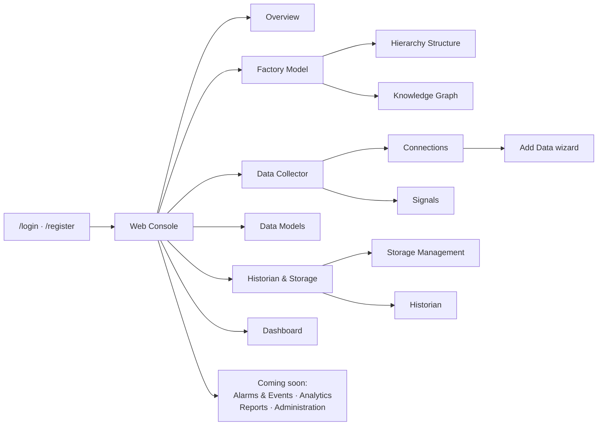

| Mục menu (Sidebar) | Route | Chức năng chính | Backend chính |
|---|---|---|---|
| **Overview** | `/overview` | KPI nhà máy, trạng thái bộ thu thập (`collector_status`) và thu thập dữ liệu (`data_collection_status`), sức khỏe kết nối, bảng giá trị mới nhất, lỗi gần đây | `GET /api/v1/overview`, `WS /stream` |
| **Factory Model → Hierarchy Structure** | `/factory/structure` | Cây tài sản ISA-95 (Enterprise → Site → Area → … → Machine): thêm, di chuyển, lưu trữ (archive) tài nguyên | `resources`, `resource_types`, `hierarchy_templates` |
| **Factory Model → Knowledge Graph** | `/factory/graph` | Đồ thị quan hệ giữa tài nguyên, tín hiệu, kết nối, model; mở rộng lân cận theo `depth` | `GET /api/v1/graph/*`, `resource_relations` |
| **Data Collector → Connections** | `/collector/connections` | Kết nối OT (5 giao thức), cấu hình job, commissioning (kiểm tra kết nối/đọc thử), tạm dừng/tiếp tục, sức khỏe | `connections`, `acquisition_jobs`, `commissioning_jobs` |
| **Add Data** (từ Connections) | `/collector/add-data` | Wizard khai báo trường nguồn (`source_fields`) và tạo tín hiệu + binding hàng loạt | `source_fields`, `signal_definitions`, `signal_bindings` |
| **Data Collector → Signals** | `/collector/signals` | Danh mục tín hiệu, giá trị trực tiếp, Signal Inspector (sparkline 15 phút, chất lượng, độ tươi), sửa hàng loạt | `signal_definitions`, `latest_signal_state`, operational history |
| **Data Models** | `/models` | Danh mục và trình dựng Data Model v2 (body JSON, mapping/calculated field, Custom Rules), xem body trực tiếp | `output_groups`, `model_state`, `model_snapshots` |
| **Historian & Storage → Storage Management** | `/historian/storage` (+ `/create`, `/bulk`, `/edit/:objectId`, `/object/:objectId`) | Quản lý đối tượng TDengine (Database / Supertable / Subtable), binding nguồn, chế độ ghi, topology thực tế vs mong muốn, PostgreSQL Explorer chỉ đọc | `storage_*`, `/api/v1/storage/td/*`, `/api/v1/storage/pg/*` |
| **Historian & Storage → Historian** | `/historian/historian` | Truy vấn lịch sử nhiều series, sự kiện chất lượng, saved views, export CSV | `/api/v1/historian/*`, `saved_queries`, `export_jobs` |
| **Dashboard** | `/dashboards`, `/dashboards/:id`, `/dashboards/:id/edit` | Dashboard Studio: dashboard chỉ đọc tự dựng từ signals và trường Data Model | `/api/v1/dashboards/*` |
| *Coming soon* | `/alarms`, `/analytics`, `/reports`, `/administration` | Chưa phát hành, hiển thị trang "Coming soon" | — |

Ghi chú: các URL cũ (`/signals`, `/acquisition/*`, `/historian/explorer`, `/historian/catalog`, …) được chuyển hướng về route mới, giữ nguyên query string; route lạ hiển thị Not Found (`apps/web/src/App.tsx`). Mọi trang trừ Overview được tải lười (code-split).

---

## 2. Kiến trúc triển khai

Một appliance = Docker Compose project **`factoriX`** (`docker-compose.yml`), 4 container trên network bridge `factorix-net`. Chỉ cổng `8080` của appliance mở ra ngoài; PostgreSQL, RabbitMQ, TDengine chỉ bind `127.0.0.1`.

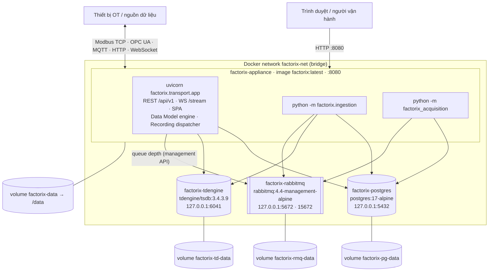

| Thành phần | Chi tiết |
|---|---|
| `factorix-appliance` | Build từ `Dockerfile` (Node 22 build web → Python 3.12 runtime). `infrastructure/docker/entrypoint.sh`: chờ PostgreSQL, chạy `alembic upgrade head`, giám sát (tự khởi động lại với backoff) `factorix_acquisition` + `factorix.ingestion` ở chế độ `acquisition`, hoặc `factorix_edge` ở chế độ `edge`; rồi chạy uvicorn cổng 8080. Từ chối khởi động ở chế độ `acquisition` nếu thiếu `FACTORIX_RABBITMQ_URL` hoặc `FACTORIX_TDENGINE_DSN`. |
| `factorix-postgres` | Control plane. Tuning trong compose (`shared_buffers=512MB`, `max_wal_size=2GB`, …). |
| `factorix-rabbitmq` | Truyền tải bền vững (quorum queues). Management UI `127.0.0.1:15672`. |
| `factorix-tdengine` | Lịch sử chuỗi thời gian, truy cập qua taosAdapter WebSocket `:6041`. |
| `depends_on` | Appliance chỉ khởi động khi 3 container còn lại `healthy` (healthcheck: `pg_isready`, `rabbitmq-diagnostics ping`, ping taosAdapter). |
| Chế độ collector | `FACTORIX_COLLECTOR_MODE` = `acquisition` (mặc định của code, image và compose) hoặc `edge` (rollback có chủ đích; `/api/v1/edge-sync/*` trả 410 ở chế độ `acquisition`, ADR-006). |

---

## 3. Luồng dữ liệu end-to-end

### 3.1 Đường đi của một quan sát

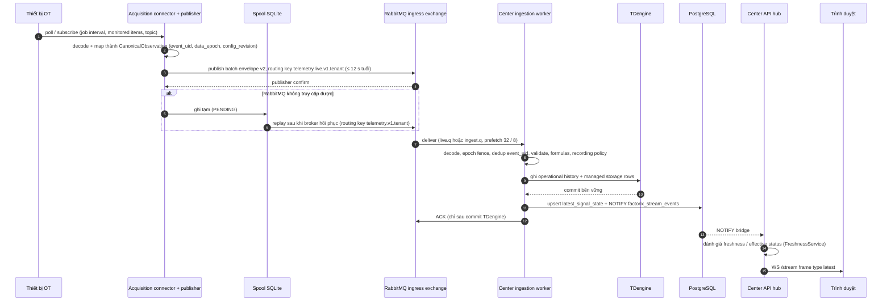

Những điểm then chốt (ADR-001, ADR-005, ADR-006, ADR-007, `contracts/obs-batch.md`, `contracts/live-stream.md`):
- **Acquisition** (`apps/acquisition`) đọc cấu hình thẳng từ PostgreSQL, không có HTTP giữa các tiến trình. Một advisory lock PostgreSQL (`FACTORIX_ACQUISITION_LOCK_KEY`) bảo đảm chỉ một bộ thu thập poll thiết bị.
- **Hai lane**: exchange topic `factorix.telemetry.ingress` → `factorix.telemetry.live.q` (binding `telemetry.live.v1.*`, quan sát không quá 12 s tuổi khi publish) và `factorix.telemetry.ingest.q` (binding `telemetry.v1.*`, dữ liệu cũ hơn/replay). Hàng đợi quorum, `x-overflow: reject-publish`, `x-delivery-limit` 5; message lỗi lặp lại đi qua `factorix.telemetry.dlx` vào `factorix.telemetry.dlq`.
- **Idempotent**: Center dedup theo `event_uid`; dữ liệu mang `data_epoch` cũ (sau Clear Telemetry) bị loại.
- **ACK sau commit**: ingestion chỉ ACK khi TDengine đã ghi bền vững, nên TDengine dừng thì message ở lại RabbitMQ, không mất.
- **Live push**: hub của API gộp (coalesce) frame theo tín hiệu/model, gửi `heartbeat` mỗi 5 s; client không nhận frame nào trong 15 s thì coi push không sống và chuyển sang polling REST.

### 3.2 Replay & back-pressure

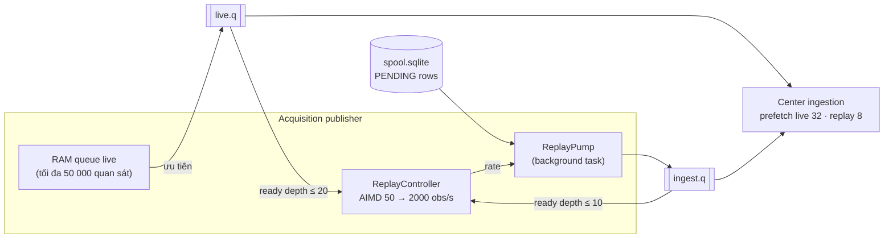

- **Khi nào có spool**: chỉ khi RabbitMQ thực sự không truy cập được (lỗi kết nối/confirm). Hàng đợi đầy (`reject-publish`) hay chậm thì tạo **back-pressure** chặn job phát (có giới hạn thời gian) thay vì ghi SQLite (`publisher.py`, `spool.py`).
- **Replay live-first** (`apps/acquisition/src/factorix_acquisition/replay.py`): `ReplayController` là bộ giới hạn tốc độ AIMD (khởi đầu 500 obs/s, +250 obs/s mỗi giây khỏe, tối đa 2000, giảm một nửa khi nghẽn, dừng 15 s khi live publish lỗi). Nó chỉ dùng phần công suất dư: dừng khi lane live chậm (tuổi đầu hàng RAM > 2 s, backlog > 1000, confirm EWMA > 1 s) hoặc khi Center chưa theo kịp — đọc **số message ready** của `live.q` (> 20) và `ingest.q` (> 10) mỗi 2 s.
- **Vì sao prefetch 8 / 32** (`FACTORIX_RABBITMQ_PREFETCH=8`, `FACTORIX_RABBITMQ_LIVE_PREFETCH=32`): độ sâu đọc bằng passive declare chỉ đếm message **ready**, không đếm message đã giao nhưng chưa ACK. Trước đây Center prefetch 128/256 envelope nên backlog nằm ở trạng thái unacked, replay "không thấy" và chạy trần 2000 obs/s khoảng 10 phút sau mỗi lần khởi động lại, làm dữ liệu live trễ 5–17 s. Prefetch nhỏ giữ backlog ở trạng thái ready để bộ điều tốc thấy và hãm replay (`contracts/README.md`, CT-21).
- **Giới hạn spool**: `FACTORIX_SPOOL_MAX_BYTES` (512 MiB), `FACTORIX_SPOOL_MAX_PENDING` (1 000 000), `FACTORIX_SPOOL_MAX_ATTEMPTS` (10), `FACTORIX_SPOOL_TTL_HOURS` = 0 (không hết hạn). Vượt giới hạn: từ chối nhận thêm và ghi nhận gap, không xóa hàng đang chờ.

---

## 4. Control plane & cấu hình

PostgreSQL là nơi **duy nhất** lưu cấu hình; chỉ API ghi cấu hình, acquisition và ingestion chỉ đọc (ADR-008, ADR-017, `contracts/config-revision.md`). Lược đồ gốc: `infrastructure/postgres/001_schema.sql` (migration `0001`), mở rộng bởi migration `0002`–`0014`.

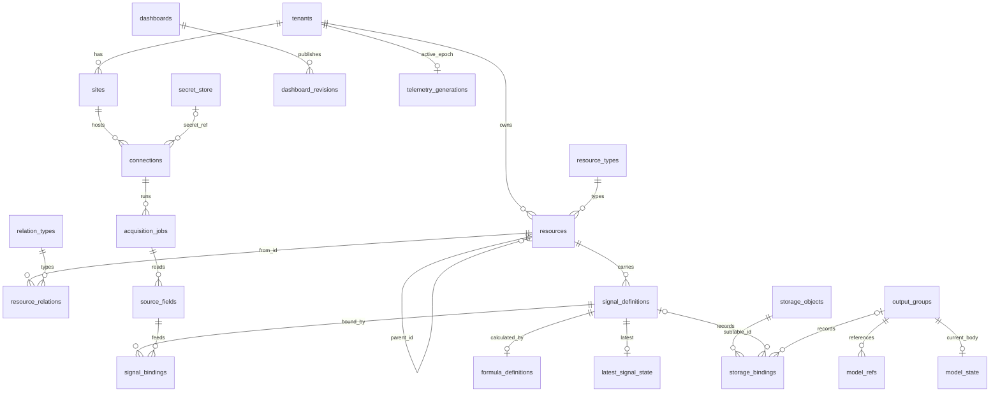

| Nhóm | Bảng chính | Ghi chú |
|---|---|---|
| Định danh | `tenants`, `sites`, `admin_accounts`, `sessions`, `password_reset_codes`, `login_throttle` | Một quản trị viên đang hoạt động (index `one_active_admin`) |
| Factory Model | `resource_types`, `resources` (`parent_id`, `path_code`), `relation_types`, `resource_relations`, `type_adjacency`, `hierarchy_templates`, `hierarchy_views` | Cây ISA-95 linh hoạt (migration `0005_flexible_hierarchy_area`) |
| Collector | `connections` (protocol `modbus_tcp`/`opcua`/`mqtt`/`http`/`websocket`; status `DRAFT`/`ACTIVE`/`PAUSED`/`ARCHIVED`; `health`), `acquisition_jobs`, `source_fields`, `signal_definitions`, `signal_bindings`, `mapping_definitions`, `formula_definitions`, `formula_dependencies`, `secret_store` (mã hóa Fernet bằng `FACTORIX_DATA_KEY`), `commissioning_jobs` | |
| Data Models | `output_groups` (`spec_json`, `sample_ms`, `state` RUNNING/PAUSED, `status` ACTIVE/ARCHIVED), `output_group_members`, `model_refs`, `model_templates`, `model_state`, `model_snapshots`, `model_events` | |
| Storage | `storage_objects`, `storage_object_drafts`, `storage_bindings`, `storage_operations`, `storage_physical_registry`, `storage_record_outbox`, `storage_field_state`, `storage_bulk_jobs`, `storage_designs`/`storage_design_versions`/`storage_datasets`/`storage_field_bindings`/`storage_recording_policies`/`storage_dependencies` (mô hình logic cũ) | |
| Runtime | `latest_signal_state`, `collector_runtime_status`, `telemetry_generations`, `observation_quarantine`, `audit_events`, `export_jobs`, `saved_queries` | |
| Dashboards | `dashboards`, `dashboard_revisions`, `dashboard_templates` | Migration `0013_dashboard_studio` |
| Di sản Edge | `edge_nodes`, `edge_enrollment_tokens`, `configuration_drafts`, `configuration_releases`, `deployment_events`, `observations`, `ingest_dedup` | Chỉ dùng ở chế độ `edge` (hoặc shadow PG) |

**Config revision**: acquisition đọc snapshot cấu hình trong một transaction `REPEATABLE READ READ ONLY` (connections không ARCHIVED, jobs, source fields, binding đang hiệu lực, formula PUBLISHED, epoch), tính `structure_sha256`; `revision` được **suy ra** (không lưu trong bảng) và tăng khi digest đổi. Snapshot hợp lệ cuối cùng được lưu file LKG (`FACTORIX_LKG_CONFIG_PATH`, đã bỏ secret) để khởi động khi PostgreSQL chưa sẵn sàng. Kích hoạt đọc lại: NOTIFY `factorix_config_changed` / `factorix_epoch_changed` / `factorix_commissioning` (payload chỉ là gợi ý), poll 10 s, mỗi lần LISTEN kết nối lại. Revision áp dụng được đóng dấu lên mỗi quan sát (`config_revision`).

---

## 5. Data Models v2

Data Model là một **body JSON có thứ tự** được tính lại định kỳ từ giá trị mới nhất của các tín hiệu (`modules/data_models.py`, `modules/models_engine.py`, `domain/body.py`, `domain/rules.py`).

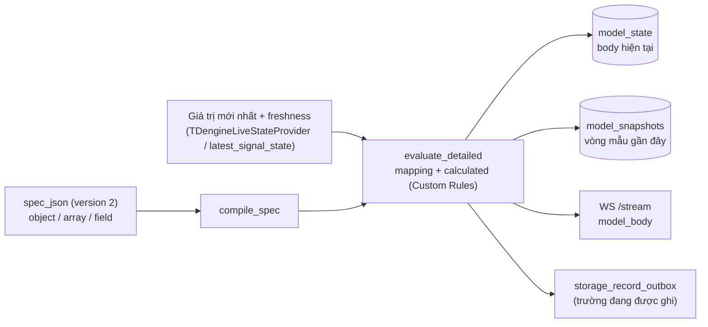

- **Cấu trúc**: `spec` là cây `{"version": 2, "root": {"type": "object", "children": [...]}}`. Node `object` có con có khóa, `array` có con không khóa, `field` sinh một giá trị theo `mode`: `mapping` (giá trị hợp lệ mới nhất của một tín hiệu) hoặc `calculated` (Custom Rule). Kiểu giá trị: `auto`, `float`, `int`, `string`, `bool`, `timestamp`, `json`. Giới hạn: sâu 16 cấp, tối đa 2000 trường. Thứ tự node là thứ tự khóa của body (lưu dạng JSON text, không phải JSONB, để giữ thứ tự).
- **Custom Rules** (`domain/rules.py`): hàm số học/toán học và hàm thời gian như `value_at`, `ts`, `latest_ts`, `now` (danh sách đầy đủ: `GET /api/v1/data-models/rules/functions`).
- **Engine**: một scheduler nền trong tiến trình API là nơi duy nhất ghi trạng thái model. Mỗi model `RUNNING` được lấy mẫu mỗi `sample_ms` (độc lập với collector): đọc giá trị mới nhất của mọi tín hiệu tham chiếu (tín hiệu STALE/PAUSED giữ giá trị cuối, BAD giữ giá trị tốt cuối; chất lượng trường phản ánh tình trạng), tính body, ghi `model_state`, nối vào `model_snapshots`, đẩy `{"type": "model_body", group_id, body, sampled_at, errors}` tới client đã subscribe sau khi commit. Body được phát mỗi chu kỳ kể cả khi không đổi (heartbeat). Engine có ngân sách thời gian mỗi vòng; model chưa kịp sẽ được lấy mẫu ở vòng sau.
- **Formula tín hiệu** (khác Data Model): `formula_definitions` PUBLISHED được ingestion tính **đồng bộ** khi quan sát đầu vào được ghi (độ sâu giới hạn, `application/ingestion/formulas.py`), tạo quan sát tính toán của tín hiệu đích.
- **Tham chiếu & tác động**: `model_refs` đánh chỉ mục mọi tín hiệu/tài nguyên mà model dùng (cập nhật khi lưu) cho tra cứu "signal được dùng ở đâu".

---

## 6. Storage & Historian

### 6.1 Bố cục TDengine

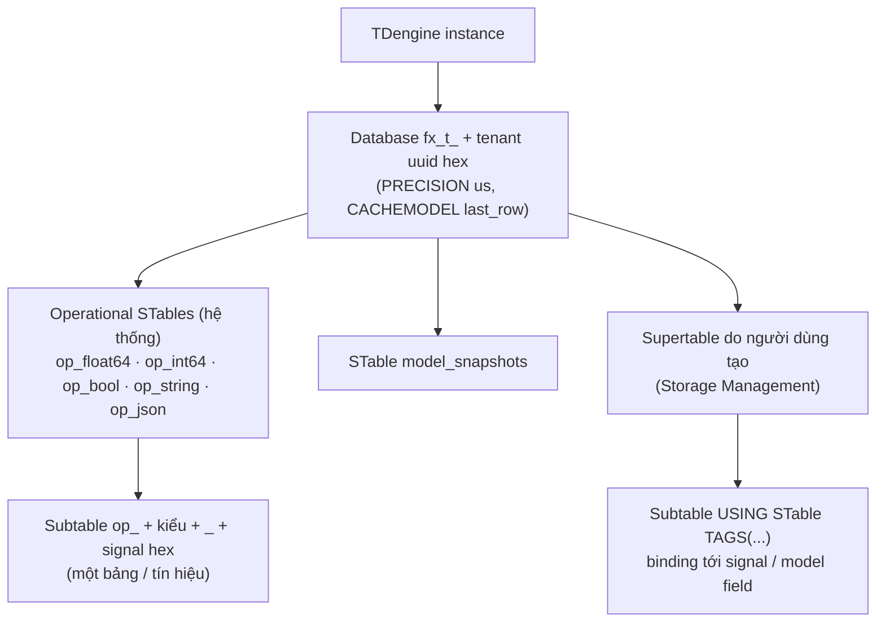

- **Database theo tenant**: `fx_t_<tenant uuid hex>` (`FACTORIX_TDENGINE_DB_PREFIX`, ADR-002). Mọi đối tượng vật lý do FactoriX tạo được đăng ký trong PostgreSQL (`storage_objects`, `storage_physical_registry`, ADR-012) để reset/xóa chỉ chạm đúng đối tượng của tenant.
- **Operational history** (ADR-003): ghi tự động mọi quan sát khi `FACTORIX_RECORD_OPERATIONAL=true` (compose đặt `true`); phục vụ sparkline 15 phút, `value_at()`, Historian chế độ `operational`. Giữ `FACTORIX_OPERATIONAL_HISTORY_DAYS` (mặc định 7) ngày.
- **Storage objects** (ADR-009, ADR-016): người dùng tạo Database → Supertable → Subtable qua wizard; subtable được bind tới tín hiệu hoặc trường Data Model (`storage_bindings`, `row_assembly_policy`).

### 6.2 Chế độ ghi (recording modes)

| Chế độ | Ý nghĩa | Nơi áp dụng |
|---|---|---|
| `ON_CHANGE` | Ghi mẫu đầu tiên (baseline) rồi chỉ ghi khi giá trị / trạng thái null / (tùy chọn) chất lượng thay đổi | Tín hiệu (`recording_policy.py`), trường model (`storage_model_recorder.py`) |
| `EVERY_ACQUISITION` | Ghi mọi `event_uid` / mọi mẫu model | Tín hiệu, trường model |
| `INTERVAL` | Một điểm cho mỗi bucket thời gian UTC cố định, có dung sai đến muộn và đánh dấu gap | Tín hiệu |
| `ON_NEW_EVENT` | Một hàng chứa mọi trường bound khi định danh sự kiện thay đổi (row assembly `ATOMIC_EVENT`) | Trường model |

### 6.3 Ghi trường Data Model: record outbox → recorder

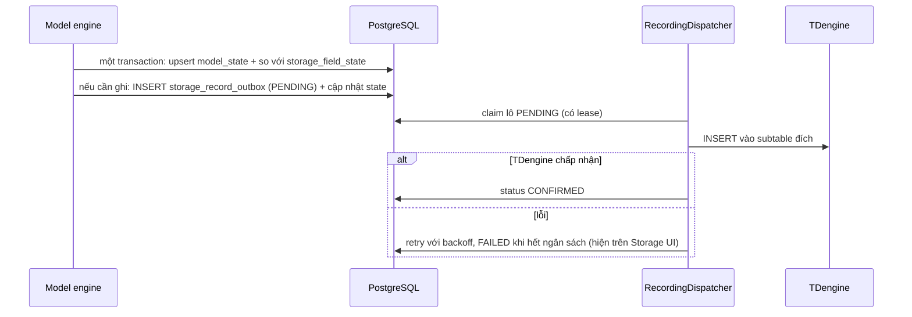

Lô bị claim mà dispatcher chết giữa chừng sẽ được phát lại sau lease; khóa `(ts, event_key)` làm việc ghi idempotent.

### 6.4 Vòng đời đối tượng & saga publish

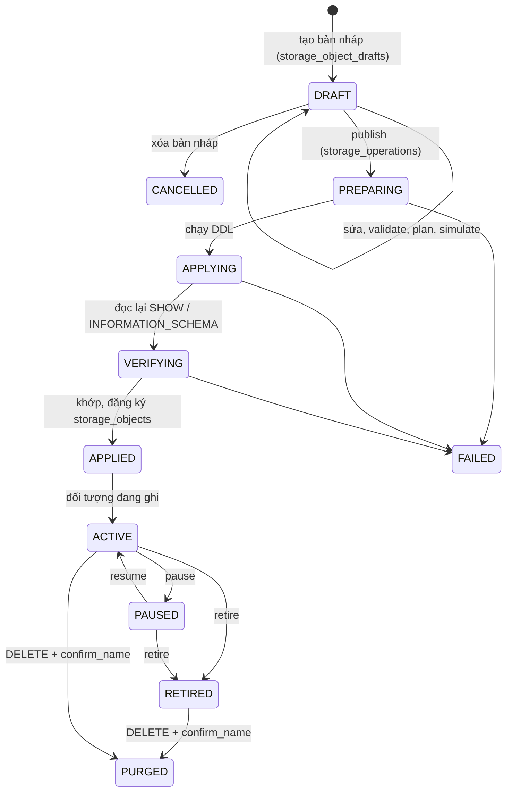

- `APPLIED` chỉ được đặt sau khi đọc lại TDengine xác nhận DDL (`modules/storage_revisions.py`).
- Endpoint: `POST /api/v1/storage/td/objects/drafts` → `.../drafts/{id}/validate` · `/plan` · `/simulate` · `/publish`; `POST /api/v1/storage/td/objects/{id}/pause|resume|retire`; `DELETE /api/v1/storage/td/objects/{id}?confirm_name=<tên>` (supertable còn subtable hoạt động → 409 `DEPENDENCY_EXISTS` trừ khi `force=true`).
- **Historian**: `POST /api/v1/historian/query` (≤ 20 series, ≤ 5000 điểm, ≤ 366 ngày; trả kèm fidelity và ghi chú coverage), `/historian/latest`, `/historian/events`, `/historian/views`, export CSV (`export_jobs`, chống formula injection, file hết hạn trả 410 `EXPORT_EXPIRED`).
- **PostgreSQL Explorer** (tab trong Storage Management): xem schema/quan hệ/dữ liệu control plane ở chế độ chỉ đọc (xem mục 9).

---

## 7. Dashboard Studio

Dashboard là **view chỉ đọc** do người dùng tự dựng (ADR-019, hợp đồng [`contracts/dashboard.md`](docs/architecture/contracts/dashboard.md)). Backend chỉ lưu metadata và phân giải nguồn; trình duyệt tự lấy dữ liệu qua Historian và `/stream`. Không có nguồn URL/SQL/script, không có lệnh ghi xuống thiết bị.

### 7.1 Tài liệu (document schema v1)
- `settings`: `theme` (preset `factorix_light` / `control_room_dark` / `industrial_neutral` + ghi đè accent, canvas, surface, text, radius, gap, font_scale), `time_range` (tương đối `5m`…`30d` hoặc tuyệt đối), `refresh` (`live`, `10s`, `30s`, `1m`, `5m`, `off`), `row_height`.
- `variables` (≤ 10): bộ chọn tài nguyên (`type: resource`, lọc theo `resource_type`).
- `widgets` (≤ 40): `id`, `type`, `title`, `layout` theo breakpoint `lg` 12 cột / `md` 6 / `sm` 1, `hidden`, `time` (theo dashboard hoặc riêng), `bindings`, `options` (chỉ các khóa registry khai báo; khóa lạ bị từ chối).
- **Binding source** — đúng 3 loại: `signal` (`signal_id`), `model_field` (`model_id` + `field_path` chính xác), `signal_key` (tín hiệu ACTIVE có `key` đó trên tài nguyên đang chọn trong biến; khớp chính xác theo `(resource_id, key)`). Hiển thị: `label`, `color`, `unit`, `scale`, `offset`.

### 7.2 Widget registry
`apps/center/src/factorix/application/dashboards/registry.py` là nguồn sự thật duy nhất; API validate `options` theo registry, Studio dựng inspector từ `GET /api/v1/dashboards/widget-types`.

| Nhóm | Widget |
|---|---|
| value | Value (`kpi`), Gauge (`gauge`), Progress (`progress`) |
| status | Status (`status`) |
| trend | Time series (`timeseries`, ≤ 20 series), State timeline (`state_timeline`) |
| compare | Bar chart (`bar`), Pie chart (`pie`) |
| distribution | Histogram (`histogram`), XY scatter (`scatter`) |
| table | Latest values (`latest_table`, ≤ 50 nguồn), History table (`history_table`) |
| industrial | Equipment (`equipment`) |
| content | Text (`text`, Markdown giới hạn), Image (`image`, ảnh raster nhúng), Divider (`divider`), Link (`link`) |

### 7.3 Vòng đời
- Mọi thay đổi dùng khóa lạc quan theo `version` (lệch → 409 `RESOURCE_VERSION_CONFLICT`).
- **Validate** hai mức: cấu trúc (mọi lần ghi, 422 `VALIDATION`) và đầy đủ khi **Publish** (mọi binding phải phân giải được và phù hợp widget, 422 `PUBLISH_BLOCKED`).
- **Publish** tạo revision bất biến (`dashboard_revisions.document_json`); **Restore** chép một revision vào bản nháp; **Duplicate**; **Archive/Unarchive**; **Delete** chỉ cho dashboard đã archive (xóa luôn revision, 409 `NOT_ARCHIVED` nếu chưa).
- **Export** `{format: "factorix.dashboard", format_version: 1, ...}` và **Import** (binding không phân giải được trong tenant được giữ lại, báo cảnh báo và chặn publish).
- **Templates**: 4 template dựng sẵn (machine overview, process trends, line status board, energy monitoring) dùng *role* thay cho nguồn cụ thể; tenant có thể lưu template từ dashboard.

### 7.4 Mở một dashboard

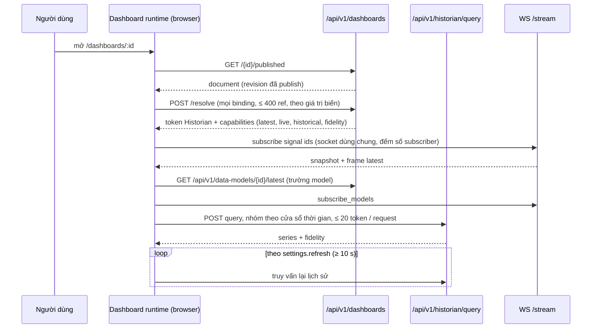

Socket `/stream` mở khi subscriber đầu tiên đăng ký và đóng khi subscriber cuối rời đi, tự kết nối lại và gửi lại subscription (`apps/web/src/lib/liveStream.ts`). Request Historian giống nhau được dùng chung, request lỗi thời bị hủy; với `live_append`, frame live mới hơn điểm cuối được nối vào series. Chất lượng/độ tươi luôn là phán quyết của server; thiếu chất lượng hiển thị "unknown", không bao giờ hiển thị GOOD.

---

## 8. Chất lượng & độ tươi dữ liệu

Nguồn quy tắc: `domain/signal_state.py`, `application/live/freshness_service.py` (một bộ đánh giá duy nhất cho mọi bề mặt live), hợp đồng [`contracts/freshness.md`](docs/architecture/contracts/freshness.md).

| Khái niệm | Giá trị | Nguồn |
|---|---|---|
| Source quality (`quality` / `raw_quality`) | `GOOD`, `UNCERTAIN`, `BAD` | Do acquisition đọc/giải mã; lưu trong `latest_signal_state.quality` |
| Freshness | `FRESH`, `DELAYED`, `STALE`, `UNKNOWN`, `NO_DATA` | Tính khi phục vụ, từ tuổi `last_acquired_at` + bằng chứng pipeline |
| Effective status (badge trên UI) | `GOOD`, `UNCERTAIN`, `BAD`, `STALE`, `NO_DATA`, `DISABLED`, `PAUSED` | Kết hợp hai trục trên |

Ngưỡng: `stale_after_ms = max(2 × interval_ms, 12 000)`, với `interval_ms` = `signal_definitions.expected_interval_ms` → `acquisition_jobs.interval_ms` → 1000.

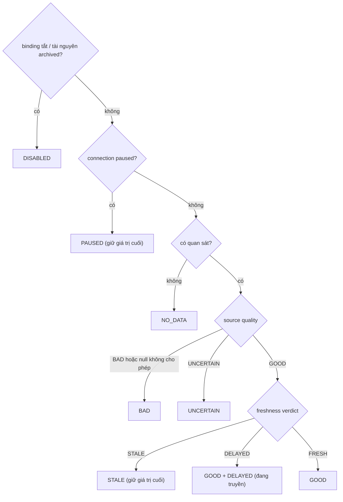

- **DELAYED** nghĩa là giá trị vẫn đang được tạo ở nguồn nhưng đến trễ (ví dụ đang replay); **STALE** nghĩa là nguồn im lặng (có dữ liệu mới hơn của cùng connection mà tín hiệu này không có, hoặc không có lần đọc thành công nào trong ngưỡng), hoặc trễ quá `max(10 × stale_after, 300 s)`.
- UI chỉ hiển thị phán quyết của server: badge effective status ở Signals/Overview/Dashboard, "Data delayed" trên Overview, đếm "N delayed" trong tóm tắt tín hiệu. STALE/PAUSED/DELAYED giữ giá trị cuối; chỉ BAD/NO_DATA/DISABLED hiển thị "—".
- **Sức khỏe kết nối** lưu: `HEALTHY` / `DEGRADED` / `UNKNOWN`; hiệu dụng thêm `PAUSED`, `ARCHIVED`, `IDLE` (không có binding hoạt động). Connection có binding nhưng không có mẫu mới trong `max(3 × interval, 30 s)` → `DEGRADED` "No samples received for N s."

---

## 9. Bảo mật

- **Tài khoản quản trị đầu tiên**: khi chưa có quản trị viên, `/` chuyển tới **Initial setup** (`/register`, `POST /api/v1/auth/bootstrap`). Nếu đặt `FACTORIX_BOOTSTRAP_TOKEN`, form yêu cầu **Setup code** bằng đúng giá trị đó (header `X-Bootstrap-Token`, so sánh hằng thời gian). Không đặt token: chỉ mở khi `FACTORIX_ENVIRONMENT=development`; ở `production` (mặc định) trả 403 `BOOTSTRAP_DISABLED`. Chỉ chạy một lần (409 `ADMIN_EXISTS`).
- **Vai trò**: hiện có **một** quản trị viên đang hoạt động mỗi appliance (index `one_active_admin`), vai trò `admin`; mọi API quản trị yêu cầu phiên admin. Chưa có trình sửa người dùng/vai trò (module Administration "Coming soon").
- **Mật khẩu**: 12–128 ký tự, ≥ 3 nhóm ký tự, chặn mật khẩu dễ đoán (`domain/passwords.py`); băm Argon2 (`platform/security.py`). Đăng nhập sai 5 lần → khóa 15 phút. Đặt lại mật khẩu qua mã email (hiệu lực 10 phút, cần `FACTORIX_SMTP_*`).
- **Phiên & CSRF**: cookie `fx_session` (HttpOnly, SameSite=Lax, `Secure` theo `FACTORIX_COOKIE_SECURE`), thời hạn `FACTORIX_SESSION_TTL_MINUTES` (mặc định 480 phút); cookie `fx_csrf` + header `X-CSRF-Token` bắt buộc cho request thay đổi dữ liệu. CORS chỉ cho `FACTORIX_WEB_ORIGIN`; response có Content-Security-Policy. `/stream` kiểm tra cookie phiên và origin cùng nguồn.
- **Bí mật kết nối OT**: lưu trong `secret_store`, mã hóa Fernet bằng `FACTORIX_DATA_KEY` (mất khóa = mất mọi bí mật đã mã hóa); API chỉ trả `secret_configured`, cấu hình trả về đã che. Acquisition giải mã trong tiến trình; snapshot LKG đã bỏ secret; `provenance` của quan sát không chứa thông tin đăng nhập.
- **PostgreSQL Explorer**: chỉ admin; mỗi request chạy trong transaction `SET TRANSACTION READ ONLY` (PostgreSQL tự từ chối mọi ghi/DDL), có `statement_timeout` (preview 5 s, đếm chính xác 10 s); các bảng nhạy cảm (`admin_accounts`, `sessions`, `password_reset_codes`, `login_throttle`, `secret_store`, `edge_enrollment_tokens`, `audit_events`, `alembic_version`) bị ẩn và trả 403 `ACCESS_DENIED`; giá trị cột/khóa JSON nhạy cảm được che `********`; dữ liệu lọc theo tenant (`modules/postgres_explorer.py`).
- **Thao tác phá hủy**: `revert-to-zero` cũ bị vô hiệu vĩnh viễn (410); Clear Telemetry yêu cầu cụm từ `CLEAR TELEMETRY` + mật khẩu admin và giữ nguyên cấu hình (ADR-007). Test phá hủy bị chặn ngoài DB test (`tests/safety/test_destructive_guard.py`).
- **Mạng**: DB/broker/TSDB chỉ bind `127.0.0.1`; mọi endpoint OT được cấu hình tự động nằm trong allowlist, thêm ngoại lệ bằng `FACTORIX_OT_ALLOWLIST`.
- **Bí mật cấu hình**: chỉ trong `.env` (mẫu `.env.example`), không bao giờ commit; entrypoint không in DSN chứa mật khẩu.

---

## 10. Vận hành (Runbook)

### 10.1 Triển khai & tài khoản quản trị đầu tiên
1. Sao chép `.env.example` thành `.env`, thay mọi giá trị `change-me...` / `example...` bằng bí mật riêng của nhà máy (mật khẩu PostgreSQL, RabbitMQ, TDengine DSN, `FACTORIX_DATA_KEY` — khóa Fernet, `FACTORIX_BOOTSTRAP_TOKEN`). Không commit `.env`.
2. Chạy `./run-appliance.ps1` (hoặc `docker compose up -d --build`). Script chờ `/health/live` rồi in `GET /api/v1/auth/status` (`admin_exists`, `bootstrap_enabled`, `setup_code_required`).
3. Mở `http://127.0.0.1:8080` → **Initial setup** tạo quản trị viên (mục 9).
4. Nâng cấp: sao lưu trước (10.3), cập nhật mã, `docker compose up -d --build`; container appliance tự chạy `alembic upgrade head` khi khởi động.

### 10.2 Sức khỏe, log & kiểm tra nhanh
```powershell
docker compose ps
docker logs -f --tail 100 factorix-appliance
Invoke-RestMethod http://127.0.0.1:8080/health/live
Invoke-RestMethod http://127.0.0.1:8080/health/ready

# Chất lượng tín hiệu (bảng chỉ lưu GOOD / UNCERTAIN / BAD; STALE được tính khi phục vụ)
docker exec factorix-postgres psql -U factorix -d factorix -c "SELECT quality, count(*) FROM latest_signal_state GROUP BY quality;"

# Kết nối OT và heartbeat của acquisition / ingestion
docker exec factorix-postgres psql -U factorix -d factorix -c "SELECT name, protocol, status, health, last_error FROM connections WHERE status <> 'ARCHIVED';"
docker exec factorix-postgres psql -U factorix -d factorix -c "SELECT instance_id, role, health, broker_ok, spool_pending, fast_buffered, last_heartbeat FROM collector_runtime_status;"

# RabbitMQ: ping và độ sâu hàng đợi
docker exec factorix-rabbitmq su-exec rabbitmq rabbitmq-diagnostics -q ping
docker exec factorix-rabbitmq su-exec rabbitmq rabbitmqctl list_queues name type messages messages_ready messages_unacknowledged

# TDengine: ping taosAdapter, liệt kê database (-p hỏi mật khẩu root đã cấu hình)
docker exec factorix-tdengine curl -fsS http://127.0.0.1:6041/-/ping
docker exec -it factorix-tdengine taos -p -s "SHOW DATABASES;"
```
Lệnh `psql` giả định `POSTGRES_USER` / `POSTGRES_DB` mặc định `factorix`. Trên UI, Overview hiển thị `collector_status` / `data_collection_status`, và `GET /api/v1/edges` trả trạng thái collector (`ONLINE` / `DEGRADED` / `OFFLINE`, `delivery_lag_ms`).

### 10.3 Sao lưu & khôi phục
- PostgreSQL: `pg_dump -Fc` trong container `factorix-postgres`, khôi phục thử vào container tạm — chi tiết: [`docs/operations/backup-restore.md`](docs/operations/backup-restore.md).
- TDengine: `taosdump` từng database tenant; RabbitMQ chỉ là truyền tải (export definitions nếu cần).
- Luôn sao lưu PostgreSQL và TDengine trước khi nâng cấp hoặc chạy Clear Telemetry ([`docs/operations/storage-reset-preservation.md`](docs/operations/storage-reset-preservation.md)).

### 10.4 Sự cố thường gặp

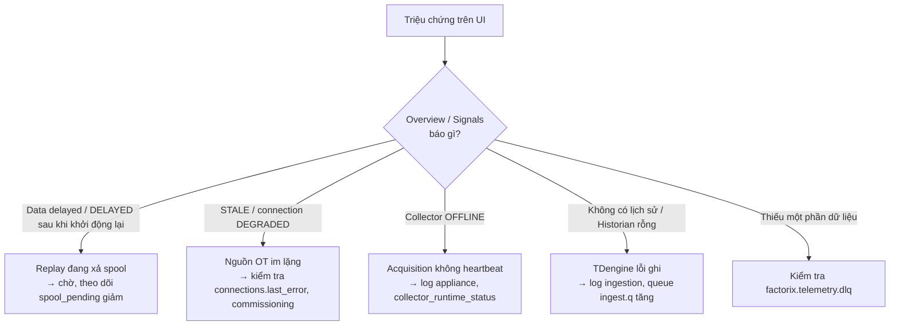

| Sự cố | Dấu hiệu | Nguyên nhân thường gặp | Cách xử lý |
|---|---|---|---|
| **Dữ liệu live trễ sau khi khởi động lại** | Overview "Data delayed", tín hiệu `DELAYED`, `spool_pending > 0` | Spool đang replay backlog tích lũy khi RabbitMQ gián đoạn; replay nhường lane live nhưng vẫn chiếm công suất Center | Chờ `spool_pending` về 0; kiểm tra `messages_ready` của `ingest.q`/`live.q` không tăng mãi; giữ prefetch mặc định 8/32 (prefetch lớn làm bộ điều tốc replay "mù", CT-21) |
| **DLQ có message** | `factorix.telemetry.dlq` > 0 | Envelope bị từ chối lặp lại quá `x-delivery-limit` (5) — dữ liệu hỏng, lỗi ghi không retry được | Xem log `factorix.ingestion` quanh thời điểm đó và bảng `observation_quarantine`; sửa nguyên nhân trước khi xử lý message trong DLQ qua management UI (`127.0.0.1:15672`) |
| **TDengine lỗi ghi** | `ingest.q`/`live.q` tăng, `storage_health` xấu, Historian không có điểm mới | `factorix-tdengine` dừng/đầy đĩa, DSN sai | `docker compose ps`, ping taosAdapter, `docker logs factorix-tdengine`; message ở lại RabbitMQ (ACK chỉ sau commit) và được xử lý tiếp khi TDengine hồi phục |
| **Collector không báo cáo** | `collector_status` `OFFLINE`, `last_heartbeat` cũ | Tiến trình acquisition crash-loop (xem "exited with code … restarting" trong log), thiếu `FACTORIX_RABBITMQ_URL`/`FACTORIX_TDENGINE_DSN`, sai `FACTORIX_DATA_KEY` | `docker logs factorix-appliance`; kiểm tra `.env`; entrypoint tự khởi động lại tiến trình với backoff tối đa 30 s |
| **Connection DEGRADED** | `health = DEGRADED`, "No samples received for N s." | Thiết bị/mạng OT, timeout, cấu hình địa chỉ | Chạy commissioning trên trang Connections; xem `last_error` |
| **Ghi trường model thất bại** | Storage UI hiển thị hàng `FAILED` | Subtable/cột không khớp, TDengine lỗi | Xem `storage_record_outbox` (`status`, `last_error`), sửa binding rồi thử lại |

---

## 11. Phát triển

### 11.1 Bố cục repository
```
.
├── apps/
│   ├── center/                    # Center: Python 3.12, FastAPI, asyncpg, aio-pika, taos-ws-py
│   │   ├── src/factorix/
│   │   │   ├── application/       # Theo bounded context: collector, dashboards, health, history,
│   │   │   │                      #   ingestion (worker RabbitMQ -> TDengine/PG), live, reset, legacy_edge
│   │   │   ├── domain/            # Logic thuần: quality, signal_state, body, rules, formula, canonical, health
│   │   │   ├── modules/           # Dịch vụ: identity, collect, data_models, models_engine, historian_*, storage_*
│   │   │   ├── platform/          # settings, db, broker (RabbitMQ), tdengine, security, mail
│   │   │   ├── transport/         # FastAPI app, routers HTTP, WebSocket /stream (hub), phục vụ SPA
│   │   │   ├── adapters/          # legacy_pg_telemetry (đường ghi PostgreSQL cũ)
│   │   │   └── ingestion/         # Entry point `python -m factorix.ingestion`
│   │   ├── migrations/versions/   # Alembic 0001 -> 0014
│   │   └── tests/                 # unit/, contracts/, integration/
│   ├── acquisition/               # `factorix_acquisition`: connectors/, jobs, mapping, config_provider,
│   │                              #   pg_control, publisher, spool, replay, runtime; tests unit/ + integration/
│   ├── edge/                      # Edge daemon cũ (`factorix_edge`), chỉ khi FACTORIX_COLLECTOR_MODE=edge
│   ├── shared/src/factorix_core/  # contracts (notify, runtime_status), quy tắc đặt tên TDengine, time
│   └── web/                       # Web Console: React 18, TypeScript, Vite 5, Tailwind, ECharts (xem apps/web/README.md)
├── docs/                          # architecture/ (ADR + contracts), baseline/, benchmark/, operations/, storage/, testing/
├── infrastructure/                # docker/ (entrypoint.sh, bootstrap_db.py, backup.sh, requirements.txt), postgres/001_schema.sql
├── tests/                         # load/ (bench_pipeline.py), safety/, simulators/ (5 giao thức OT giả lập)
├── .github/workflows/ci.yml       # CI: python-unit, web-build, storage-integration
├── Dockerfile · docker-compose.yml · docker-compose.test.yml · run-appliance.ps1
├── .env.example · .env.test.example · pytest.ini · pyproject.toml · conftest.py
└── RELEASE_READINESS.md
```

### 11.2 Chạy test (giống CI)
```powershell
# python-unit: unit, safety, contract & simulator (không cần DB thật).
# Đặt FACTORIX_ENVIRONMENT=test, FACTORIX_DATABASE_URL (driver postgresql+asyncpg, DB tên *_test)
# và FACTORIX_DATA_KEY (khóa Fernet dùng riêng cho test) như trong .github/workflows/ci.yml.
$env:PYTHONPATH = ".;apps/center/src;apps/acquisition/src;apps/edge/src;apps/shared/src"
python -m pytest apps/center/tests/unit apps/acquisition/tests/unit apps/edge/tests tests/safety tests/simulators -q

# web-build
Push-Location apps/web; npm ci; npm run check; npm run build; Pop-Location

# storage-integration: PostgreSQL 17 + RabbitMQ 4.4 + TDengine 3.4.3.9 riêng cho test
# (docker compose -f docker-compose.test.yml up -d, xem docs/testing/test-environment.md),
# FACTORIX_ENABLE_DESTRUCTIVE_TESTS=YES_I_USE_EPHEMERAL_DB và các biến kết nối như ci.yml.
Push-Location apps/center; python -m alembic upgrade head; Pop-Location
python -m pytest apps/center/tests/integration apps/acquisition/tests/integration -v --tb=short
```
- `pytest.ini` mặc định chạy `apps/center/tests/unit`, `apps/center/tests/contracts`, `apps/acquisition/tests/unit`, `apps/edge/tests`; test trong `*/tests/integration` mang marker `integration`.
- Đo chi phí pipeline trong tiến trình (không cần broker/DB): `python tests/load/bench_pipeline.py --signals 336 --cycles 30 --repeat 2`.
- Giả lập 5 giao thức OT: `python -m tests.simulators` (profile `sim` trong `docker-compose.test.yml`).
- **Không bao giờ** chạy test integration vào stack vận hành (`factorix-appliance`, `:8080`).

### 11.3 CI (`.github/workflows/ci.yml`)

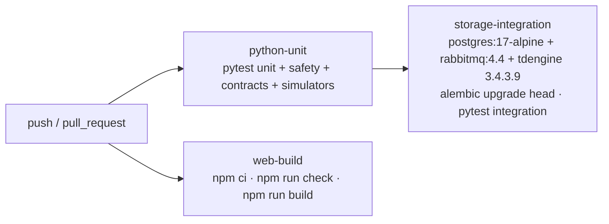

### 11.4 Nhánh & migration
- Nhánh tích hợp hiện tại là **`Dashboard`**; nhánh tính năng (`dash-*`) được merge vào `Dashboard`, và `Dashboard` vào `main` qua pull request sau khi CI xanh và chủ sở hữu chấp nhận (`RELEASE_READINESS.md`).
- **Một thay đổi schema = một migration Alembic**; repository luôn chỉ có **một Alembic head** (hiện tại `0014_bulk_jobs_failed_idx`). Migration phải an toàn dữ liệu (chỉ thêm cột nullable/có default khi có thể), có `downgrade`, và được thử `downgrade` → `upgrade head` trước khi merge.
- Thay đổi hợp đồng giữa module (queue, NOTIFY, document dashboard, …) tuân theo ADR-018 (versioning) và cập nhật `docs/architecture/contracts/`.

---

## 12. Dữ liệu vận hành thực tế (PC03)

Mục này mô tả cấu hình và dữ liệu đang chạy tại hiện trường do chủ dự án ghi nhận (2026-11-10/12); đây là dữ liệu runtime trong cơ sở dữ liệu, không phải giá trị mặc định của mã nguồn.

### 12.1 Nguồn Dữ liệu Thực tế

Toàn bộ dữ liệu thực tế tại hiện trường đang được thu thập từ trạm thiết bị mô phỏng **PC03** tại địa chỉ IP nội bộ: **`192.168.2.108`**.

Hệ thống kết nối song song qua **5 giao thức công nghiệp**, tất cả đều đang ở trạng thái **`ACTIVE`** và sức khỏe **`HEALTHY`**:

| Tên Kết nối (Connection Name) | Giao thức | Địa chỉ Endpoint Nguồn | Chu kỳ / Cơ chế | Chức năng thu thập |
|---|---|---|---|---|
| **PC03 Modbus TCP 502** | `modbus_tcp` | `192.168.2.108:502` | Poll 1000 ms (Holding/Input Registers) | Tọa độ rung 3 trục, lưu lượng dòng chảy, mức dầu, điện áp/dòng điện pha |
| **PC03 OPC UA 4840** | `opcua` | `opc.tcp://192.168.2.108:4840/simulator/` | Monitored Items (Subscription) | Nhiệt độ máy (temp 1-7), nhiệt độ môi trường, áp suất 1 & 2 |
| **PC03 MQTT 1883** | `mqtt` | `mqtt://192.168.2.108:1883` | Sub topic `factory/+/+/telemetry` | Công suất tiêu thụ (P, Q, S), hệ số công suất PF, năng lượng tích lũy |
| **PC03 HTTP 443** | `http` | `http://192.168.2.108:443/` | Concurrent Poll 1000 ms | Thông tin lệnh sản xuất (SO/WO), mã sản phẩm, số lượng Good/Bad, tiến độ |
| **PC03 WebSocket live** | `websocket` | `ws://192.168.2.108/ws/live` | Stream thời gian thực | Trạng thái máy (Run/Stop/Idle/Error), tốc độ vòng quay (Speed 1/2), ca làm việc, mã nhân viên |


### 12.2 Cây Phân cấp Tài sản

Hệ thống tài sản được tổ chức theo tiêu chuẩn phân cấp ISA-95:

```
[Enterprise] TIPA
 └── [Site] DongNai (code: DongNai)
      └── [Area] Factory-1
           └── [Zone] ASSY (Khu vực lắp ráp)
                ├── [Line] Assembly - AA10-01 (A1) ──> [Machine] AA10-01 (56 signals)
                ├── [Line] Assembly - AA10-02 (AB) ──> [Machine] AA10-02 (56 signals)
                ├── [Line] Assembly - AA10-03 (A3) ──> [Machine] AA10-03 (56 signals)
                ├── [Line] Assembly - AA10-04 (A4) ──> [Machine] AA10-04 (56 signals)
                ├── [Line] Assembly - AA10-05 (MM) ──> [Machine] AA10-05 (56 signals)
                └── [Line] Assembly - AA10-06 (A6) ──> [Machine] AA10-06 (56 signals)
```

- **Tổng số máy vận hành**: 6 máy (`AA10-01` đến `AA10-06`).
- **Tổng số tín hiệu đang hoạt động trên màn hình**: **336 tín hiệu** ($56 \times 6 = 336$).
- **Số tín hiệu trong Database**: **344 tín hiệu** (Gồm 336 tín hiệu `ACTIVE` + 8 tín hiệu `ARCHIVED` từ các máy thử nghiệm tạm thời trong các vòng review).

#### Nhóm 56 tín hiệu trên mỗi máy:
1. **Nhiệt độ & Môi trường**: `machine_temp_1` đến `machine_temp_7`, `ambient_temp`, `humidity`, `noise`.
2. **Cơ khí & Thủy lực**: `pressure_1`, `pressure_2`, `vibration_1_x/y/z`, `vibration_2_x/y/z`, `vibration_3_x/y/z`, `flow_rate_1`, `flow_rate_2`, `oil_level`.
3. **Năng lượng & Điện năng**: `voltage_1/2/3`, `current_1/2/3`, `power_active`, `power_reactive`, `power_apparent`, `power_factor`, `energy_active`, `energy_reactive`, `frequency`.
4. **Vận hành & Tốc độ**: `speed_1`, `speed_2`, `program_name`, `program_no`, `uptime_1`, `uptime_2`, `status`, `mode`, `stop_error`, `employee`.
5. **Sản xuất & Đơn hàng**: `so_id`, `wo_id`, `product_id`, `product_name`, `target_qty`, `good_qty`, `bad_qty`, `progress_percent`, `run_rate`.


### 12.3 Hệ thống 36 Data Models v2

Mỗi máy trong 6 máy sở hữu **6 Data Models** độc lập chạy ở chu kỳ mẫu 1.000 ms, tổng cộng là **36 Data Models** đang chạy (`ACTIVE`, `RUNNING`).

```
6 Máy (AA10-01 → AA10-06) × 6 Models/Máy = 36 Data Models v2
```

#### Chi tiết 6 loại Data Model:

##### 1. Model: `Condition` (Tình trạng kỹ thuật)
- **Mục đích**: Giám sát rung chấn 3 trục, nhiệt độ động cơ/bạc đạn, áp suất, lưu lượng và cảnh báo bất thường.
- **Số trường**: 29 trường.
- **Cấu trúc dữ liệu đầu ra JSON**:
```json
{
  "zone_name": "ASSY",
  "line_name": "Assembly - AA10-01 (A1)",
  "machine_name": "AA10-01",
  "source_timestamp": "2026-11-10T02:03:06.191Z",
  "publish_timestamp": "2026-11-10T02:03:22.289Z",
  "machine_temp_1": 64.2,
  "machine_temp_2": 65.1,
  "machine_temp_3": 63.8,
  "machine_temp_4": 66.0,
  "machine_temp_5": 62.4,
  "machine_temp_6": 61.9,
  "machine_temp_7": 64.7,
  "ambient_temp": 28.5,
  "pressure_1": 5.4,
  "pressure_2": 5.2,
  "humidity": 68.2,
  "noise": 74.1,
  "vibration_1_x": 0.12,
  "vibration_1_y": 0.15,
  "vibration_1_z": 0.08,
  "vibration_2_x": 0.11,
  "vibration_2_y": 0.14,
  "vibration_2_z": 0.09,
  "vibration_3_x": 0.13,
  "vibration_3_y": 0.16,
  "vibration_3_z": 0.10,
  "flow_rate_1": 18.4,
  "flow_rate_2": 17.9,
  "oil_level": 88.0,
  "status": 2
}
```

##### 2. Model: `Energy` (Tiêu thụ Năng lượng)
- **Mục đích**: Đo lường điện năng 3 pha, công suất tác dụng, công suất phản kháng và hệ số PF.
- **Số trường**: 18 trường.
- **Cấu trúc dữ liệu đầu ra JSON**:
```json
{
  "zone_name": "ASSY",
  "line_name": "Assembly - AA10-01 (A1)",
  "machine_name": "AA10-01",
  "source_timestamp": "2026-11-10T02:03:06.191Z",
  "publish_timestamp": "2026-11-10T02:03:22.289Z",
  "power_active": 42.6,
  "power_reactive": 12.3,
  "power_apparent": 44.3,
  "power_factor": 0.96,
  "voltage_1": 220.4,
  "voltage_2": 219.8,
  "voltage_3": 221.1,
  "current_1": 64.5,
  "current_2": 63.9,
  "current_3": 65.1,
  "energy_active": 15420.5,
  "energy_reactive": 3120.2,
  "frequency": 50.02
}
```

##### 3. Model: `State` (Trạng thái Máy)
- **Mục đích**: Ghi nhận máy đang Chạy (Run = 2), Dừng (Stop = 0), Nghỉ (Idle = 1), mã lỗi và người vận hành.
- **Số trường**: 9 trường.
- **Cấu trúc dữ liệu đầu ra JSON**:
```json
{
  "zone_name": "ASSY",
  "line_name": "Assembly - AA10-01 (A1)",
  "machine_name": "AA10-01",
  "source_timestamp": "2026-11-10T02:03:06.191Z",
  "publish_timestamp": "2026-11-10T02:03:22.289Z",
  "status": 2,
  "mode": 0,
  "stop_error": null,
  "employee": "21113185"
}
```

##### 4. Model: `Process` (Thông số Gia công & Chu kỳ)
- **Mục đích**: Tốc độ hoạt động, chương trình đang chạy và tổng thời gian chạy thực tế (uptime).
- **Số trường**: 13 trường.
- **Cấu trúc dữ liệu đầu ra JSON**:
```json
{
  "zone_name": "ASSY",
  "line_name": "Assembly - AA10-01 (A1)",
  "machine_name": "AA10-01",
  "source_timestamp": "2026-11-10T02:03:06.191Z",
  "publish_timestamp": "2026-11-10T02:03:22.289Z",
  "speed_1": 321.7,
  "speed_2": 295.3,
  "program_name": "ASM-STD-01",
  "program_no": "PRG-43203",
  "uptime_1": 4398,
  "uptime_2": 0,
  "status": 2,
  "employee": "21113185"
}
```

##### 5. Model: `Order` (Thông tin Đơn hàng)
- **Mục đích**: Theo dõi đơn hàng (Sales Order / Work Order), mục tiêu sản xuất và số lượng đạt/hỏng.
- **Số trường**: 13 trường.
- **Cấu trúc dữ liệu đầu ra JSON**:
```json
{
  "zone_name": "ASSY",
  "line_name": "Assembly - AA10-01 (A1)",
  "machine_name": "AA10-01",
  "source_timestamp": "2026-11-10T02:03:06.191Z",
  "publish_timestamp": "2026-11-10T02:03:22.289Z",
  "so_id": "SO-2026-0891",
  "wo_id": "WO-44102",
  "product_id": "PRD-GEAR-BOX-A",
  "product_name": "Hộp giảm tốc tiêu chuẩn A",
  "target_qty": 500,
  "good_qty": 412,
  "bad_qty": 4,
  "status": 2
}
```

##### 6. Model: `Order progress` (Tiến độ Đơn hàng)
- **Mục đích**: Tính toán tỷ lệ phần trăm hoàn thành và tốc độ sản xuất tức thời.
- **Số trường**: 11 trường.
- **Cấu trúc dữ liệu đầu ra JSON**:
```json
{
  "zone_name": "ASSY",
  "line_name": "Assembly - AA10-01 (A1)",
  "machine_name": "AA10-01",
  "source_timestamp": "2026-11-10T02:03:06.191Z",
  "publish_timestamp": "2026-11-10T02:03:22.289Z",
  "so_id": "SO-2026-0891",
  "wo_id": "WO-44102",
  "progress_percent": 82.4,
  "run_rate": 45.2,
  "good_qty": 412,
  "bad_qty": 4
}
```

---

## 13. Thuật ngữ

| Thuật ngữ | Nghĩa trong FactoriX |
|---|---|
| **Appliance** | Một bản cài FactoriX tại nhà máy: 4 container Docker Compose `factoriX` |
| **Acquisition** | Bộ thu thập cục bộ `factorix_acquisition` đọc thiết bị OT và publish lên RabbitMQ |
| **Center** | Backend `apps/center`: API, ingestion worker, Data Model engine, Historian |
| **Connection** | Kết nối tới một nguồn OT (giao thức + endpoint + bí mật) |
| **Acquisition job** | Lịch đọc của một connection (poll/subscribe, `interval_ms`, timeout) |
| **Source field** | Một địa chỉ/đường dẫn đọc được trong job (register, node id, JSON path, …) |
| **Signal** | Một đại lượng gắn với tài nguyên (`signal_definitions`, có `key`, kiểu, đơn vị) |
| **Binding** | Liên kết source field → signal (`signal_bindings`) |
| **Observation** | Một mẫu giá trị của tín hiệu (`CanonicalObservation`: `event_uid`, `data_epoch`, `config_revision`, quality, thời gian) |
| **Envelope / batch** | Message RabbitMQ chứa nhiều observation (`contracts/obs-batch.md`) |
| **Live lane / ingest lane** | Hàng đợi `factorix.telemetry.live.q` (dữ liệu mới) / `factorix.telemetry.ingest.q` (replay) |
| **DLQ** | `factorix.telemetry.dlq` — message bị từ chối quá số lần giao tối đa |
| **Spool** | SQLite cục bộ của acquisition, chỉ dùng khi RabbitMQ không truy cập được |
| **Replay** | Phát lại dữ liệu từ spool, tốc độ do `ReplayController` điều chỉnh |
| **Epoch (`data_epoch`)** | Thế hệ dữ liệu của tenant (`telemetry_generations.active_epoch`), tăng khi Clear Telemetry |
| **Config revision** | Số phiên bản cấu hình acquisition áp dụng, đóng dấu lên mỗi observation |
| **LKG** | Last Known Good — snapshot cấu hình cuối cùng hợp lệ, lưu file |
| **Latest state** | Giá trị mới nhất mỗi tín hiệu (`latest_signal_state`) |
| **Operational history** | Lịch sử đầy đủ tự động trong TDengine (`op_*` STables) |
| **Storage object** | Database / Supertable / Subtable TDengine do người dùng tạo và FactoriX quản lý |
| **Data Model (output group)** | Body JSON tổng hợp từ tín hiệu, lưu trong `output_groups` |
| **Mapping / calculated field** | Trường model lấy thẳng giá trị tín hiệu / tính bằng Custom Rule |
| **Freshness** | Độ tươi: `FRESH`, `DELAYED`, `STALE`, `UNKNOWN`, `NO_DATA` |
| **Effective status** | Trạng thái hiển thị tổng hợp quality + freshness |
| **Dashboard document** | JSON schema v1 mô tả một dashboard (settings, variables, widgets) |
| **Historian token** | Định danh series do server cấp (`<signal uuid>` hoặc `mod:<model uuid>:<field path>`) |
| **Clear Telemetry** | Reset chọn lọc dữ liệu đo, giữ nguyên cấu hình (ADR-007) |

---

## 14. Nghiệm thu & phát hành

Quy trình xác minh một commit và quyết định phát hành nằm trong [`RELEASE_READINESS.md`](RELEASE_READINESS.md): các gate CI (`python-unit`, `web-build`, `storage-integration`), kiểm tra migration, nghiệm thu trên appliance với dữ liệu thật, và nguồn mã sạch. Bản dựng không tự nghiệm thu: chỉ chủ sở hữu nền tảng quyết định phát hành. Kết quả test, ảnh chụp và báo cáo nghiệm thu được bàn giao kèm từng commit, không lưu trong repository.

---
*Tài liệu cập nhật ngày 2026-11-25 theo mã nguồn nhánh hiện tại; số liệu runtime ở mục 12 do chủ dự án ghi nhận trên hệ thống thật (2026-11-10/12).*
