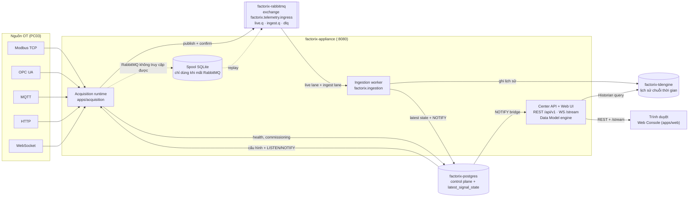

# FactoriX IIoT Platform - Technical Documentation & System Wiki

Tài liệu kỹ thuật tổng hợp về kiến trúc nền tảng, cấu trúc mã nguồn, hạ tầng dữ liệu thực tế (Data Sources, Signals, Asset Hierarchy) và hệ thống 36 Data Models v2 đang vận hành trong FactoriX Appliance. Tài liệu này là **System Wiki** phục vụ bàn giao, vận hành, bảo trì và phát triển mở rộng. Các quyết định kiến trúc chi tiết nằm trong [`docs/architecture/`](docs/architecture/) (ADR-001 đến ADR-019) và các hợp đồng giữa module trong [`docs/architecture/contracts/`](docs/architecture/contracts/README.md).

---

## Mục lục
1. [Tổng quan Kiến trúc Hệ thống (System Architecture)](#1-tổng-quan-kiến-trúc-hệ-thống)
2. [Cấu trúc Thư mục & Mã Nguồn (Codebase Structure)](#2-cấu-trúc-thư-mục--mã-nguồn)
3. [Nguồn Dữ liệu Thực tế (Live OT Data Sources)](#3-nguồn-dữ-liệu-thực-tế)
4. [Cây Phân cấp Tài sản (Asset Topology Hierarchy)](#4-cây-phân-cấp-tài-sản)
5. [Hệ thống 36 Data Models v2 (Data Models Specification)](#5-hệ-thống-36-data-models-v2)
6. [Kiến trúc Lưu trữ & Truyền tải Dữ liệu (Storage & Transport)](#6-kiến-trúc-lưu-trữ--truyền-tải-dữ-liệu)
7. [Giao diện Web & Dashboard Studio (Web Console)](#7-giao-diện-web--dashboard-studio)
8. [Vận hành, Giám sát & Khắc phục Sự cố (Runbook & Operations)](#8-vận-hành-giám-sát--khắc-phục-sự-cố)
9. [Nghiệm thu & Phát hành (Release Readiness)](#9-nghiệm-thu--phát-hành)

---

## 1. Tổng quan Kiến trúc Hệ thống

FactoriX là nền tảng IIoT triển khai dưới dạng **một appliance tại nhà máy** (Docker Compose project `factoriX`, 4 container). Bộ thu thập cục bộ (`apps/acquisition`) đọc thiết bị OT qua 5 giao thức và gửi dữ liệu qua RabbitMQ; Center (`apps/center`) ghi lịch sử vào TDengine, cập nhật trạng thái mới nhất trong PostgreSQL, tính Data Model v2 và đẩy dữ liệu trực tiếp tới Web Console qua WebSocket.

| Container | Image (`docker-compose.yml`) | Vai trò |
|---|---|---|
| `factorix-appliance` | `factorix:latest` (build từ `Dockerfile`), cổng `8080` | Center API + Web UI (`uvicorn factorix.transport.app:app`), ingestion worker (`python -m factorix.ingestion`), acquisition runtime (`python -m factorix_acquisition`) — cả ba do `infrastructure/docker/entrypoint.sh` giám sát |
| `factorix-postgres` | `postgres:17-alpine`, `127.0.0.1:5432` | Control plane: định danh, Factory Model, Connections, Signals, Data Models, Storage, Dashboards, `latest_signal_state`, audit (ADR-008) |
| `factorix-rabbitmq` | `rabbitmq:4.4-management-alpine`, `127.0.0.1:5672` / `15672` | Truyền tải bền vững: quorum queues, hai lane live/ingest, DLQ (ADR-001) |
| `factorix-tdengine` | `tdengine/tsdb:3.4.3.9`, `127.0.0.1:6041` | Lịch sử chuỗi thời gian: operational history, Storage objects, model snapshots (ADR-002, ADR-003) |



### Luồng dữ liệu
1. **Acquisition** (`apps/acquisition`) đọc cấu hình trực tiếp từ PostgreSQL (`config_provider.py`, `LISTEN/NOTIFY` + snapshot LKG), giữ một advisory lock để không bao giờ có hai bộ thu cùng poll thiết bị (ADR-006), và publish lô quan sát tới exchange `factorix.telemetry.ingress` với publisher confirms. Lane live (`factorix.telemetry.live.q`) nhận quan sát không quá 12 s tuổi khi publish; dữ liệu cũ hơn (replay) đi lane ingest (`factorix.telemetry.ingest.q`) (ADR-001, `contracts/obs-batch.md`).
2. **Ingestion worker** (Center) tiêu thụ hai lane, áp epoch fence + idempotency theo `event_uid` (ADR-005, ADR-007), ghi TDengine, **chỉ ACK sau khi TDengine commit bền vững**, rồi cập nhật `latest_signal_state` và gửi NOTIFY. Message lỗi lặp lại quá `x-delivery-limit` (mặc định 5) đi vào `factorix.telemetry.dlq`.
3. **Center API** nhận NOTIFY, đẩy giá trị mới nhất, health và `model_body` tới trình duyệt qua `WS /stream` (`contracts/live-stream.md`). Data Model engine (`modules/models_engine.py`) chạy trong tiến trình API, lấy mẫu mỗi model theo `sample_ms` và ghi `model_state` / `model_snapshots`.
4. **Historian & Dashboard** đọc lịch sử từ TDengine qua `POST /api/v1/historian/query`.

### Các nguyên tắc thiết kế cốt lõi
1. **Không mất dữ liệu một cách âm thầm**: publisher confirms + ACK sau commit TDengine + DLQ `at-least-once`; hàng đợi đầy thì từ chối publish (`reject-publish`) và tạo backpressure thay vì bỏ message. Khi RabbitMQ không truy cập được, acquisition ghi tạm vào spool SQLite và phát lại khi broker hồi phục; nếu spool chạm giới hạn, quan sát mới bị từ chối và được ghi nhận thành khoảng trống (gap) rõ ràng (`apps/acquisition/src/factorix_acquisition/spool.py`).
2. **Bảo toàn giá trị tốt cuối cùng (Last Good Value)**: khi tín hiệu lỗi, `latest_signal_state` lưu chất lượng `BAD` nhưng giữ `last_good_value_json` và `last_good_event_time`. `STALE` không được lưu trong bảng mà được tính khi phục vụ dữ liệu (`domain/quality.py`, `contracts/freshness.md`).
3. **Thứ tự & idempotency chuẩn tắc**: mỗi quan sát có `event_uid` xác định và `data_epoch`; dữ liệu replay hoặc dữ liệu thuộc epoch cũ (sau Clear Telemetry) không thể ghi đè trạng thái mới (ADR-005, ADR-007, ADR-011).

---

## 2. Cấu trúc Thư mục & Mã Nguồn

```
.
├── apps/
│   ├── center/                    # Center: Python 3.12, FastAPI, asyncpg, aio-pika, taos-ws-py
│   │   ├── src/factorix/
│   │   │   ├── application/       # Use case theo bounded context: collector, dashboards, health, history,
│   │   │   │                      #   ingestion (worker RabbitMQ -> TDengine/PG), live, reset, legacy_edge
│   │   │   ├── domain/            # Logic thuần: quality, signal_state, body, formula, canonical, health
│   │   │   ├── modules/           # Dịch vụ: identity, collect, data_models, models_engine, historian_*, storage_*
│   │   │   ├── platform/          # settings, db, broker (RabbitMQ), tdengine, security, mail
│   │   │   ├── transport/         # FastAPI app, routers HTTP, WebSocket /stream (hub), phục vụ SPA
│   │   │   ├── adapters/          # legacy_pg_telemetry (đường ghi PostgreSQL cũ)
│   │   │   └── ingestion/         # Entry point `python -m factorix.ingestion`
│   │   ├── migrations/versions/   # Alembic 0001 -> 0014 (0001 áp dụng infrastructure/postgres/001_schema.sql)
│   │   └── tests/                 # unit/, contracts/, integration/
│   ├── acquisition/               # Bộ thu thập cục bộ `factorix_acquisition`
│   │   ├── src/factorix_acquisition/  # connectors/ (modbus, opcua, mqtt, http_pull, ws), jobs, mapping,
│   │   │                              #   config_provider, pg_control, publisher, spool, replay, runtime
│   │   └── tests/                 # unit/, integration/
│   ├── edge/                      # Edge daemon cũ (`factorix_edge`), chỉ chạy khi FACTORIX_COLLECTOR_MODE=edge
│   ├── shared/src/factorix_core/  # Dùng chung: contracts (notify, runtime_status), quy tắc đặt tên TDengine, time
│   └── web/                       # Web Console: React 18, TypeScript, Vite 5, TailwindCSS, ECharts, @xyflow/react
│       └── src/                   # api/, components/ (shell, modals), features/ (auth, dashboard), lib/,
│                                  #   pages/, store/ (AppContext), types/, utils/
├── docs/                          # architecture/ (ADR + contracts), baseline/, benchmark/, operations/, storage/, testing/
├── infrastructure/
│   ├── docker/                    # entrypoint.sh, bootstrap_db.py, backup.sh, requirements.txt
│   └── postgres/001_schema.sql    # Schema gốc (migration 0001)
├── tests/                         # load/ (bench_pipeline.py), safety/, simulators/ (5 giao thức OT giả lập)
├── .github/workflows/ci.yml       # CI: python-unit, web-build, storage-integration
├── Dockerfile                     # Image appliance (web build + Center + acquisition + edge)
├── docker-compose.yml             # Stack vận hành factoriX (4 container)
├── docker-compose.test.yml        # Stack thử nghiệm cô lập factorix-storage-e2e
├── run-appliance.ps1              # Build + khởi động stack, chờ /health/live
├── .env.example / .env.test.example
├── pytest.ini / pyproject.toml / conftest.py
└── RELEASE_READINESS.md
```

Ghi chú: `apps/edge` vẫn được đóng gói vào image để rollback có chủ đích (`FACTORIX_COLLECTOR_MODE=edge`). Ở chế độ mặc định `acquisition`, API `/api/v1/edge-sync/*` trả về **410 Gone** (`transport/http/routers/edge_legacy.py`, ADR-006).

---

## 3. Nguồn Dữ liệu Thực tế

Toàn bộ dữ liệu thực tế tại hiện trường đang được thu thập từ trạm thiết bị mô phỏng **PC03** tại địa chỉ IP nội bộ: **`192.168.2.108`**.

Hệ thống kết nối song song qua **5 giao thức công nghiệp**, tất cả đều đang ở trạng thái **`ACTIVE`** và sức khỏe **`HEALTHY`**:

| Tên Kết nối (Connection Name) | Giao thức | Địa chỉ Endpoint Nguồn | Chu kỳ / Cơ chế | Chức năng thu thập |
|---|---|---|---|---|
| **PC03 Modbus TCP 502** | `modbus_tcp` | `192.168.2.108:502` | Poll 1000 ms (Holding/Input Registers) | Tọa độ rung 3 trục, lưu lượng dòng chảy, mức dầu, điện áp/dòng điện pha |
| **PC03 OPC UA 4840** | `opcua` | `opc.tcp://192.168.2.108:4840/simulator/` | Monitored Items (Subscription) | Nhiệt độ máy (temp 1-7), nhiệt độ môi trường, áp suất 1 & 2 |
| **PC03 MQTT 1883** | `mqtt` | `mqtt://192.168.2.108:1883` | Sub topic `factory/+/+/telemetry` | Công suất tiêu thụ (P, Q, S), hệ số công suất PF, năng lượng tích lũy |
| **PC03 HTTP 443** | `http` | `http://192.168.2.108:443/` | Concurrent Poll 1000 ms | Thông tin lệnh sản xuất (SO/WO), mã sản phẩm, số lượng Good/Bad, tiến độ |
| **PC03 WebSocket live** | `websocket` | `ws://192.168.2.108/ws/live` | Stream thời gian thực | Trạng thái máy (Run/Stop/Idle/Error), tốc độ vòng quay (Speed 1/2), ca làm việc, mã nhân viên |

---

## 4. Cây Phân cấp Tài sản

Hệ thống tài sản được tổ chức theo tiêu chuẩn phân cấp ISA-95:

```
[Enterprise] TIPA
 └── [Site] DongNai (code: DongNai)
      └── [Area] Factory-1
           └── [Zone] ASSY (Khu vực lắp ráp)
                ├── [Line] Assembly - AA10-01 (A1) ──> [Machine] AA10-01 (56 signals)
                ├── [Line] Assembly - AA10-02 (AB) ──> [Machine] AA10-02 (56 signals)
                ├── [Line] Assembly - AA10-03 (A3) ──> [Machine] AA10-03 (56 signals)
                ├── [Line] Assembly - AA10-04 (A4) ──> [Machine] AA10-04 (56 signals)
                ├── [Line] Assembly - AA10-05 (MM) ──> [Machine] AA10-05 (56 signals)
                └── [Line] Assembly - AA10-06 (A6) ──> [Machine] AA10-06 (56 signals)
```

- **Tổng số máy vận hành**: 6 máy (`AA10-01` đến `AA10-06`).
- **Tổng số tín hiệu đang hoạt động trên màn hình**: **336 tín hiệu** ($56 \times 6 = 336$).
- **Số tín hiệu trong Database**: **344 tín hiệu** (Gồm 336 tín hiệu `ACTIVE` + 8 tín hiệu `ARCHIVED` từ các máy thử nghiệm tạm thời trong các vòng review).

### Nhóm 56 tín hiệu trên mỗi máy:
1. **Nhiệt độ & Môi trường**: `machine_temp_1` đến `machine_temp_7`, `ambient_temp`, `humidity`, `noise`.
2. **Cơ khí & Thủy lực**: `pressure_1`, `pressure_2`, `vibration_1_x/y/z`, `vibration_2_x/y/z`, `vibration_3_x/y/z`, `flow_rate_1`, `flow_rate_2`, `oil_level`.
3. **Năng lượng & Điện năng**: `voltage_1/2/3`, `current_1/2/3`, `power_active`, `power_reactive`, `power_apparent`, `power_factor`, `energy_active`, `energy_reactive`, `frequency`.
4. **Vận hành & Tốc độ**: `speed_1`, `speed_2`, `program_name`, `program_no`, `uptime_1`, `uptime_2`, `status`, `mode`, `stop_error`, `employee`.
5. **Sản xuất & Đơn hàng**: `so_id`, `wo_id`, `product_id`, `product_name`, `target_qty`, `good_qty`, `bad_qty`, `progress_percent`, `run_rate`.

---

## 5. Hệ thống 36 Data Models v2

Mỗi máy trong 6 máy sở hữu **6 Data Models** độc lập chạy ở chu kỳ mẫu 1.000 ms, tổng cộng là **36 Data Models** đang chạy (`ACTIVE`, `RUNNING`).

```
6 Máy (AA10-01 → AA10-06) × 6 Models/Máy = 36 Data Models v2
```

### Chi tiết 6 loại Data Model:

#### 1. Model: `Condition` (Tình trạng kỹ thuật)
- **Mục đích**: Giám sát rung chấn 3 trục, nhiệt độ động cơ/bạc đạn, áp suất, lưu lượng và cảnh báo bất thường.
- **Số trường**: 29 trường.
- **Cấu trúc dữ liệu đầu ra JSON**:
```json
{
  "zone_name": "ASSY",
  "line_name": "Assembly - AA10-01 (A1)",
  "machine_name": "AA10-01",
  "source_timestamp": "2026-11-10T02:03:06.191Z",
  "publish_timestamp": "2026-11-10T02:03:22.289Z",
  "machine_temp_1": 64.2,
  "machine_temp_2": 65.1,
  "machine_temp_3": 63.8,
  "machine_temp_4": 66.0,
  "machine_temp_5": 62.4,
  "machine_temp_6": 61.9,
  "machine_temp_7": 64.7,
  "ambient_temp": 28.5,
  "pressure_1": 5.4,
  "pressure_2": 5.2,
  "humidity": 68.2,
  "noise": 74.1,
  "vibration_1_x": 0.12,
  "vibration_1_y": 0.15,
  "vibration_1_z": 0.08,
  "vibration_2_x": 0.11,
  "vibration_2_y": 0.14,
  "vibration_2_z": 0.09,
  "vibration_3_x": 0.13,
  "vibration_3_y": 0.16,
  "vibration_3_z": 0.10,
  "flow_rate_1": 18.4,
  "flow_rate_2": 17.9,
  "oil_level": 88.0,
  "status": 2
}
```

#### 2. Model: `Energy` (Tiêu thụ Năng lượng)
- **Mục đích**: Đo lường điện năng 3 pha, công suất tác dụng, công suất phản kháng và hệ số PF.
- **Số trường**: 18 trường.
- **Cấu trúc dữ liệu đầu ra JSON**:
```json
{
  "zone_name": "ASSY",
  "line_name": "Assembly - AA10-01 (A1)",
  "machine_name": "AA10-01",
  "source_timestamp": "2026-11-10T02:03:06.191Z",
  "publish_timestamp": "2026-11-10T02:03:22.289Z",
  "power_active": 42.6,
  "power_reactive": 12.3,
  "power_apparent": 44.3,
  "power_factor": 0.96,
  "voltage_1": 220.4,
  "voltage_2": 219.8,
  "voltage_3": 221.1,
  "current_1": 64.5,
  "current_2": 63.9,
  "current_3": 65.1,
  "energy_active": 15420.5,
  "energy_reactive": 3120.2,
  "frequency": 50.02
}
```

#### 3. Model: `State` (Trạng thái Máy)
- **Mục đích**: Ghi nhận máy đang Chạy (Run = 2), Dừng (Stop = 0), Nghỉ (Idle = 1), mã lỗi và người vận hành.
- **Số trường**: 9 trường.
- **Cấu trúc dữ liệu đầu ra JSON**:
```json
{
  "zone_name": "ASSY",
  "line_name": "Assembly - AA10-01 (A1)",
  "machine_name": "AA10-01",
  "source_timestamp": "2026-11-10T02:03:06.191Z",
  "publish_timestamp": "2026-11-10T02:03:22.289Z",
  "status": 2,
  "mode": 0,
  "stop_error": null,
  "employee": "21113185"
}
```

#### 4. Model: `Process` (Thông số Gia công & Chu kỳ)
- **Mục đích**: Tốc độ hoạt động, chương trình đang chạy và tổng thời gian chạy thực tế (uptime).
- **Số trường**: 13 trường.
- **Cấu trúc dữ liệu đầu ra JSON**:
```json
{
  "zone_name": "ASSY",
  "line_name": "Assembly - AA10-01 (A1)",
  "machine_name": "AA10-01",
  "source_timestamp": "2026-11-10T02:03:06.191Z",
  "publish_timestamp": "2026-11-10T02:03:22.289Z",
  "speed_1": 321.7,
  "speed_2": 295.3,
  "program_name": "ASM-STD-01",
  "program_no": "PRG-43203",
  "uptime_1": 4398,
  "uptime_2": 0,
  "status": 2,
  "employee": "21113185"
}
```

#### 5. Model: `Order` (Thông tin Đơn hàng)
- **Mục đích**: Theo dõi đơn hàng (Sales Order / Work Order), mục tiêu sản xuất và số lượng đạt/hỏng.
- **Số trường**: 13 trường.
- **Cấu trúc dữ liệu đầu ra JSON**:
```json
{
  "zone_name": "ASSY",
  "line_name": "Assembly - AA10-01 (A1)",
  "machine_name": "AA10-01",
  "source_timestamp": "2026-11-10T02:03:06.191Z",
  "publish_timestamp": "2026-11-10T02:03:22.289Z",
  "so_id": "SO-2026-0891",
  "wo_id": "WO-44102",
  "product_id": "PRD-GEAR-BOX-A",
  "product_name": "Hộp giảm tốc tiêu chuẩn A",
  "target_qty": 500,
  "good_qty": 412,
  "bad_qty": 4,
  "status": 2
}
```

#### 6. Model: `Order progress` (Tiến độ Đơn hàng)
- **Mục đích**: Tính toán tỷ lệ phần trăm hoàn thành và tốc độ sản xuất tức thời.
- **Số trường**: 11 trường.
- **Cấu trúc dữ liệu đầu ra JSON**:
```json
{
  "zone_name": "ASSY",
  "line_name": "Assembly - AA10-01 (A1)",
  "machine_name": "AA10-01",
  "source_timestamp": "2026-11-10T02:03:06.191Z",
  "publish_timestamp": "2026-11-10T02:03:22.289Z",
  "so_id": "SO-2026-0891",
  "wo_id": "WO-44102",
  "progress_percent": 82.4,
  "run_rate": 45.2,
  "good_qty": 412,
  "bad_qty": 4
}
```

---

## 6. Kiến trúc Lưu trữ & Truyền tải Dữ liệu

Phiên bản image lấy từ `docker-compose.yml`; container DB/broker chỉ mở cổng trên `127.0.0.1`. Mọi thông tin đăng nhập (PostgreSQL, RabbitMQ, TDengine) được cấu hình trong `.env` (mẫu: `.env.example`) và **không** được ghi vào tài liệu hay git.

### 1. PostgreSQL 17 — Control Plane (`factorix-postgres`, volume `factorix-pg-data`)
- **Nhiệm vụ**: định danh & phiên (`admin_accounts`, `sessions`), Factory Model (`resources`, ...), Connections (`connections`, `acquisition_jobs`, `secret_store` mã hóa bằng `FACTORIX_DATA_KEY`), Signals (`signal_definitions`, `signal_bindings`), Data Models (`output_groups`, `model_state`, `model_snapshots`), Storage (`storage_*`), Dashboards (`dashboards`, `dashboard_revisions`, `dashboard_templates`), `telemetry_generations` (epoch), `collector_runtime_status`, `audit_events` (ADR-008, ADR-017).
- **Trạng thái mới nhất**: `latest_signal_state` (một hàng / tín hiệu) do ingestion worker cập nhật.
- **Schema**: chỉ thay đổi qua Alembic (`apps/center/migrations/versions/`, head hiện tại `0014_bulk_jobs_failed_idx`); container appliance chạy `alembic upgrade head` khi khởi động.
- **Lưu ý**: ở chế độ `acquisition`, lịch sử **không** còn ghi vào bảng `observations` / `ingest_dedup` của PostgreSQL (chỉ ghi khi bật `FACTORIX_INGESTION_SHADOW_PG=true`, mặc định `false`). Các bảng này là di sản của Edge daemon.

### 2. TDengine 3.4.3.9 — Time-Series Data Plane (`factorix-tdengine`, volume `factorix-td-data`)
- **Nhiệm vụ**: lịch sử chuỗi thời gian. Mỗi tenant có database riêng `fx_t_<tenant uuid hex>` (`FACTORIX_TDENGINE_DB_PREFIX`, mặc định `fx_t_`; ADR-002).
- **Operational history**: ghi tự động mọi quan sát khi `FACTORIX_RECORD_OPERATIONAL=true` (đặt sẵn trong `docker-compose.yml`), phục vụ sparkline 15 phút, `value_at()` và Historian (ADR-003).
- **Storage objects**: database / supertable / subtable do người dùng tạo trong Storage Management, đăng ký trong PostgreSQL (`storage_objects`, `storage_physical_registry`; ADR-012, ADR-016).
- **Kết nối**: WebSocket qua taosAdapter `:6041` (`FACTORIX_TDENGINE_DSN`).

### 3. RabbitMQ 4.4 — Reliable Transport (`factorix-rabbitmq`, volume `factorix-rmq-data`)
- **Topology** (`apps/center/src/factorix/platform/broker.py`): topic exchange `factorix.telemetry.ingress`; quorum queue `factorix.telemetry.live.q` (binding `telemetry.live.v1.*`, quan sát không quá 12 s tuổi khi publish) và `factorix.telemetry.ingest.q` (binding `telemetry.v1.*`, dữ liệu replay); dead-letter exchange `factorix.telemetry.dlx` → `factorix.telemetry.dlq`.
- **Đảm bảo**: publisher confirms, `x-overflow: reject-publish`, `x-delivery-limit` (`FACTORIX_RABBITMQ_DELIVERY_LIMIT`, mặc định 5), ACK thủ công sau khi TDengine commit. RabbitMQ chỉ là tầng truyền tải, không bao giờ là đích lưu trữ trên UI (ADR-001).

### 4. Spool cục bộ của Acquisition (SQLite WAL, trong volume `factorix-data`)
- **Vị trí**: `/data/acquisition/spool.sqlite` (`FACTORIX_SPOOL_PATH`; mặc định `<FACTORIX_ACQUISITION_DIR>/spool.sqlite`, image đặt `FACTORIX_ACQUISITION_DIR=/data/acquisition`).
- **Khi nào dùng**: bình thường acquisition publish thẳng lên RabbitMQ, **không** đi qua SQLite. Chỉ khi RabbitMQ thực sự không truy cập được (lỗi kết nối/confirm, không phải chậm hay hàng đợi đầy) thì quan sát chưa được xác nhận mới tràn vào spool để replay `at-least-once`, ưu tiên giá trị mới nhất mỗi tín hiệu và loại bỏ dữ liệu thuộc epoch cũ.
- **Giới hạn** (`apps/acquisition/src/factorix_acquisition/__main__.py`): `FACTORIX_SPOOL_MAX_BYTES` (mặc định 512 MiB), `FACTORIX_SPOOL_MAX_PENDING` (mặc định 1.000.000 hàng), `FACTORIX_SPOOL_MAX_ATTEMPTS` (mặc định 10). Khi vượt giới hạn, spool từ chối nhận thêm (ghi nhận gap) chứ không xóa hàng đang chờ. `FACTORIX_SPOOL_TTL_HOURS` mặc định `0` (tắt, backlog không bị hết hạn).

### 5. Volume dữ liệu appliance (`factorix-data` → `/data`)
Chứa spool acquisition (`/data/acquisition`); `entrypoint.sh` cũng tạo thư mục `/data/exports` (`FACTORIX_STORAGE_EXPORT_DIR`).

---

## 7. Giao diện Web & Dashboard Studio

Web Console (`apps/web`) được build vào image và phục vụ cùng cổng `8080` với API. Lần khởi động đầu (chưa có quản trị viên) trình duyệt được chuyển tới `/register`; sau đó là `/login`.

### Menu điều hướng (`apps/web/src/components/shell/Sidebar.tsx`, routes trong `apps/web/src/App.tsx`)

| Mục menu | Trang con / Route | Chức năng |
|---|---|---|
| **Overview** | `/overview` | KPI tổng quan, trạng thái kết nối & thu thập, giá trị mới nhất |
| **Factory Model** | Hierarchy Structure `/factory/structure` · Knowledge Graph `/factory/graph` | Cây tài sản ISA-95 và đồ thị quan hệ |
| **Data Collector** | Connections `/collector/connections` · Signals `/collector/signals` | Kết nối OT, commissioning, danh mục tín hiệu; trình hướng dẫn Add Data tại `/collector/add-data` |
| **Data Models** | `/models` (một mục duy nhất) | Danh mục và trình dựng Data Model v2 |
| **Historian & Storage** | Storage Management `/historian/storage` · Historian `/historian/historian` | Quản lý đối tượng lưu trữ TDengine (wizard tạo/sửa/bulk) và truy vấn lịch sử (ADR-009) |
| **Dashboard** | `/dashboards` · xem `/dashboards/:id` · soạn `/dashboards/:id/edit` | Dashboard Studio (xem bên dưới) |
| *Coming soon* | `/alarms`, `/analytics`, `/reports`, `/administration` | Chưa phát hành, hiển thị trang "Coming soon" |

Các URL cũ (`/signals`, `/historian/explorer`, `/acquisition/*`, ...) được chuyển hướng về route mới, giữ nguyên query string; route không tồn tại hiển thị trang Not Found.

### Dashboard Studio (ADR-019, hợp đồng `docs/architecture/contracts/dashboard.md`)
- **Bản chất**: dashboard là **view chỉ đọc**. Backend chỉ lưu metadata (`dashboards`, `dashboard_revisions`, `dashboard_templates`, migration `0013_dashboard_studio`) và phân giải nguồn dữ liệu; trình duyệt tự lấy lịch sử qua Historian và giá trị trực tiếp qua `/stream`. Không có lệnh ghi xuống thiết bị.
- **Nguồn dữ liệu**: chỉ **signal** (`signal`), **trường Data Model** (`model_field`: model + đường dẫn trường) và `signal_key` (tín hiệu có key tương ứng trên tài nguyên chọn qua biến dashboard). Không có nguồn URL, SQL hay script.
- **Loại widget** (registry backend `apps/center/src/factorix/application/dashboards/registry.py`, `GET /api/v1/dashboards/widget-types`): Value (`kpi`), Gauge, Progress, Status, Time series, State timeline, Bar chart, Pie chart, Histogram, XY scatter, Latest values, History table, Equipment, Text, Image, Divider, Link. Giới hạn: tối đa 40 widget / dashboard, 20 series / truy vấn Historian.
- **Vòng đời**: bản nháp lưu với khóa lạc quan theo `version`; **Publish** kiểm tra đầy đủ (mọi binding phải phân giải được và phù hợp widget) rồi tạo revision bất biến; có xem/khôi phục revision, duplicate, archive/unarchive, **export** (`format: factorix.dashboard`) và **import**, template (4 template dựng sẵn + template của tenant), 3 theme preset.

---

## 8. Vận hành, Giám sát & Khắc phục Sự cố

### Khởi động & tài khoản quản trị đầu tiên
1. Sao chép `.env.example` thành `.env` và thay mọi giá trị `change-me...` / `example...` bằng bí mật riêng của nhà máy (mật khẩu PostgreSQL, RabbitMQ, TDengine DSN, `FACTORIX_DATA_KEY`, `FACTORIX_BOOTSTRAP_TOKEN`). Không commit `.env`.
2. Chạy `./run-appliance.ps1` (hoặc `docker compose up -d --build`). Script chờ `/health/live` rồi in kết quả `GET /api/v1/auth/status` (`admin_exists`, `bootstrap_enabled`, `setup_code_required`).
3. Mở `http://127.0.0.1:8080`. Khi chưa có quản trị viên, trang **Initial setup** (`/register`) cho phép tạo tài khoản quản trị đầu tiên (`POST /api/v1/auth/bootstrap`, `modules/identity.py`):
   - Nếu `FACTORIX_BOOTSTRAP_TOKEN` được đặt, form yêu cầu **Setup code** bằng đúng giá trị đó.
   - Nếu không đặt token: chỉ mở khi `FACTORIX_ENVIRONMENT=development`; ở `production` (mặc định) bootstrap bị tắt (`403 BOOTSTRAP_DISABLED`).
   - Bootstrap chỉ chạy một lần; khi đã có quản trị viên sẽ trả `409 ADMIN_EXISTS`.
   - Mật khẩu: 12–128 ký tự, ít nhất 3 nhóm ký tự (`domain/passwords.py`).
4. Quên mật khẩu: trang `/forgot-password` gửi mã đặt lại (hiệu lực 10 phút) qua SMTP, cần cấu hình `FACTORIX_SMTP_*`.

### Các lệnh vận hành nhanh (CLI)

#### 1. Trạng thái container & sức khỏe ứng dụng
```powershell
docker compose ps
docker logs -f --tail 100 factorix-appliance
Invoke-RestMethod http://127.0.0.1:8080/health/live
Invoke-RestMethod http://127.0.0.1:8080/health/ready
```

#### 2. Chất lượng tín hiệu trong PostgreSQL
```powershell
docker exec factorix-postgres psql -U factorix -d factorix -c "SELECT quality, count(*) FROM latest_signal_state GROUP BY quality;"
```
*(Bảng chỉ lưu `GOOD` / `UNCERTAIN` / `BAD`; `STALE` được tính khi phục vụ và xem trên UI/API. Khi mọi nguồn khỏe, các hàng đều là `GOOD`.)*

#### 3. Sức khỏe kết nối OT và bộ thu thập
```powershell
docker exec factorix-postgres psql -U factorix -d factorix -c "SELECT name, protocol, status, health FROM connections WHERE status <> 'ARCHIVED';"
docker exec factorix-postgres psql -U factorix -d factorix -c "SELECT instance_id, role, health, broker_ok, spool_pending, last_heartbeat FROM collector_runtime_status;"
```
*(`status`: `DRAFT` / `ACTIVE` / `PAUSED` / `ARCHIVED`; `health` bình thường là `HEALTHY`. `spool_pending > 0` nghĩa là acquisition đang giữ dữ liệu chờ phát lại vì RabbitMQ gián đoạn.)*

#### 4. TDengine và RabbitMQ
```powershell
# TDengine: ping taosAdapter, liệt kê database (-p hỏi mật khẩu root đã cấu hình)
docker exec factorix-tdengine curl -fsS http://127.0.0.1:6041/-/ping
docker exec -it factorix-tdengine taos -p -s "SHOW DATABASES;"

# RabbitMQ: ping và độ sâu hàng đợi
docker exec factorix-rabbitmq su-exec rabbitmq rabbitmq-diagnostics -q ping
docker exec factorix-rabbitmq su-exec rabbitmq rabbitmqctl list_queues name type messages
```
*(Lệnh `psql` giả định `POSTGRES_USER` / `POSTGRES_DB` mặc định là `factorix`; đổi `-U` / `-d` nếu `.env` khác.)*

#### 5. Sao lưu
Xem [`docs/operations/backup-restore.md`](docs/operations/backup-restore.md). Luôn sao lưu PostgreSQL (`pg_dump`) và TDengine trước khi nâng cấp hoặc chạy Clear Telemetry ([`docs/operations/storage-reset-preservation.md`](docs/operations/storage-reset-preservation.md)).

#### 6. Chạy test (giống CI `.github/workflows/ci.yml`)
```powershell
# Job python-unit: unit, safety, contract & simulator (không cần DB thật).
# Đặt FACTORIX_ENVIRONMENT=test, FACTORIX_DATABASE_URL (driver postgresql+asyncpg, DB tên *_test)
# và FACTORIX_DATA_KEY (khóa base64 32 byte dùng riêng cho test) như trong ci.yml.
$env:PYTHONPATH = ".;apps/center/src;apps/acquisition/src;apps/edge/src;apps/shared/src"
python -m pytest apps/center/tests/unit apps/acquisition/tests/unit apps/edge/tests tests/safety tests/simulators -q

# Job web-build
Push-Location apps/web; npm ci; npm run check; npm run build; Pop-Location

# Job storage-integration: cần PostgreSQL 17 + RabbitMQ 4.4 + TDengine 3.4.3.9 riêng cho test
# (vd. docker compose -f docker-compose.test.yml up -d, xem docs/testing/test-environment.md),
# FACTORIX_ENABLE_DESTRUCTIVE_TESTS=YES_I_USE_EPHEMERAL_DB và các biến kết nối như ci.yml.
Push-Location apps/center; python -m alembic upgrade head; Pop-Location
python -m pytest apps/center/tests/integration apps/acquisition/tests/integration -v --tb=short
```
**Không bao giờ** chạy test integration vào stack vận hành (`factorix-appliance`, `:8080`) — test destructive được chặn bởi `tests/safety/test_destructive_guard.py`.

---

## 9. Nghiệm thu & Phát hành

Quy trình xác minh một commit và quyết định phát hành nằm trong [`RELEASE_READINESS.md`](RELEASE_READINESS.md): các gate CI (`python-unit`, `web-build`, `storage-integration`), kiểm tra migration, nghiệm thu trên appliance với dữ liệu thật, và nguồn mã sạch. Bản dựng không tự nghiệm thu: chỉ chủ sở hữu nền tảng quyết định phát hành. Kết quả test, ảnh chụp và báo cáo nghiệm thu được bàn giao kèm từng commit, không lưu trong repository.

---
*Tài liệu cập nhật ngày 2026-11-25 theo mã nguồn nhánh hiện tại; các số liệu runtime ở mục 3–5 do chủ dự án ghi nhận trên hệ thống thật (2026-11-10/12).*
