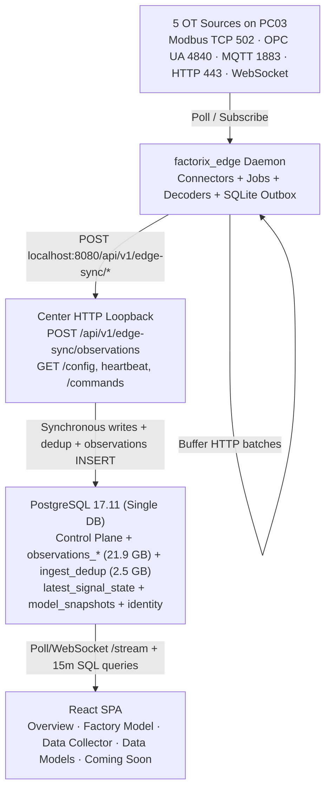

# Current State Architecture (Pre-TDengine Baseline)

## 1. Runtime & Data Flow Overview

On `main` (`1cd21f38`), the appliance packages PostgreSQL 17, FastAPI Center (`factorix.transport.app`), the React SPA, and an enrolled Edge daemon (`factorix_edge`) inside a single container (`infrastructure/docker/entrypoint.sh`), yet models Edge-to-Center synchronization as if Edge were a remote enrolled node:

## 2. Identified Architectural Bottlenecks & Hazards

1. **Loopback Edge Enrollment & HTTP Sync Overhead (`apps/edge`, `modules/edge_sync.py`):**
   - `entrypoint.sh` enrolls `factorix_edge` on `127.0.0.1` via credential tokens, maintains a growing SQLite WAL file (`outbox.sqlite`, ~81 MB / 46.9k pending under stalls), polls config releases over HTTP, and posts small HTTP batches to `/api/v1/edge-sync/observations`.
2. **PostgreSQL Unbounded Time-Series Growth (`telemetry.py::_store_batch`):**
   - Every sample across 336 active signals (~300-800 obs/s) appends a row to monthly partitioned `observations_*` (~21.9 GB in Nov alone) plus `ingest_dedup` (~2.48 GB), generating heavy heap/index WAL traffic even though `synchronous_commit = off` was added as a mitigation.
3. **Destructive Legacy `Revert To Zero` (`identity.py::revert_to_zero` / `RevertToZeroModal.tsx`):**
   - Executes `TRUNCATE TABLE <all public tables except alembic_version> RESTART IDENTITY CASCADE`, wipes enrollment/outbox files, invalidates the user session, clears client state, and navigates to `/register` — violating the requirement to reset acquired telemetry **without** destroying Factory Model, Connections, Signals, Data Models, or admin accounts.
4. **Placeholder Historian & Storage UI (`Sidebar.tsx`):**
   - Currently sits under `Coming Soon` with disabled child labels (`Data Explorer`, `Storage Policies`, `Retention & Export`) mapped to `ComingSoonPage.tsx`.
