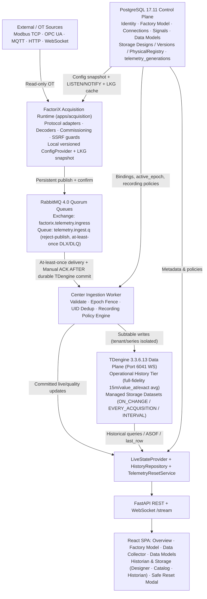

# Target State Architecture — Acquisition + RabbitMQ + TDengine + Historian & Storage

## 1. Logical & Runtime Architecture

## 2. Clean Separation of Concerns

| Plane | Responsibility | Store / Broker |
|---|---|---|
| **Control Plane** | Auth/RBAC, Factory hierarchy, Connections (`secret_store` encrypted), 336+ Signals, 36+ Data Models (`spec_json`), Storage DSL ASTs/versions/registry, `telemetry_generations` epochs, operation/reset audit | **PostgreSQL 17.11** |
| **Acquisition Plane** | Local site worker owning 5 OT protocol clients/timers, block reading, commissioning probes, SSRF/DNS validation; zero Edge enrollment or loopback HTTP outbox | **Site Process (`factorix-acquisition`)** |
| **Reliable Transport** | Decoupled ingress buffering, durable publish confirms, bounded quorum queues (`reject-publish`), retry delivery limit -> DLQ quarantine | **RabbitMQ 4.0 Management Alpine** |
| **Time-Series Data Plane** | Canonical high-compression TSDB holding both automatic **Operational History** (guaranteeing 15m sparklines, sample-weighted aggregates, and `value_at` parity) and published user **Storage Designs** | **TDengine 3.3.6.13 (`taos-ws-py`)** |

## 3. Navigation & Safe Reset Contract

- **Sidebar `Historian & Storage` (Main Nav, right after `Data Models`):** strictly 3 child items:
  1. `Designer` (`/historian/designer`, `/historian/designer/:designId`)
  2. `Catalog` (`/historian/catalog`, `/historian/catalog/:designId`) — includes `Operations` & `Retention` drawers/tabs internally
  3. `Historian` (`/historian/historian`) — includes `Trend`, `Query Workspace`, `Saved Views`, `Exports & Jobs` tabs internally
- **Legacy URL Compatibility:** `/historian/explorer`, `/historian/policies`, `/historian/retention`, `/storage` redirect safely into the new workspace while preserving query params.
- **Safe `Revert To Zero` (`CLEAR_TELEMETRY_ONLY`):** Orchestrated multi-stage saga (`R0`–`R5` in `TelemetryResetService`) that fences writes via `telemetry_generations.active_epoch += 1`, purges tenant-scoped TDengine data, RabbitMQ old-epoch backlog, exports, and PG runtime state while keeping **100% of configuration entities, accounts, Factory Model, 5 Connections, 336 Signals, and 36 Data Models intact**, keeping the admin logged in without ever routing to `/register`.
