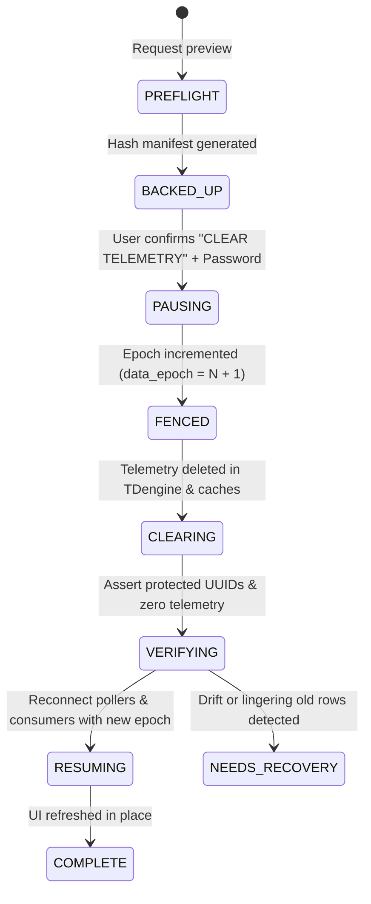

# Safe Telemetry Reset & Preservation Runbook

**Branch:** TDengine-RabbitMQ-Stoorage-Historian  
**Source baseline:** 400dba192eb13be30806dbacb1568ffff23ae26b  
**Last updated:** 2026-11-12

---

## 1. Core Principle: Telemetry-Only Reset vs Storage Purge

In FactoriX, there is a fundamental distinction between two operations that must never be conflated:

| Operation | Purpose | Scope | Action on Configuration |
|---|---|---|---|
| **Revert To Zero (`CLEAR TELEMETRY`)** | Clear runtime time-series telemetry so sources can restart cleanly from empty history. | Telemetry rows, latest values, epoch fencing, export jobs | **100% PRESERVED**: Accounts, factory model, connections, signals, models, and TDengine schemas remain intact. |
| **Purge Storage Object** | Permanently drop a specific physical TDengine database, supertable, or subtable. | Target storage object and child subtables | Destructive schema DDL (`DROP STABLE` / `DROP TABLE`). Requires separate approval and impact review. |

---

## 2. Preservation Manifest (What Must NOT Be Deleted)

During `Revert To Zero`, the following entities are strictly protected and verified before and after execution:

1. **User Accounts & Authentication Sessions:**
   - `admin_accounts`, `roles`, active JWT sessions, password hashes.
   - User is never logged out or redirected to `/register`.
2. **Factory Model & Hierarchy:**
   - Enterprise, Site, Area, Line, Machine/Asset nodes and graph relations.
3. **Data Collector Configurations:**
   - All 5 protocol Connections (Modbus TCP, OPC UA, MQTT, HTTP, WebSocket), connection credentials, and poller jobs.
4. **Signal Catalog:**
   - 336 active Signal definitions, unique UUIDs, source field mappings, data types, and engineering units.
5. **Data Models:**
   - 36 Data Model definitions, AST formula expressions, body definitions, and published revisions.
6. **Physical Storage Schema Registry:**
   - TDengine Database, Supertable, and Subtable definitions.
   - `storage_object_specs`, `storage_object_revisions`, `storage_source_bindings_v2`, `storage_row_assembly`.
   - Physical table schemas in TDengine (empty tables ready to receive new rows).

---

## 3. What IS Cleared During Reset

1. **TDengine Time-Series Rows:** All rows across subtables within the active tenant/site scope.
2. **PostgreSQL Latest State:** `latest_signal_state` values reset to `UNKNOWN`/`NO_DATA` (row definitions preserved).
3. **Model Snapshots & Transient History:** Model evaluation snapshots derived from old telemetry.
4. **RabbitMQ In-Flight Backlog:** Queued messages tagged with the old epoch are rejected/drained.
5. **Acquisition Local Spool:** SQLite spool records tagged with the old epoch are cleared.
6. **Historian Export Artifacts:** Temporary CSV/JSON files generated from previous epoch telemetry.

---

## 4. Reset FSM (State Machine) & Epoch Fencing

To ensure that reset survives container crashes and cannot resurrect old data, execution follows a 6-phase state machine:

### 4.1 Epoch Fencing Guarantee
- When the reset starts, PostgreSQL updates `telemetry_generations.data_epoch = data_epoch + 1`.
- Any delayed message arriving from RabbitMQ or SQLite spool with `data_epoch <= old_epoch` is dropped immediately by the ingestion worker.
- Fresh observations arrive with `data_epoch = new_epoch` and begin recording cleanly.

---

## 5. UI Modal Verification Steps (`RevertToZeroModal.tsx`)

1. User navigates to Settings / Admin → `Clear Telemetry & Operational History`.
2. Modal loads dynamic preview from `GET /api/v1/admin/telemetry-reset/preview`.
3. Side-by-side comparison is displayed:
   - **Will Be Cleared:** Telemetry points count, export jobs, cached states.
   - **Strictly Preserved:** 5 Connections, 336 Signals, 36 Data Models, Storage Schemas, Active Admin Session.
4. Two-factor confirmation required:
   - Exact typed phrase: `CLEAR TELEMETRY`
   - Current Admin password
5. Submit calls `POST /api/v1/admin/telemetry-reset/execute`.
6. Success response updates `active_epoch`, closes modal, and refreshes UI data without logout.

---

## 6. Verification Checklist for QA

| Check | Verification Command / Query | Pass Condition |
|---|---|---|
| User Session Intact | Browser reload after reset | User remains authenticated at `/` or current page. |
| Connections Preserved | `SELECT count(*) FROM connections;` | Exactly matches baseline count (5). |
| Signals Preserved | `SELECT count(*) FROM signal_definitions;` | Exactly matches baseline count (336). |
| Models Preserved | `SELECT count(*) FROM data_models;` | Exactly matches baseline count (36). |
| Schemas Preserved | TDengine `SHOW STABLES;` | Supertables still exist and have identical schema. |
| Rows Cleared | TDengine `SELECT count(*) FROM <subtable>;` | 0 rows in all subtables immediately after reset. |
| Fresh Data Resumes | Watch Signals Catalog for 10 seconds | Values transition from `UNKNOWN` to fresh `GOOD` values under new epoch. |
