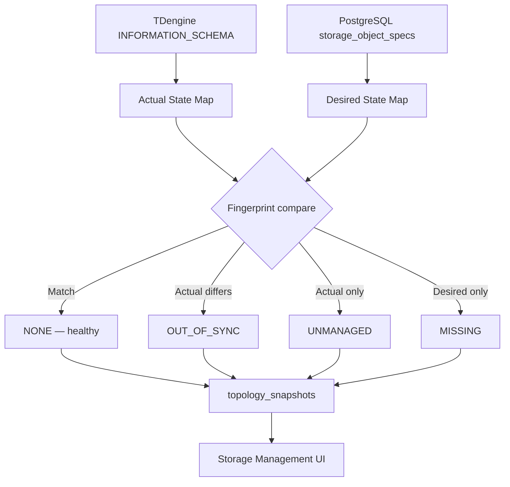

# TDengine Actual vs Desired Topology

**Branch:** TDengine-RabbitMQ-Stoorage-Historian  
**Source baseline:** 400dba192eb13be30806dbacb1568ffff23ae26b  
**Last updated:** 2026-11-12

---

## Purpose

This document defines the reconciliation model between:
- **Desired state**: what FactoriX's PostgreSQL registry (`storage_object_specs`, `storage_object_revisions`) declares as the intended physical schema
- **Actual state**: what TDengine's `INFORMATION_SCHEMA` and `SHOW` commands return as the runtime reality

The Storage Management topology view must always display **actual metadata**, not desired state alone. Drift between desired and actual is flagged explicitly.

---

## Topology API Contract

```
GET /api/v1/storage/td/topology?database=&depth=&cursor=
```

Response fields per object node:

| Field | Source | Meaning |
|-------|--------|---------|
| `name` | TDengine INFORMATION_SCHEMA | Physical name as TDengine sees it |
| `actual_state` | TDengine SHOW/DESCRIBE | Runtime columns, tags, row count estimate |
| `desired_state` | PostgreSQL registry | Last published spec hash |
| `drift_type` | Computed | `NONE`, `OUT_OF_SYNC`, `UNMANAGED`, `MISSING` |
| `last_verified_at` | Storage topology snapshot | When reconcile last ran |
| `fingerprint_hash` | Computed from DESCRIBE | Schema fingerprint for change detection |

### Drift Types

| Type | Meaning | UI Display |
|------|---------|------------|
| `NONE` | Actual matches desired | Green badge |
| `OUT_OF_SYNC` | Physical schema differs from registry | Yellow warning; Reconcile CTA |
| `UNMANAGED` | Object exists in TDengine but not in FactoriX registry | Blue info; Claim or Ignore |
| `MISSING` | Registry entry has no corresponding physical object | Red error; Re-create or Remove |

---

## Discovery Rules

### What counts as "actual"

Actual topology is obtained by:
1. `SHOW DATABASES` → list all databases visible to service account
2. For each database: `SHOW STABLES IN <db>` → list supertables with column/tag counts
3. For selected objects: `DESCRIBE <db>.<stable>` → columns, tags, types
4. For subtable inspection: `SHOW TABLES IN <db>` filtered by stable membership
5. Row counts: `SELECT COUNT(*) FROM <db>.<subtable>` — only on demand, not bulk

**Never** infer actual topology from client-side fields, frontend heuristics, or cached plan hashes.

### What counts as "desired"

Desired topology is the highest `published_revision` row in `storage_object_specs` with `state = ACTIVE`. A draft or failed revision is **never** the desired state.

### What is "UNMANAGED"

Any TDengine database, STable, or table whose physical name does not appear in `storage_object_specs` with matching `physical_db`/`physical_name`/`tenant_id`. These objects may have been created:
- Directly via TDengine CLI or external tooling
- By a previous version of FactoriX using a different naming convention
- By operational history auto-provisioning when `FACTORIX_RECORD_OPERATIONAL=true`

UNMANAGED objects are displayed in the topology graph with a distinct border style. The user may `Claim` them (associate with a registry entry) or `Ignore` them. FactoriX will not automatically DROP unmanaged objects.

---

## Reconciliation Process

Triggered by: user action (Refresh / Reconcile button), scheduled background job, or post-operation verification.

```
1. Fetch actual topology from TDengine (paginated, timeout-bounded)
2. Load desired specs from PostgreSQL registry
3. Compute fingerprint for each actual object
4. Compare actual fingerprints to desired spec hashes
5. Categorize each object: NONE / OUT_OF_SYNC / UNMANAGED / MISSING
6. Write snapshot to storage_topology_snapshots with timestamp
7. Update object state in storage_object_specs if drift detected
8. Surface to UI; do NOT auto-remediate drift without user action
```

### Reconciliation Boundaries

- Reconciliation READS from TDengine; it does NOT apply DDL
- Auto-reconcile (self-heal) is NOT enabled by default; operator must trigger Reconcile action
- During active publish operation, reconciliation is deferred to avoid race conditions

---

## Mermaid: Topology Comparison Flow



---

## Edge Cases

### TDengine Unavailable

When TDengine is unreachable:
- API returns `503` with `source: tdengine_unavailable`
- UI displays `Storage server unavailable` state; existing snapshot with `last_verified_at` shown
- NO synthetic/cached topology presented as current
- Operations that require TDengine connectivity are disabled with explicit reason

### PostgreSQL Unavailable

- Topology API returns `503`; no fabricated desired state
- Acquisition continues with last loaded binding config until PG recovers

### Large Object Counts

For >1000 subtables: pagination via `cursor` parameter; UI renders virtual list, not 1000 DOM nodes.  
For >100k subtables: graph shows aggregated counts at STable level; drill-down on demand.

---

## Related Configuration

| Setting | Location | Default | Impact |
|---------|----------|---------|--------|
| `FACTORIX_RECORD_OPERATIONAL` | docker-compose.yml env | `false` (Compose override); code default `true` if no env | Controls auto-creation of operational history STables |
| Reconcile interval | storage_topology.py | On-demand only | Scheduled reconcile not enabled by default |
| Snapshot retention | storage_topology_snapshots | Last 10 per object | Configurable |

> [!WARNING]
> `FACTORIX_RECORD_OPERATIONAL=false` in Compose overrides the code default of `true` introduced in commit `316976108529d4d`. The effective value must be verified at runtime: `docker exec factorix-appliance env | grep FACTORIX_RECORD_OPERATIONAL`. Changing this setting on a running system without capacity planning may cause unexpected TDengine write amplification.
