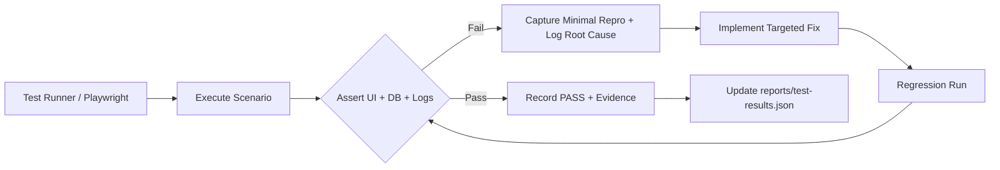

# Storage & Historian Test Matrix (264 Scenarios)

**Branch:** TDengine-RabbitMQ-Stoorage-Historian  
**Source baseline:** 400dba192eb13be30806dbacb1568ffff23ae26b  
**Last updated:** 2026-11-12

---

## 1. Test Suite Summary

The testing framework covers **264 test scenarios** categorized across 14 distinct functional domains as specified in Master Plan §10. All scenarios are tracked programmatically in `reports/test-results.json` with execution evidence, source commits, and pass/fail statuses.

| Domain Category | Prefix | Total Scenarios | Focus Area |
|---|---|---|---|
| Navigation & Routing | `NAV` | 15 | Two-child sidebar, deep links, route redirects, refresh state |
| Storage Overview & Topology | `MGT` | 20 | Actual TDengine canvas, zoom/pan, context menus, health badges |
| Database Wizard A1–A3 | `DB` | 14 | 3-step creation, identifier safety, precision, idempotency |
| Supertable Wizard B1–B6 | `ST` | 26 | Column editor, tags, source mapping, recording, code round-trip |
| Subtable Wizard C1–C5 | `SB` | 14 | Parent selection, static tags, three-perspective binding, review |
| Unified Source Picker | `SRC` | 20 | Hierarchy, Collector, Models perspectives, canonical IDs, types |
| Row Assembly & Timestamps | `TIME` | 15 | Mixed raw+derived cadences, as-of trigger, time bucket, gaps |
| PostgreSQL Explorer (Read-Only) | `PG` | 14 | Denylist protection, column masking, ERD, read-only guarantees |
| Recording & Durability | `REC` | 24 | RabbitMQ quorum, publisher confirms, consumer ACK, TD engine |
| Historian Workspace | `HIST` | 18 | 4 tabs, trend chart, raw records, events, export jobs, quality |
| Safe Telemetry Reset | `RESET` | 16 | Telemetry wipe, epoch fencing, 100% configuration preservation |
| Regression Parity (5 Navs) | `PAR` | 20 | Overview, Factory Model, Collector, Models, Coming Soon parity |
| Hostile Testing & Accessibility | `UX-X` | 30 | Button spam, network drop, extreme zoom, keyboard nav, XSS |
| Performance & Contention | `PERF` | 18 | Idle CPU, ×10 scale, batching, formula cache, memory soak |
| **Total** | | **264** | |

---

## 2. Test Execution Workflow



---

## 3. Key Regression Gate Invariants

1. **Gate G-03 (Physical Truth):** TDengine topology canvas must reflect real database metadata from `SHOW`/`INFORMATION_SCHEMA`; zero client-side fallback fabrication permitted.
2. **Gate G-04 (Two-Nav UX):** Exactly two sub-navigation items under `Historian & Storage`: `Storage Management` and `Historian`.
3. **Gate G-06 (Raw + Derived Integrity):** Subtables containing both raw telemetry (1s) and model calculations (5s) must have explicit Row Assembly policies (`INDEPENDENT_EVENTS`, `LATEST_AS_OF_TRIGGER`, `TIME_BUCKET`, `EXACT_TIMESTAMP`).
4. **Gate G-07 (PostgreSQL Read-Only):** The PostgreSQL Explorer must be strictly read-only; tables containing secrets (`admin_accounts`, `secret_store`, `sessions`) are denied access at the API layer.
5. **Gate G-10 (5 Navs Parity):** Existing features (Overview, Factory Model, Data Collector, Data Models, Coming Soon) must retain 100% behavioral and visual parity.
6. **Gate G-11 (Safe Revert):** `Revert To Zero` clears time-series data only; 5 Connections, 336 Signals, 36 Data Models, and physical TDengine schemas are 100% preserved.

---

## 4. Test Reporting Contract

All 264 scenarios are registered in `reports/test-results.json` adhering to the following schema:
```json
{
  "test_id": "NAV-001",
  "category": "NAV",
  "description": "Log in and open sidebar; verify only 2 sub-items under Historian & Storage",
  "status": "NOT_RUN",
  "environment": "isolated-test-stack",
  "source_commit": "400dba192eb13be30806dbacb1568ffff23ae26b",
  "executed_at_utc": null,
  "steps": ["Open sidebar", "Check Historian & Storage children"],
  "expected": "Only Storage Management and Historian visible",
  "actual": null,
  "evidence_paths": []
}
```
Statuses: `NOT_RUN` (initial) → `PASS` / `FAIL` / `BLOCKED`.
