# REVIEW.md — FactoriX IIoT: RabbitMQ → TDengine → Storage Management → Historian

> **Tài liệu điều hành sửa lỗi end-to-end, làm sạch bản phát hành và chuẩn bị kiểm định độc lập**  
> Ngày lập: **13/11/2026** · Ngôn ngữ triển khai: tiếng Việt · Trạng thái: **RELEASE BLOCKED / NOT READY**.  
> Repository: `https://github.com/dangtai111325/factoriX`  
> Branch được đánh giá: `TDengine-RabbitMQ-Stoorage-Historian`  
> Baseline commit đã kiểm tra: `ed2970c72c4773ff8108e4f8dffc7dc0afa881e0`  
> Git tree: **520 entries; trong đó 418 file**. Đây là hai phép đếm khác nhau, không phải hai bản repository.  
> **Đối tượng đọc:** kỹ sư/AI coding agent thực hiện sửa, reviewer E2E, QA, người quyết định phát hành.  
> **Cách dùng:** đọc toàn bộ trước khi sửa; thực thi theo gate; mọi việc không đạt phải để `BLOCKED`, không tự khai `PASS`.

---

## Mục lục điều hướng nhanh

- **Phần I:** Kiến trúc thực tế và kiến trúc phải đạt, các luồng Mermaid từ connectors tới Historian.
- **Phần II:** 25 nhóm lỗi/vấn đề P0/P1, phân tích nguyên nhân, hậu quả, tệp sửa và nghiệm thu.
- **Phần III:** Tính đúng của TDengine graph, mixed raw/model data, reliability, quality, performance và UI/UX.
- **Phần IV:** 21 phase thực thi `00–20` cùng file mapping, dependency, migration và gate.
- **Phần V:** Kiểm kê cụ thể file rác/legacy, quy trình clean Git và bảo toàn dữ liệu local.
- **Phần VI:** 262 mã kịch bản nghiệm thu từ zero install đến fault injection, reset, security, performance.
- **Phần VII:** Bộ hồ sơ evidence bắt buộc push Git và bảo quản raw artifacts riêng.
- **Phần VIII:** Ràng buộc coding agent, quality gates, quy trình commit/push và tiêu chuẩn quyết định release.
- **Phần IX:** Source references, giới hạn xác minh và kết luận.

---

## 0. Mệnh lệnh triển khai — phải đọc trước tiên

Đây không phải bản đề xuất mang tính tham khảo. Đây là **chỉ thị sửa source và nghiệm thu release**. Người thực thi phải truy vết hiện trạng của từng file, nêu tác động liên module, sửa tận gốc, chạy kiểm thử thực tế và lưu bằng chứng. **Không được** thay một lỗi contract bằng fallback giả, thêm `try/except: pass`, hardcode số liệu, tự trả `healthy=true`, hoặc chỉ sửa giao diện để che lỗi backend. **Không được** tự động xóa dữ liệu local hoặc quyết định một nhánh legacy là “không còn dùng” nếu chưa chứng minh đường gọi không còn tồn tại.

**Bốn quy tắc bất khả xâm phạm:**

1. **Repository phát hành từ zero phải sạch:** checkout + cấu hình bí mật hợp lệ + `docker compose up` phải mở một hệ thống chưa có tenant, tài khoản, connection, signal, model, telemetry, historian, các bảng do người dùng tạo hay dữ liệu demo. Không có seed tự chạy, mock/fallback giống dữ liệu thật, snapshot từ máy tác giả, artefact benchmark giả, database dump, log tạm hoặc credentials trong Git và image phát hành. Test source có thể tồn tại để CI kiểm chứng nhưng không mang theo *dữ liệu test lưu sẵn* và không được chạy ở production; mọi test data phải được tạo tự động bên trong môi trường cô lập rồi hủy.
2. **Dữ liệu local của chủ dự án phải nguyên vẹn:** hiện trạng tham chiếu gồm **36 Data Models, 336 Signals, 5 Connections** cùng tài khoản, Factory Model, Bindings, công thức, settings, storage schema, secrets và dữ liệu đo đang lưu. Đây là **baseline cần xác minh bằng query/manifest, không phải giá trị được phép hardcode**. Không được `down -v`, `docker volume rm`, `TRUNCATE`, `DROP DATABASE`, `DROP TABLE`, xóa WAL/spool/outbox, chạy Revert hay migration phá hủy trên local thật. Mọi thao tác phá hủy chỉ được chạy trên môi trường test tách biệt, với xác nhận của chủ sở hữu cho từng lần tác động production.
3. **Đúng định hướng đã chốt:** **RabbitMQ Quorum Queue** làm durable transport; **Acquisition** trực tiếp kết nối nguồn; **TDengine** là data plane cho dữ liệu phát sinh từ nguồn, kể cả tín hiệu chậm thay đổi, quality và sự kiện có yếu tố thời gian; **PostgreSQL** là control plane và metadata; UI có đúng **hai nav con `Storage Management` và `Historian`**. End user thao tác trực tiếp **Database → Supertable → Subtable**, không bị bắt sử dụng “Dataset Designer” làm đối tượng chính. PostgreSQL Explorer **read-only**. Giữ nguyên hành vi thực tế của năm miền cũ: Overview, Factory Structure/Knowledge Graph, Data Collector/Signals, Data Models, và các đường điều hướng đang hoạt động; có thể refactor backend nhưng **không thay đổi kết quả**.
4. **Không nghiệm thu bằng lời hứa:** `CI xanh`, `x/y PASS`, `0 issues`, report do AI tạo và screenshot tĩnh không thay thế được bằng chứng từ code chạy, network requests, SQL read-back, logs, timestamps và điều kiện môi trường. Không có chứng cứ thật thì trạng thái là `NOT_RUN` hoặc `BLOCKED`.

**Giới hạn của bản review này:** những mục ghi **[CONFIRMED_SOURCE]** là sai lệch có thể đối chiếu từ mã tại commit ở trên. **[REQUIRES_RUNTIME]** là rủi ro hoặc hành vi phải xác minh trên Docker/TDengine/RabbitMQ/PostgreSQL thật. Tôi không gán nhãn “runtime đã lỗi” cho điều chưa chạy. Lịch sử trao đổi ngày 10–13/11/2026 là nguồn yêu cầu sản phẩm; repository tại commit nêu trên là nguồn tình trạng triển khai.

### 0.1. Gate khẩn cấp trước khi chạm vào code

Chưa có `BASELINE_CAPTURED`, `BACKUP_RESTORE_VERIFIED`, `TEST_ENV_ISOLATED`, `SECRET_SCAN_CLEAN`, `CHANGE_SCOPE_RECORDED` thì **không được** chạy migration có ghi, reset, xóa file/volume, thay compose production, phát hành artifact hoặc merge. Chủ dự án phải giữ được quyền khởi động phiên bản cũ và phục hồi cấu hình. Không có sự cho phép bằng văn bản thì agent **không chạy Revert trên local thật**.

### 0.2. Kết quả tối thiểu phải bàn giao

Một branch sửa sạch, PR có commit rõ nghĩa, toàn bộ patch có test; `docs/release/evidence/<review-sha>/` chứa manifest bằng chứng không nhạy cảm; GitHub Actions chạy lại được; các phát hiện trước đây được đánh dấu `FIXED/VERIFIED/BLOCKED` theo từng ID; `RELEASE_READINESS.md` kết luận dựa trên gate thực tế. Giữ `review.md` này trong root để reviewer so sánh từng yêu cầu. **Không sửa tài liệu để tuyên bố PASS trước khi hệ thống pass.**

---

# PHẦN I — HIỂU ĐÚNG HỆ THỐNG TRƯỚC KHI SỬA

## 1. Vì sao đã thay RabbitMQ và TDengine nhưng FactoriX vẫn chưa thể phát hành?

FactoriX đã đi qua một thay đổi kiến trúc lớn. Trước kia một phần Edge nhận dữ liệu và chuyển bằng HTTP vào Center; PostgreSQL giữ cả metadata lẫn nhiều bảng telemetry. Phương án được thống nhất không phải thêm hai container cho đẹp, mà chuyển trách nhiệm: connector làm acquisition, RabbitMQ nhận trách nhiệm truyền dẫn và backpressure, Ingestion quyết định công nhận observation, TDengine lưu lịch sử có dấu thời gian, PostgreSQL lưu identity/configuration, và UI phải cho người dùng tạo và quản lý chính cấu trúc TDengine thật. Một bước riêng lẻ chạy đúng chưa có nghĩa hệ thống chạy xuyên suốt. Ví dụ API có thể chấp nhận nút Create, nhưng service DDL gọi một method không tồn tại; người dùng vẫn thấy topology vì React tự tạo ra dữ liệu mô phỏng; CI lại xanh vì test chỉ mock adapter. Cả ba lớp đều có vẻ “hoạt động”, nhưng dữ liệu thật không được tạo.

Bởi vậy, review này **không chấm từng màn hình độc lập**. Mọi chức năng đều phải được kiểm tra xuyên tầng: ý định người dùng → UI payload → API validation/auth → PostgreSQL transaction → TDengine DDL/read-back → registry → ingestion actual writes → query/historian → UI read-back, cộng với rollback, concurrency, lỗi mạng và reboot. Cách sửa phải bắt đầu từ hợp đồng và transaction trước khi trang trí giao diện.

### 1.1. Sơ đồ triển khai đang có (rút ra từ Docker và entry point)

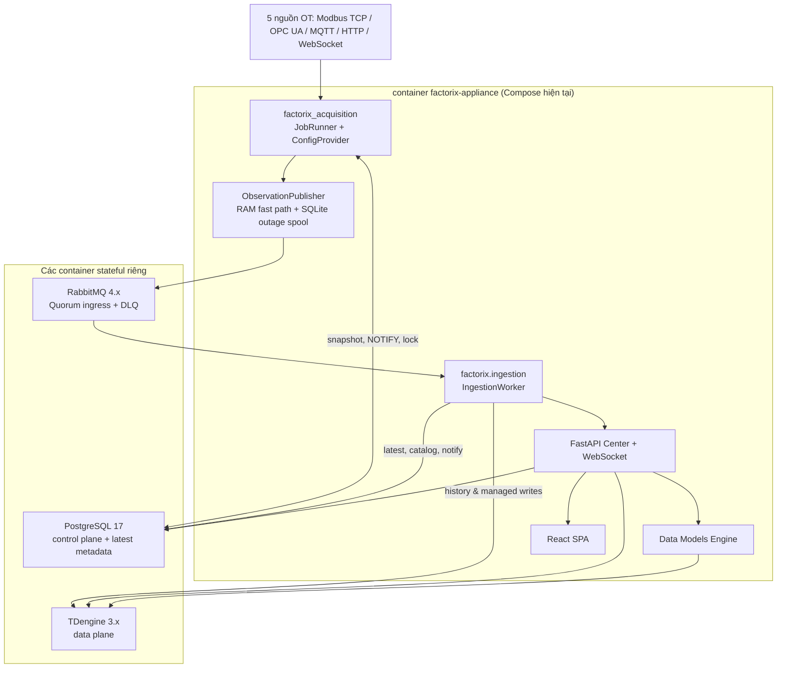

Đây là topology Compose có thể truy vết. `Dockerfile` vẫn đặt default `FACTORIX_COLLECTOR_MODE=edge`, còn `docker-compose.yml` ép `acquisition`. `infrastructure/docker/entrypoint.sh` chứa cả đường legacy Edge lẫn đường Acquisition. Phải xử lý tương thích và loại bỏ legacy có kiểm soát; không được tự coi source cũ đang chạy song song trong Compose. Mã Edge cũ cũng không được vô tình kích hoạt ở release mới khi biến môi trường thiếu.

### 1.2. Luồng observation cần đạt được

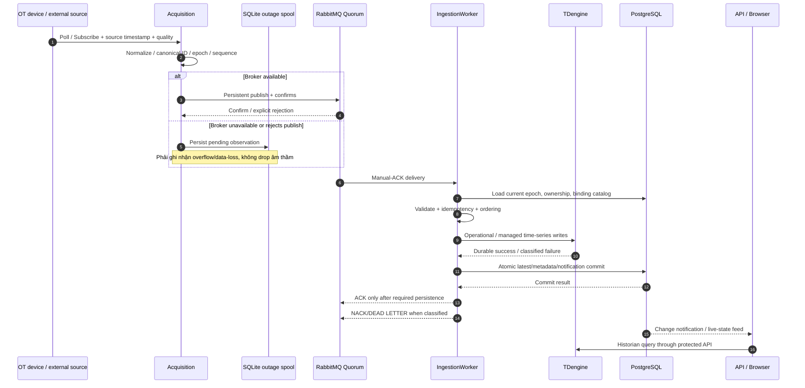

**Lưu ý kiến trúc:** TDengine và PostgreSQL không có cùng một distributed ACID transaction. “TDengine trước → PostgreSQL sau → ACK RabbitMQ” là một *protocol of retries and idempotency*, không phải một transaction nguyên tử liên cơ sở dữ liệu. Nếu TDengine ghi thành công nhưng PostgreSQL lỗi, RabbitMQ sẽ phát lại; TDengine write phải idempotent theo identity được quyết định trước, hoặc hệ thống phải có reconciliation. Không được chỉ kiểm tra `event_uid` trong RAM và gọi đó là exactly-once.

### 1.3. Hai miền lưu trữ không được đánh đồng

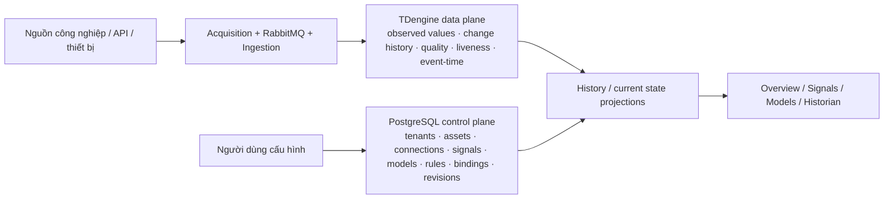

Một tín hiệu Boolean chỉ đổi 3 lần trong một ngày vẫn là dữ liệu thuộc data plane; không được đẩy nó sang PostgreSQL chỉ vì nó “không realtime”. Tuy nhiên “mọi dữ liệu nguồn thuộc TDengine” **không đồng nghĩa** phải ghi một record trùng giá trị cho mỗi lần poll. Ghi theo thay đổi là một chính sách recording; liveness/last-acquired/quality vẫn phải được cập nhật để biết thiết bị còn thực sự trả lời.

### 1.4. Đối tượng vật lý TDengine và đồ thị đúng ngữ nghĩa

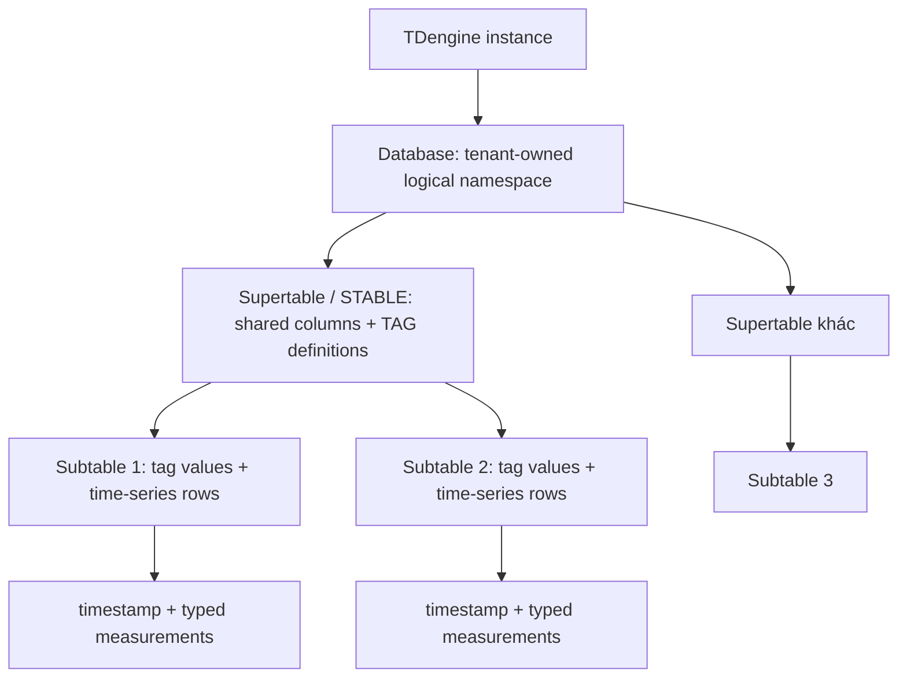

**Không có foreign key từ Database A sang Database B hay từ STABLE sang Subtable.** Mũi tên `Database → STABLE → Subtable` trong giao diện có nghĩa *contains / instantiated from*, không phải relational join. Tags dùng để gắn ngữ cảnh và giúp lọc, không phải PK/FK. Những liên hệ `Signal → Column`, `Model field → Column` hay `Derived from` là *lineage/bindings do FactoriX quản lý*, phải dùng loại cạnh và legend khác. Không vẽ ERD giả cho TDengine. PostgreSQL Explorer mới là nơi vẽ FK/ERD thực.

### 1.5. Định hướng giao diện đã thống nhất cuối cùng

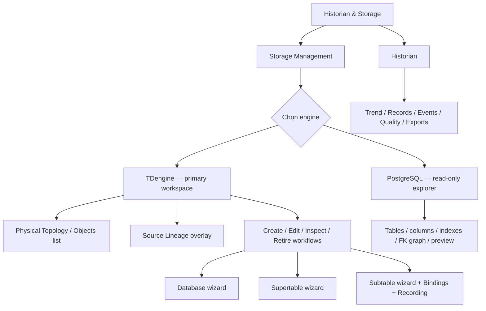

Không đưa “Dataset” trở lại làm đơn vị người dùng buộc phải tạo. Những bảng `storage_datasets` từ phiên bản cũ chỉ có thể tồn tại như một dạng metadata nội bộ hoặc đối tượng migration nếu đã có dữ liệu; muốn xóa phải lập dependency mapping và chứng minh không làm mất dữ liệu. Chỉ hai nhãn nav con công khai `Storage Management` và `Historian`.

---

# PHẦN II — REVIEW VẤN ĐỀ, HẬU QUẢ VÀ CÁCH KHẮC PHỤC

## 2. Ma trận phát hiện gốc và ưu tiên

| ID | Ưu tiên | Tình trạng | Nút thắt / kết quả không được chấp nhận |
|---|---|---|---|
| FX-P0-01 | P0 | CONFIRMED_SOURCE | Frontend sinh topology/rows/trends/quality giả khi API lỗi |
| FX-P0-02 | P0 | CONFIRMED_SOURCE | TDengine adapter và Storage services khác tên method, khác kiểu rows |
| FX-P0-03 | P0 | CONFIRMED_SOURCE | Publish operation status `COMPLETED` không khớp UI `APPLIED` |
| FX-P0-04 | P0 | CONFIRMED_SOURCE | Draft ở RAM, DDL không có read-back/saga recovery, TD client null có thể báo thành công |
| FX-P0-05 | P0 | CONFIRMED_SOURCE | Edit wizard gọi PATCH route chưa được khai báo; thiếu full lifecycle |
| FX-P0-06 | P0 | CONFIRMED_SOURCE | Subtable DDL lấy tag schema rỗng; Source Binding không nối tới active writer |
| FX-P0-07 | P0 | CONFIRMED_SOURCE | Source Picker ba góc nhìn lệch backend hierarchical shape / frontend flat shape |
| FX-P0-08 | P0 | CONFIRMED_SOURCE | Tenant ownership chưa cưỡng chế nhất quán khi đọc TDengine object |
| FX-P0-09 | P0 | CONFIRMED_SOURCE | PostgreSQL Explorer masking/allowlist yếu, queries dữ liệu không tenant-scoped |
| FX-P0-10 | P0 | CONFIRMED_SOURCE | `/api/v1/admin/revert-to-zero` cũ vẫn thực hiện truncate cấu hình/tài khoản |
| FX-P0-11 | P0 | CONFIRMED_SOURCE | Selective reset DROP subtables, chưa chứng minh tái tạo/khớp schema; ngoại vi exports cần kiểm |
| FX-P0-12 | P0 | CONFIRMED_SOURCE | Compose có hardcoded credential; entrypoint log DSN đầy đủ; default Edge trái Compose |
| FX-P0-13 | P0 | CONFIRMED_SOURCE | `FACTORIX_RECORD_OPERATIONAL=false` ở Compose trái mục tiêu lịch sử mặc định |
| FX-P0-14 | P0 | CONFIRMED_SOURCE | Outage spool được phép đánh DEAD/xóa pending khi vượt cap; không thể claim zero loss |
| FX-P0-15 | P0 | CONFIRMED_SOURCE | Acceptance report generic/sai commit, test evidence không phân biệt từng scenario |
| FX-P1-01 | P1 | CONFIRMED_SOURCE | Topology chỉ load subset nhưng stats diễn giải thành tổng; health/status hardcode |
| FX-P1-02 | P1 | CONFIRMED_SOURCE | Object IDs `db:` vs `db/` và dạng database.table không nhất quán |
| FX-P1-03 | P1 | CONFIRMED_SOURCE | Drift inspector không có PG pool và gọi registry schema không khớp migration hiện tại |
| FX-P1-04 | P1 | CONFIRMED_SOURCE | GET Engine trả PostgreSQL 16 cố định dù Docker dùng PG17 |
| FX-P1-05 | P1 | CONFIRMED_SOURCE | `COUNT(*)` preview, per-object TD queries gây overhead; pagination không có sort ổn định |
| FX-P1-06 | P1 | REQUIRES_RUNTIME | Ingestion, model evaluation, polling, queue/pool contention có thể gây CPU cao |
| FX-P1-07 | P1 | REQUIRES_RUNTIME | Tính idempotency thật khi redelivery, collision timestamp, restart và reset race |
| FX-P1-08 | P1 | REQUIRES_RUNTIME | Contract Historian recorded vs reconstructed, quality/gap, mixed raw+model rows |
| FX-P1-09 | P1 | CONFIRMED_SOURCE | Test/demo/legacy source, docs, reports lẫn vào tree; chưa có clean-release policy |
| FX-P1-10 | P1 | REQUIRES_RUNTIME | Đồng nhất 5 nav, browser interactions, responsive/keyboard và release UX chưa được chứng minh |

**Thứ tự:** P0 lỗi an toàn và đúng dữ liệu trước; P1 hiệu năng/UX sau. Một PR làm nhiều vấn đề phải chỉ ra đầy đủ ID được giải quyết và test hồi quy. Các điểm cần runtime-test không được tự chuyển sang CONFIRMED chỉ vì suy luận.

## 3. FX-P0-01 — Dữ liệu giả trên màn vận hành: lỗi toàn vẹn thông tin

### Vấn đề và hậu quả

Trong `apps/web/src/pages/storage-management/StorageManagementPage.tsx`, `getTDTopology().catch(...)` dựng sẵn `factory_master`, `process_telemetry`, subtables, cạnh graph; drawer còn dựng giả columns, tags, binding và `ACTIVE`. Trong `apps/web/src/pages/historian/HistorianExplorerPage.tsx`, khi query lịch sử lỗi, trang tự sinh các points theo `Math.sin(...)`, tính quality như dữ liệu thật. `PostgresExplorerView.tsx` có `catch` dựng schemas, table lists, relationships và record preview, trong đó còn hardcode những con số giống hiện trạng local. Đây là hành vi xác nhận qua source, **không phải tình huống giả định**.

Một người vận hành có thể nhìn biểu đồ có nhiệt độ ổn định trong khi thực tế TDengine đã offline. Họ tưởng cấu hình schema đã tồn tại và chọn một source không bao giờ được bind. Khi nghiệm thu, screenshots trông đầy đủ, nhưng không một observation nào được đọc từ database. Sửa lỗi này là bảo đảm độ trung thực của hệ thống, không phải giảm bớt demo cho đẹp.

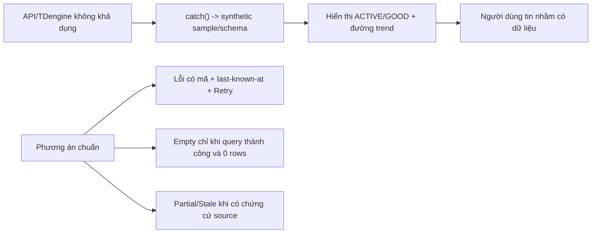

### Sửa ở đâu và bằng cách nào

**File bắt buộc:** `StorageManagementPage.tsx`, `StorageObjectDrawer.tsx`, `StorageObjectDetailPage.tsx`, `HistorianExplorerPage.tsx`, `PostgresExplorerView.tsx`; tìm thêm toàn bộ `apps/web/src` bằng từ khóa `mock`, `fallback`, `Math.sin`, `sampleData`, `demo`, `factory_master`, `GOOD`, `toISOString()`, `catch`, `Promise.resolve`, `active = true` và tất cả code tự dựng giá trị sau lỗi API. Xem cả các trang legacy 10/11 và `lib/storagePhysicalApi.ts`, `lib/storageApi.ts` trước khi quyết định xóa/tái sử dụng.

**Hướng sửa:** dựng chung `RemoteResource<T>`/`AsyncState` phân biệt `idle/loading/ready-empty/ready-data/partial/stale/error/forbidden/unavailable`; mỗi endpoint có typed error code, `correlation_id`, `observed_at` chỉ do server cung cấp; cache UI last-known snapshot chỉ được hiện với nhãn **STALE SNAPSHOT — timestamp nguồn**, không được biến nó thành current state. Backend trả HTTP 503 khi không thể xác nhận TDengine, 403 cho thiếu quyền, 404 cho object không tồn tại, 200 + `items: []` cho kết quả rỗng hợp lệ. Chỉ render `GOOD` nếu quality thực tế là GOOD. Không đặt `goodPct=100`, `data_epoch=1`, `recording_active` từ default không được chứng minh.

**Kiểm thử:** (a) chặn TDengine, kiểm tra Historian không sinh point; (b) chặn API Topology, graph hiện Error thay vì node giả; (c) 403 PostgreSQL Explorer, không lộ bảng; (d) response 200 rỗng tạo Empty state đúng; (e) stale cache phải hiển thị thời điểm nguồn và ngừng nhận như live; (f) frontend error-boundary không crash. **Gate:** grep + code review + browser network log chứng minh không có production synthetic fallback; test cố tình 503 phải hiển thị trạng thái lỗi.

## 4. FX-P0-02 — Storage service gọi sai TDengineClient; đây là lỗi tích hợp nền tảng

### Vấn đề và hậu quả

`apps/center/src/factorix/platform/tdengine.py` thực hiện `query_rows(sql)` trả `list[dict]` và `execute_sql(sql)` trả kết quả thực thi. Nhưng `modules/storage_topology.py` gọi `self._td.run_read(...)` và thao tác theo `row[0]`, `row[1]`; `modules/storage_revisions.py` gọi `self.td.run_write(sql)`. Hai phương thức ấy không nằm trong public interface của `TDEngineClient` tại baseline. Topology `_td_query()` lại bắt `Exception` rồi trả `[]`, tức lỗi bị làm thành “database trống”. `get_engines_info()` có thể coi một lời gọi trả `[]` là hệ thống còn khỏe. `publish_draft()` không có TD client thì vẫn có nhánh hoàn tất.

Điều này gây chuỗi hậu quả: API không phát hiện được schema, graph bị rỗng hoặc fallback; operation tạo bảng lỗi hoặc báo thành công rỗng; owner không phân biệt “chưa có bảng” với “không kết nối được”. Chỉ đổi `run_read` thành `query_rows` **chưa đủ**, vì code còn đọc kết quả theo tuple, trong khi adapter trả dictionary.

### Sửa ở đâu và bằng cách nào

- **`platform/tdengine.py`:** xác định interface duy nhất: `execute_sql`, `query_rows`, `health_probe`, `ensure_operational_schema`, `list_subtables`; bổ sung `TypedRows` hoặc protocol riêng nếu thật sự cần. Không tạo alias `run_read/run_write` chỉ để che các consumer sai; nếu bắt buộc alias tương thích phải có thời hạn và integration tests. Đảm bảo lỗi có code/retryable, timeout và result shape nhất quán.
- **`storage_topology.py`:** thay tất cả lời gọi, đọc `row['name']`/`row['stable_name']`/… theo column aliases đã truy vấn; không giả định ordinal từ `SHOW` và `information_schema` cùng thứ tự. Viết adapter cụ thể cho mỗi query/fallback. Đừng bắt mọi `Exception` rồi trả `[]`; trả lỗi typed cùng correlation id.
- **`storage_revisions.py`:** thực thi qua `execute_sql`, verify operation luôn có client healthy/authorized. DDL phải read-back cấu trúc thực tế trước APPLIED. Mất kết nối hoặc chưa verify => `FAILED`/`VERIFYING`, **không phải success**.
- **`storage_api.py`:** lấy client từ `app.state` bằng dependency injection hoặc một provider có lifecycle được quản lý tập trung; không giữ singleton khác đời sống với client API và không tự biến lỗi khởi tạo thành `None` thành công.

**Test bắt buộc trên TDengine thật:** tạo DB, STABLE, Subtable; query metadata và DESCRIBE bằng typed dictionary; đọc lại tags; mất mạng giữa DDL và read-back; TDengine unreachable -> 503; API health không thể thành green khi query fail. Test mock chỉ kiểm interface, không thay integration.

## 5. FX-P0-03/04 — Operation contract sai, draft RAM và publish chưa phải saga an toàn

### Vấn đề và hậu quả

`CreateStorageObjectWizard.tsx` polling tới khi `APPLIED/FAILED/CANCELLED`, còn service `publish_draft()` cập nhật PostgreSQL `storage_operations.status='COMPLETED'`. Người dùng có thể chờ hết 60 giây rồi nhận timeout mặc dù backend đã thay schema. Khi họ retry, table có thể đã tồn tại và operation mới lại lỗi. Tệ hơn, `storage_revisions.py` lưu `_IN_MEMORY_DRAFTS`; restart API là mất draft, không có recovery. Code hiện có thể `COMPLETED` sau khi chạy statements mà chưa đọc metadata thực tế. Tên gọi “saga” trong comment không đủ chứng minh một saga có thể resume.

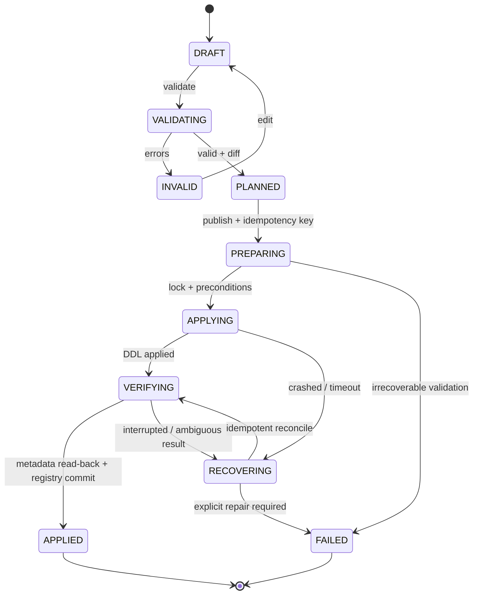

### Sửa ở đâu và bằng cách nào

- **Database migration mới:** tạo/chuẩn hóa *một* nơi authoritative lưu `storage_object_drafts`, `storage_object_revisions`, `storage_operations`, `storage_operation_steps`, `storage_objects`, `storage_bindings` và lifecycle. Nếu có bảng `storage_physical_registry`, `storage_designs`, `storage_design_versions` đã chứa thông tin hiện hữu thì viết migration/backfill **không destructive** trước khi đổi; không dựng bảng mới trùng semantics mà bỏ rơi writer cũ. Index unique theo `(tenant_id, object_type, qualified_name)` và `(tenant_id,idempotency_key)`, optimistic `revision`/ETag.
- **`storage_revisions.py`:** bỏ `_IN_MEMORY_DRAFTS` làm source of truth. CRUD draft trong PostgreSQL, revisions immutable, spec hash, author, server-side validation. DDL plan phải kiểm dependency, ownership, current schema fingerprint, khả năng thay đổi hợp lệ của TDengine version/edition. Operation phải persist step + expected effect **trước** DDL, ghi result và read-back **sau**, cho retry/resume/reconcile. Nếu client null, trả `STORAGE_ENGINE_UNAVAILABLE` rõ ràng.
- **`storage_api.py` + `lib/storagePhysicalApi.ts`:** dùng **một enum** `DRAFT/VALIDATING/PLANNED/PREPARING/APPLYING/VERIFYING/APPLIED/FAILED/RECOVERING/CANCELLED` cho physical operation; không lẫn trạng thái Draft object và Operation. `POST publish` trả `operation_id`, `status`, `links`; GET operation cùng schema; không trả `COMPLETED` nếu FE cần `APPLIED`. Nếu cần migrate status cũ, thực hiện conversion explicit tại API boundary và test.
- **Wizards:** sử dụng server-side draft ID và revision, client localStorage chỉ giữ form UX chưa nhạy cảm và cache; back/refresh không mất draft; báo version conflict 409 với diff; terminal success chỉ khi `APPLIED` và đọc lại object thấy schema cùng fingerprint. Poll có abort, backoff, timeout báo `UNKNOWN/VERIFYING` kèm operation ID để resume, không mặc định thất bại rồi tạo duplicate.

**Gate:** restart API ở mỗi bước DRAFT, PREPARING, APPLYING, VERIFYING; recover deterministic; idempotency double-click/retry; hai admin đồng thời sửa; TDengine DDL thành công nhưng PG commit fail; PG operation ghi xong nhưng TD chưa thực thi; all terminal outcomes có audit và version. Không có đường null-client `APPLIED`.

## 6. FX-P0-05 — Edit/Add/Retire/Purge chưa xuyên suốt

### Vấn đề và hậu quả

`EditStorageObjectWizard.tsx` đang gửi `PATCH /api/v1/storage/td/objects/{objectId}`, nhưng backend baseline chỉ khai báo GET tại route đó. Vì thế UI có thể cho người dùng sửa cấu hình, hiển thị diff và nút Save, nhưng server không nhận sửa. “Edit” không thể được nghiệm thu bằng sự tồn tại của một màn hình. TDengine cũng không hỗ trợ mọi kiểu ALTER theo cách PostgreSQL làm: đổi timestamp column, đổi loại cột không tương thích, thay tag đã có dữ liệu, hoặc hạ schema cần được kiểm tra version/DDL support và impact chứ không gửi raw SQL tùy ý.

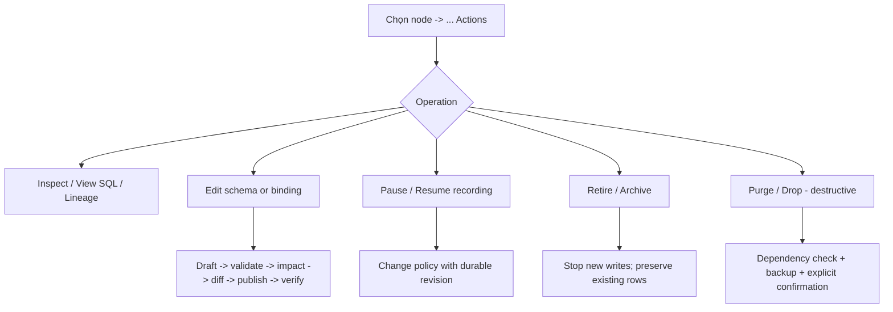

### Sửa ở đâu và bằng cách nào

**Backend:** bổ sung thật route `PATCH`/`POST edit` cho object được sở hữu và có version, nhưng không thực thi ngay khi người dùng gõ. Sửa các trường display metadata, retention, columns/tags/bindings bằng change-plan typed; phân biệt metadata-only update với online TDengine DDL, migration đòi downtime và thao tác không được TDengine hỗ trợ. Thay đổi phá hủy phải được reject có code, hoặc đề xuất safe rebuild (new object → backfill → verify → switch binding → retire old) theo edition/version thật. Dùng lifecycle `ACTIVE/PAUSED/RETIRED/PURGING/PURGED/ERROR` cho object và policy độc lập; không sử dụng flag “write_active=true” được dựng cứng. Đảm bảo writer **không tái tạo** table đã retire/purge từ cached catalog.

**Frontend:** dấu `...` chỉ hiển thị action hợp lệ cho loại node và quyền người dùng; drawer inspection khác editor; wizard có step và read-back, nhấn Cancel không được apply DDL; delete cảnh báo mất dữ liệu, danh sách dependent models/bindings/views, yêu cầu nhập tên object và re-auth nếu destructive. Sau publish, layout graph refresh node thật. **Gate:** verify mọi action qua network + SQL + TD metadata; 404/409/503/401; sửa đồng thời, keyboard back/forward, reload và undo draft.

## 7. FX-P0-06/07 — Source Picker trông có ba tab nhưng chưa truyền đúng source đến TDengine

### Vấn đề và hậu quả

User đã chốt **ba cách chọn nguồn**: Factory Hierarchy, Data Collector và Data Models. Backend `storage_bindings.py` trả `Resource → signals[]`, `Connection → signals[]`, `Model → fields[]`. Frontend Wizard lại mong mỗi item là một `SourceRef` độc lập (`id`, `kind`, `path`, `data_type`). Điều đó có thể khiến click lên Resource ID thay vì Signal ID, mất field path của model, hoặc nhập column binding với reference không hợp lệ. Song song, `create_td_subtable` chuyển tag values thành dict rồi gửi sang `StorageRevisionService`, nhưng validation/plan vẫn đưa `stable_tags=[]`. `bindings` và `row_assembly_policy/recording_mode` trong request không có đường persist đầy đủ để IngestionWorker nhận biết. Một subtable tồn tại về mặt DDL nhưng **không có dữ liệu chảy vào** là lỗi end-to-end.

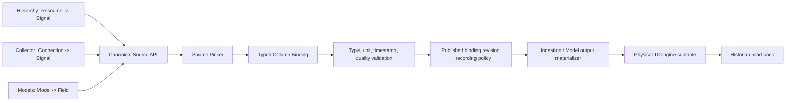

### Hợp đồng chuẩn phải định nghĩa trước khi sửa UI

Source identity **không phải chuỗi display name**. `signal` có canonical `(tenant_id, signal_id)` bất kể được tìm qua Hierarchy hay Collector. `model_field` có `(tenant_id, model_id, field_path, model_revision)` hoặc định danh trường bền tương đương. Mỗi source có `kind, canonical_id, data_type, unit, display_path, active_status, quality, freshness, provenance`; presentation tree được đặt bên ngoài `sources[]` chuẩn hóa. Backend có thể trả `groups`/`nodes` cho cây, nhưng leaves phải dùng một cấu trúc uniform. `selectedSources` là dictionary theo canonical ID, **không bị reset khi đổi tab hoặc search**. Type coercion phải deterministic, không dùng tên hiển thị hoặc ép kiểu tùy tiện để định danh source.

**Backend:** sửa `storage_bindings.py` thành source resolver dùng SQL tenant-scoped, phân biệt nhánh cây với leaves có thể chọn. Data Models phải enumerate cả field lồng nhau trong spec thật, không giả định mọi field là `spec['fields']`; pin version hoặc có quy tắc xử lý khi model revision thay đổi. Nguồn đã archive cần `UNRESOLVED`, không trỏ vào tên tương tự để “tự sửa”. `storage_revisions.py` phải load tag definitions thật từ parent STABLE, kiểm required, cardinality, thứ tự, kiểu và quote value, validate bindings, persist và publish vào đúng registry mà writer đọc.

**Writer:** nối binding revision đã publish vào `ingestion_worker.py` và `DefaultRecordingPolicyEvaluator`. Không tạo thêm writer song song không idempotent với writer cũ; cần migration adapter cho `storage_field_bindings` và `storage_physical_registry` hiện hữu. Model field phải nối tới model engine/snapshot/output materializer thật, không mặc định chúng được gửi qua RabbitMQ. **Gate:** một signal chọn qua Hierarchy và Collector phải ra cùng ID; model field có ID duy nhất; tạo binding và read-back sample từ TDengine; reload/Back/Search không mất selection.

## 8. FX-P0-06 — Row assembly khi một bảng có raw signal và calculated model field

Đây là yêu cầu khó và có thể trở thành nguyên nhân sai dữ liệu nếu chỉ “nhét nhiều field vào cùng một bảng”. Một nguồn Modbus cập nhật 1 giây, một output model 5 giây, một trạng thái máy cập nhật theo sự kiện. Ba timestamp không nhất thiết trùng nhau, quality của chúng cũng khác nhau. Nếu tự gán các field chưa cập nhật về zero hoặc lấy giá trị cuối vô hạn thời gian, một record trông đầy đủ nhưng mô tả một trạng thái chưa từng tồn tại. TDengine còn có quy tắc timestamp và row uniqueness: duplicate hoặc nhiều write cùng timestamp cần chính sách rõ ràng.

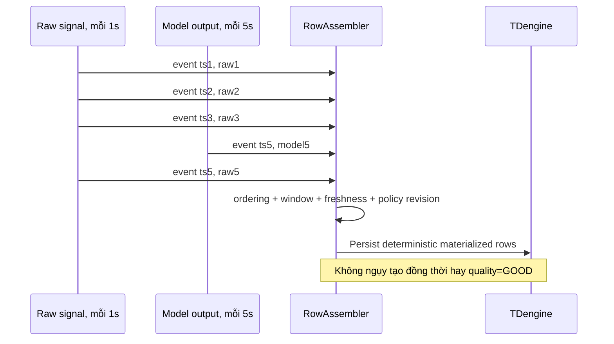

**Quy trình sửa:** dùng `row_assembly_policy` đã expose trên frontend làm contract thực thi, không chỉ metadata. Với `INDEPENDENT_EVENTS`, mỗi event được lưu riêng và các field khác là missing theo chính sách, không giả thành record đầy đủ. Với `LATEST_AS_OF_TRIGGER`, xác định trigger và cutoff `max_age`; mọi field lấy as-of phải lưu provenance/age/quality rõ ràng. Với `TIME_BUCKET`, xác định bucket alignment/timezone, aggregation, watermark, allowed lateness, xử lý update muộn và idempotent row. Với `EXACT_TIMESTAMP`, chỉ gộp những event cùng event time đã normalize theo precision công bố. **Nếu một mode chưa implemented, UI phải disable kèm giải thích và backend trả lỗi validation — không được cho publish một mode bị bỏ qua.**

Định danh ghi managed row phải deterministic theo `(tenant, data_epoch, physical_object_id, policy_version, trigger_event_uid hoặc bucket_key, source identity)`. Quy định timezone UTC, `event_time` và `acquired_at` tách biệt, tie-breaker trên `source_sequence/event_uid`, policy khi TDengine trùng primary timestamp. Quan sát lỗi thể hiện ở quality và missing marker, không biến thành zero. Test raw 1s + model 5s + status event, out-of-order, duplicate, delayed, BAD/UNCERTAIN, restart, reset, 2 writers và edit binding trong lúc đang ingest.

## 9. FX-P0-08/09 — Tenant isolation và PostgreSQL Explorer cần hàng rào thật

Trong `storage_api.py`, một số đường detail `get_database(name)`, `get_stable(db, name)`, `get_subtable(db, name)` nhận tên vật lý mà chưa chứng minh ownership từ tenant. Việc `list_databases(tenant_id)` có filter **không** bảo vệ một GET detail khác. Tenant A biết tên database của tenant B không được có khả năng xem schema, query dữ liệu, export hoặc thay đổi trạng thái của nó.

`postgres_explorer.py` hiện chặn preview rất ít bảng (`alembic_version`), che một số tên cột theo regex, dùng application DB session có quyền rộng và query `COUNT(*)`. Bảng `admin_accounts`, `sessions`, `secret_store`, password reset, JSON chứa credentials/OT endpoints hoặc dữ liệu của tenant khác có thể cần bảo vệ ở cấp bảng, row và column. “Nút chỉ xem” không phải là cơ chế authorization.

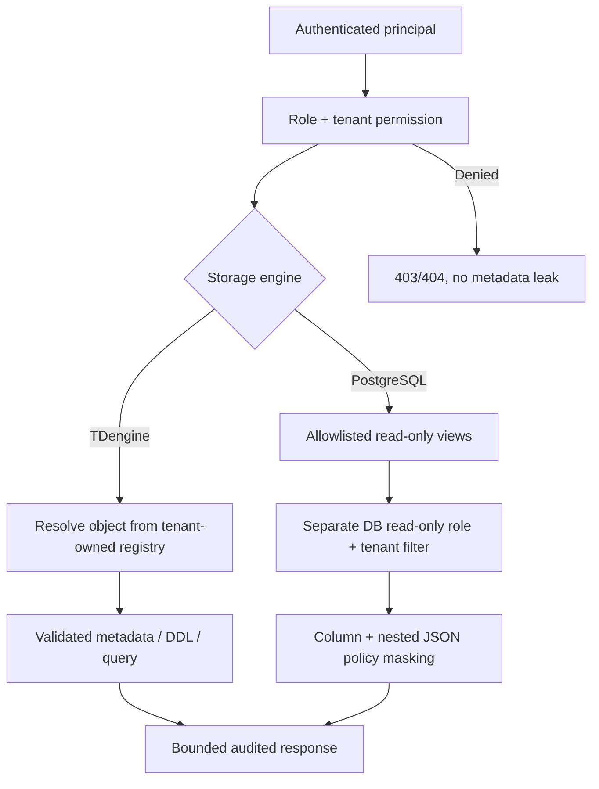

**Sửa:** tạo `StorageAuthorization` dùng xuyên suốt Storage/History/Exports, map `object_id` về tenant, database, STABLE, subtable trước mỗi thao tác. Nếu cho phép user đặt nhiều database names, phải có mapping ownership bền vững; không vừa cho tạo tên tự do vừa chỉ list `fx_t_<tenant_hex>`. Mọi identifier/cursor được validate, quote đúng TDengine; không interpolate cursor tùy ý. PostgreSQL Explorer dùng allowlisted metadata và *sanitized views* cho data preview với quyền SELECT cụ thể, role DB riêng không có DML/DDL. Chặn hẳn bảng bí mật ở server; tenant-scoped policies cho bảng có tenant_id; không preview trực tiếp bảng global nhạy cảm. Có timeout, giới hạn rows/bytes, phân trang ổn định; audit chỉ metadata thao tác, không ghi raw row. Negative tests phải cover cả API list, detail, graph, source picker, history và export.

## 10. FX-P0-10/11 — Revert To Zero có đường cũ phá hủy cấu hình; reset mới chưa đủ chứng cứ bảo toàn

`telemetry_reset.py` mới đã có `active_epoch`, `RESETTING`, xác nhận mật khẩu và các giai đoạn R0–R5. Đây là thiết kế đúng hướng: nếu broker/spool còn observation epoch cũ, chỉ xóa TDengine thôi là chưa đủ vì worker có thể ghi chúng trở lại. **Nhưng** `app.py` vẫn có `/api/v1/admin/revert-to-zero` cũ gọi `identity.revert_to_zero()`, và method đó dùng `TRUNCATE` các bảng PostgreSQL public trừ alembic. Nó có thể xóa trực tiếp admin, Factory Model, 336 Signals, 36 Models, 5 Connections và các cấu hình khác. Đây là P0 không được trì hoãn.

Reset mới hiện còn gọi DROP tenant subtables. Nếu một subtable người dùng tạo có tag values, binding, name và lifecycle riêng, giữ metadata trong PostgreSQL **không chứng minh** cấu trúc TDengine vật lý vẫn còn hoặc tái tạo tương đương. Mặt khác xóa rows của `export_jobs` không đồng nghĩa file CSV/export ngoài volume đã bị xóa. Chỉ so số dòng là chưa đủ: two configurations có số dòng giống hệt nhưng binding hoặc formula khác nhau.

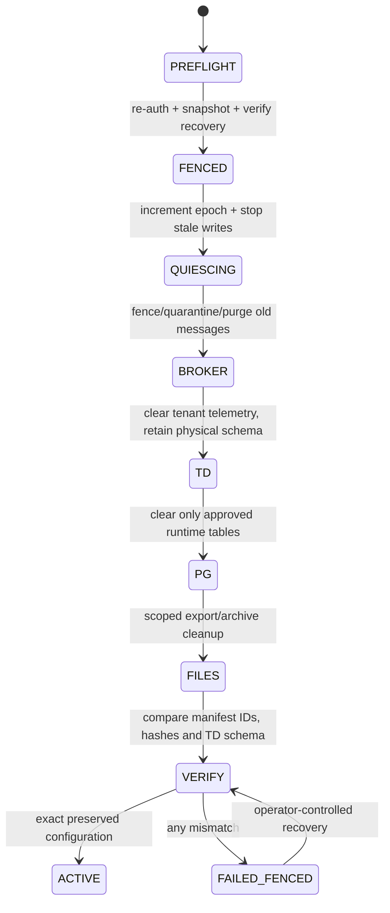

**Sửa ngay:** route `/api/v1/admin/revert-to-zero` phải bị remove hoặc trả 410; mọi frontend cũ, redirect, docs/script gọi route phải cập nhật. User action thống nhất là **Clear Telemetry**, có impact preview server thật, nhập cụm xác nhận và mật khẩu, không có fallback con số 5/336/36. Trong `telemetry_reset.py`, tạo manifest canonical theo sorted keys và băm nội dung sau khi loại secrets không phù hợp; so sánh IDs, field definitions, references, hashes của model expressions, signal bindings, published storage objects/revisions/tags/DDL và ownership. Cần phân loại `model_state` rõ ràng: cấu hình engine/scheduling được giữ, live calculated value/snapshots phải được reset như runtime data.

Thứ tự đúng: R0 backup+preflight+object inventory; R1 khóa tenant và tăng epoch; chờ Acquisition/Ingestion apply epoch; R2 purge/fence queue và spool với thống kê; R3 xóa giá trị telemetry mà **bảo toàn schema** và tag/binding, dùng kỹ thuật thay thế có đối soát nếu TDengine thiếu lệnh phù hợp; R4 dọn đúng runtime PG tables và scoped files; R5 xác minh manifest, làm mới cache, mở lại collection. Nếu giữa chừng fail, giữ `FAILED_FENCED`, không tùy tiện bật lại consumer. **Không chạy quá trình này trên dữ liệu local thật trong nhiệm vụ sửa code.** Chỉ test trên clone môi trường cô lập; sau reset test phải login được, cùng số lượng + cùng IDs/hash và TD schema, new epoch ingest được còn old epoch không thể replay.

## 11. FX-P0-12/13/14 — Config Docker, history default và sự thật về outage spool

Compose hiện đưa secret bằng biến/hardcode fallback; `entrypoint.sh` in DSN chứa mật khẩu; Dockerfile mặc định Edge nhưng Compose chọn Acquisition. `FACTORIX_RECORD_OPERATIONAL=false` ở Compose mâu thuẫn mục tiêu lưu TDengine ngay từ zero, phục vụ tín hiệu live, 15 phút trend, `value_at()` và Data Models. Không được tuyên bố “đã tối ưu CPU” bằng cách tắt khả năng ghi history. `AcquisitionSpool.enforce_cap()` đánh `DEAD` các pending rows cũ, còn `enforce_byte_cap()` có thể xóa `PENDING`. Khi RabbitMQ down lâu hơn spool chịu đựng được, đó là **mất dữ liệu do chính sách**, không thể gọi zero loss.

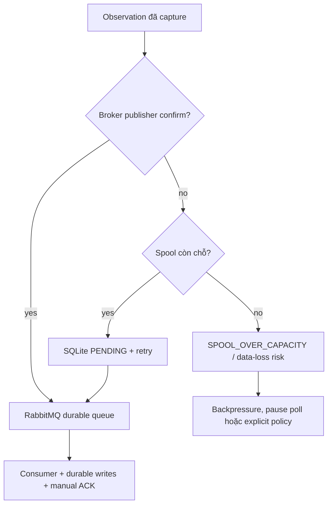

**Sửa:** không có production default credentials; secrets/env phải được xác nhận ngay startup, không log URL có username/password/query token; sample `.env.example` chỉ có placeholder vô hiệu để hướng dẫn. Đồng nhất `collector_mode=acquisition` trong Compose/Dockerfile/entrypoint; legacy edge để riêng migration compatibility và phải disabled mặc định. Dùng healthcheck readiness từng service và image version/digest rõ ràng; kiểm license TDengine Community/Enterprise trước phát hành thương mại. Cấu hình operational history cần đảm bảo default fidelity/retention, viết test trạng thái không đổi nhưng vẫn fresh và có lịch sử hợp lệ; nếu user tắt recording, phải hiểu rõ impact và không làm hỏng nav cũ.

Spool phải có explicit overflow policy. `PAUSE_SOURCE` phù hợp polling, với push chỉ backpressure được khi transport hỗ trợ. Nếu cho phép drop theo quyền user, phải lưu durable loss counter, range, reason, affected source và alert; không được báo ACK hoặc `GOOD` cho dữ liệu bị loại. Nếu policy strict durability thì fail closed khi full; nếu giao thức nguồn không hỗ trợ backpressure, phải cảnh báo đây là giới hạn vật lý và có cơ chế sizing/capacity plan. Đồng thời test replay fairness mới nhất/oldest, broker reject-publish, disk full, SQLite WAL restart, DLQ đầy và source burst. ACK consumer khác publisher confirm; cả hai chưa tạo ACID xuyên broker/TD/PG.

## 12. FX-P0-15 — Báo cáo nghiệm thu không có evidence độc lập

`docs/release/storage-rework-acceptance.md` đã tuyên bố `ACCEPTED FOR RELEASE`, `reports/test-results.json` chứa 264 cases được ghi PASS nhưng bản review ngày 13/11 xác định nhiều field `actual/evidence` giống nhau và SHA báo cáo không khớp commit hiện tại. `docs/release/acceptance-matrix.md` còn ghi ba nav `Designer/Catalog/Historian` dù `App.tsx` mới chỉ route hai nav. Cùng lúc `.github/workflows/ci.yml` có unit, build và integration nhưng không có chứng minh browser workflow từng thao tác. Những tài liệu này cần đánh dấu **SUPERSEDED / UNVERIFIED**, không được copy nguyên vào bản release.

**Sửa:** mỗi testcase một ID độc lập; runner lưu `code_sha`, `image_digest`, `test_started_at`, `test_finished_at`, `environment`, `actual_predicates`, `status`, `evidence sha256`, CLI command hoặc browser trace URI. Chỉ `PASS` nếu assertion thực chạy và evidence tồn tại; `SKIP` phải có lý do, còn test không chạy = `NOT_RUN`. E2E browser cần screenshots/video/network/console/trace từ Playwright trên Docker thật, không dựng bằng HTML hoặc PowerPoint. Không upload raw telemetry/connection secrets lên Git: logs sau redaction + hash/link tới CI artifacts kiểm toán được. Sau sửa phải công bố report mới liên kết đúng SHA.

---
# PHẦN III — CÁC LỖI HỆ QUẢ, HIỆU NĂNG VÀ HỢP ĐỒNG DỮ LIỆU

## 13. FX-P1-01/02/03 — Topology, object identity, số đếm và drift còn sai nền tảng

### Vì sao người dùng bị ảnh hưởng?

Một graph của hệ thống lưu trữ có mục đích đại diện cho **hiện trạng TDengine thật**. Nếu graph chỉ vẽ 50 subtables đầu tiên mỗi STABLE nhưng badge lại báo tổng số subtables bằng số node hiện lên, quản trị viên sẽ tưởng hệ thống nhỏ hơn thực tế. Nếu toàn bộ status được trả cố định `ACTIVE`, `write_active=true`, `drift_status=OK`, người dùng không thể biết schema chưa được materialize, binding đã lỗi hoặc recording bị pause. Nếu object ID một màn là `db:...` còn màn khác dùng `db/...` và chi tiết lại nhận `database.table`, click từ canvas sang drawer có thể 404; frontend càng dễ rơi vào fallback giả.

Trong `storage_topology.py`, `get_topology()` gọi `list_subtables(...limit=50)` cho từng STABLE, và `_compute_drift()` dựa vào pool PG tùy chọn. Nhưng `storage_api.py` tạo `StorageTopologyInspector(td)` không truyền pool. `_compute_drift()` hiện còn query tên bảng `storage_objects` không nằm trong migration `0008_storage_and_historian.py` đã được kiểm tra (migration ấy có `storage_physical_registry`). Do đó **drift rỗng không có nghĩa không drift**. `storage_api.py` còn trả PostgreSQL 16 cố định trong khi Compose dùng 17.

### Bản sửa bắt buộc

- Có **một canonical object ID**, ví dụ `db:<physical-db>`, `stable:<physical-db>.<stable>`, `subtable:<physical-db>.<subtable>` (có thể dùng UUID registry làm primary ID, song API phải công bố một chuẩn duy nhất). Cần parser/formatter shared; mọi route, graph node, drawer, Edit, Historian deep-link và audit dùng cùng định danh. Không dùng `startsWith('db/')` trên ID dạng `db:`.
- `GET topology` trả nodes phân trang/lazy expand; `GET stats` lấy tổng real aggregate từ TD metadata hoặc registry đã reconcile, **không đếm số node đang load**. Metadata count phải có `as_of`, `source`, `is_estimate` và trạng thái `unknown` khi engine down. Không default ACTIVE cho object chưa verify.
- `GET engines` query PostgreSQL `SHOW server_version`/`SELECT current_setting('server_version')`, TDengine version thật; kiểm `reachable` đúng với read-probe. Đừng hardcode PostgreSQL 16.
- Đổi drift thành pipeline desired-vs-actual có registry nhất quán. Kết quả phải trả `IN_SYNC`, `MISSING_PHYSICAL`, `UNREGISTERED_PHYSICAL`, `SCHEMA_MISMATCH`, `BINDING_MISMATCH`, `UNKNOWN/ENGINE_UNAVAILABLE`; query lỗi => UNKNOWN, **không** OK. Registry khớp migration; không query bảng tưởng tượng rồi trả `[]`.
- Chỉ enumerate tags/columns khi mở STABLE/detail hoặc cached metadata; tránh N+1 trên mọi lần render canvas. Implement cursor có escaping/validation; `next_cursor` chỉ khi thật có trang kế tiếp.

**Gate:** 0/1/49/50/51/501 subtables; 2+ tenant databases; object tên hợp lệ sát giới hạn độ dài; user-custom DB được hiển thị nếu thuộc tenant; remote down => UNKNOWN; các ID deep-link đều đọc được object tương ứng; drift mock bị bác bỏ bằng compare SQL thực.

## 14. FX-P1-05/06 — CPU cao không được sửa bằng cách giảm fidelity dữ liệu

Source cho thấy một số nơi có nguy cơ tạo overhead: IngestionWorker làm decode/validation/ownership/TD writes/formula eval/PG latest/NOTIFY trong cùng pipeline; default consumer concurrency 128 trong khi TDengine thread pool mặc định 4; metadata polling ở `AppContext.tsx` 10–30 giây và fallback live polling 1,5–2 giây; Historian gọi từng series tuần tự; `StorageTopologyInspector` làm DESCRIBE và tag lookup lặp; PostgreSQL Preview dùng `COUNT(*)`. **Đây là ứng viên bottleneck, chưa phải bằng chứng rằng chúng gây toàn bộ CPU hiện tại.**

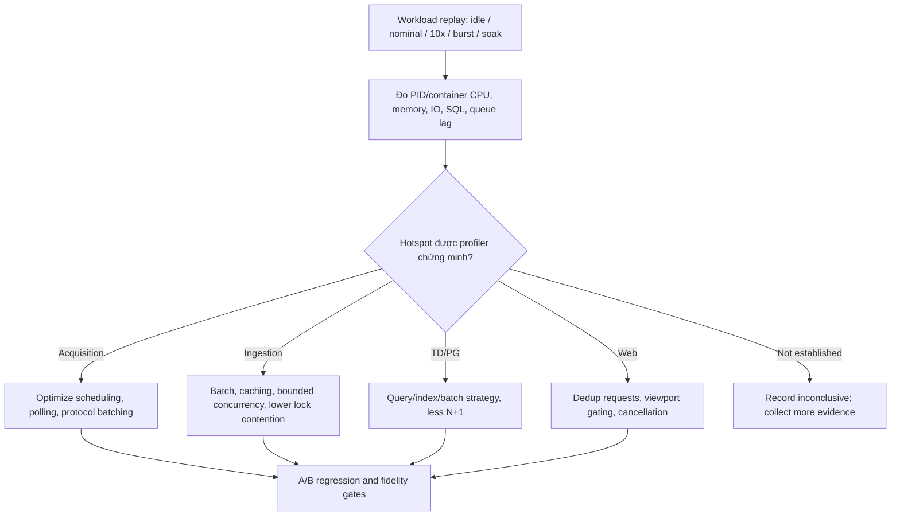

**Đề nghị kỹ thuật:** thêm OpenTelemetry-compatible spans hoặc structured correlation IDs `(tenant, connection, signal, observation event_uid, operation_id)` với sensitive fields redacted; đo capture→confirm, queue residence time, ingestion decode→TD, TD→PG, PG→UI p50/p95/p99; per-protocol poll actual interval/jitter; `pg_stat_statements` ở stack test; TD query duration; broker ready/unacked/oldest/DLQ/rejected; spool pending/bytes/drop. Chạy 3 repetitions và lấy median + confidence interval nếu đủ số mẫu, ghi hardware/CPU cores/Docker Desktop resources. Chỉ sau đó optimize `prefetch/concurrency`, pooling, query caching, component render/signal sparklines, batch Historian queries, throttle source selection, adaptive refresh khi tab hidden. Không che lỗi bằng `except`, không xóa historical writes để giảm CPU.

**Gate:** cùng nguồn generator có mối quan hệ vật lý/logic và timestamp deterministic nhưng chỉ tồn tại trong test isolation; sau tối ưu count/quality/ordering/lineage/latency không xấu đi vượt SLO đã chốt và được đo; CPU giảm cần có before/after CSV thực và command tái lập.

## 15. FX-P1-07/08 — Reliability, history semantics và tính đúng của thời gian

RabbitMQ manual ACK và TDengine batch write không tự tạo exactly-once. `TDEngineClient.write_operational_observations()` hiện xử lý va chạm timestamp microsecond trong một batch bằng tăng timestamp `+1µs` cho event khác UID. Cơ chế ấy cần kiểm thử kỹ **khi cùng hai event được chia vào hai batch hoặc phát lại sau reboot**; ID chỉ lưu ở row không bảo đảm primary-key uniqueness khi timestamp khác nhau. Chỉ cần một retry chệch cách chọn timestamp, biểu đồ có hai điểm hoặc một điểm ghi đè. Tương tự, in-memory `RecentUidLru` không thể là dedup bền vững qua restart. Phải test trên TDengine thật, sau đó đặt một quy tắc idempotency ổn định cho cả raw lẫn managed và model outputs. Nếu bài toán timestamp collision không thể giải quyết bằng một bảng vật lý hiện tại, phải điều chỉnh schema/row identity, không “nắn timestamp” ngẫu nhiên theo thứ tự batch.

Historian phải phân biệt **Recorded Events** (đúng dòng vật lý đã lưu) và **Reconstructed Timeline** (giá trị state được suy ra là kéo dài đến thời điểm kế tiếp). Ở reconstructed mode, giá trị tồn tại trước `from` chỉ làm seed nếu retention và quality hợp lệ; không tạo timestamp quan sát mới, không tự gán GOOD cho gap; biểu đồ có khoảng trống nếu source BAD/STALE/missing. Những data trễ/out-of-order phải truy vấn bằng event time và đi cùng `acquired_at/source_time` để người dùng có thể audit. Quality `GOOD`, `UNCERTAIN`, `BAD`, `STALE`, source health, broker health và storage health không được gộp thành một bool.

**File chính:** `ingestion_worker.py`, `platform/tdengine.py`, `domain/canonical.py`, `recording_policy.py`, `history_repository.py`, `historian_service.py`, `live_state.py`, `models_engine.py`, `transport/app.py`, `lib/liveStream.ts`, các components Trend/Inspector. **Test:** same event replay 100 lần across restart; event sequence reorder; timestamp collision across batches; source-time ngoài biên, future clock, DST/timezone; quality transition không đổi value; deadband và checkpoint; raw/model same subtable; page cursor; statistics chính xác cho null/gap; export CSV phản ánh đúng query.

## 16. UX bắt buộc: “đơn giản từng bước” chứ không phải xóa tính chuyên nghiệp

User cuối đã bỏ thiết kế Dataset-first và 3 subnav. Một màn hình Storage Management tốt phải bắt đầu bằng *đồ thị hiện trạng* hoặc *danh sách vật lý*, có nút Add rõ ràng, và chuyển sang màn wizard riêng khi tạo object. Không nhồi Designer, Catalog, DDL, YAML, Map, Preview, Performance, Retention và Publish vào một trang cùng lúc. Người dùng có kiến thức về database, nên phải thấy tên đối tượng vật lý TDengine thật, nhưng mỗi bước chỉ yêu cầu nhóm lựa chọn phù hợp. Các hành động cần thuận tiện như Connection Wizard/Data Models: Back, Next, Save Draft, Cancel, Review, Publish và explainable errors.

**Giao diện chi tiết đề xuất (phải triển khai và nghiệm thu):**

- **Storage Management landing:** breadcrumb `Historian & Storage / Storage Management`; engine switcher `TDengine | PostgreSQL` (TD mặc định); header có connection/health/last verified; action `+ Create` hiển thị `Database`, `Supertable`, `Subtable`; vùng graph React Flow chiếm diện tích chính (pan/zoom/fit/minimap/search/lazy load); nút chuyển `Topology | Objects`; legend cho physical edges và lineage edges; chọn node mở inspector bên phải; chỉ click `...` mới mở menu nghiệp vụ, không auto-edit.
- **TD Database inspector:** physical name, display alias, precision, retention, vgroups/replica nếu hỗ trợ, status observed, actual DB size/count nếu engine trả được, số STABLE/subtables đúng, ownership, lineage, actions và audit; nếu stat không hỗ trợ, hiển thị `Unavailable`, không số mặc định. `Create Database` Wizard có Identity → Engine Settings → Impact/Review → Apply progress/read-back.
- **Supertable wizard:** chọn parent DB thật → Identity → Columns (timestamp đầu tiên, typed values, nullable, length) → Tags (definition, ordered, size/type limitations) → Optional mapping template (chỉ khi được hỗ trợ) → Review DDL + impact → Publish. Cho phép thêm/xóa/cập nhật cột trong draft bằng table editor đơn giản; không execute DDL lúc gõ; giải thích STABLE là schema khuôn, chưa tự tạo data rows.
- **Subtable wizard:** chọn STABLE thật → Identity → Tag values → Bind source/columns (3 tabs hierarchy/collector/models) → Row Assembly + Recording Policy + quality/missing/age policy → Review DDL, bind revision và expected sample effect → Publish. Sau khi tạo phải hiển thị “waiting for first real observation”, không fake sample. Cho phép test binding bằng observation thực hiện tại, không tự sinh mô phỏng ở production.
- **Edit Wizard:** mở từ `...`; hiển thị actual revision, draft diff, impact, protected dependencies, review and publish; unsupported physical change phải gợi ý safe migration hoặc bị từ chối giải thích; conflict có nút Reload/Diff, không overwrite im lặng.
- **PostgreSQL tab:** header `READ ONLY` với mô tả; schema/table sidebar; ERD React Flow có FK thật và nút fit; table detail với columns/PK/FK/indexes; paginated masked Data Preview; search, copy tên cột, export schema metadata nếu quyền cho phép; không có Create/Edit/Drop/Run SQL arbitrary.
- **Historian:** nguồn bên trái chọn theo Signals/Models/Physical Tables, vùng chính trend + records + events có switch, time range rõ UTC/local, quality overlay, recorded/reconstructed mode; panel Inspector cho point thật có event time/acquired time/source time/quality/reason/epoch/provenance; Saved Views và Exports; zero data thì Empty, lỗi database thì Error, stale thì badge rõ timestamp. Không dùng tên field giả để làm chart.

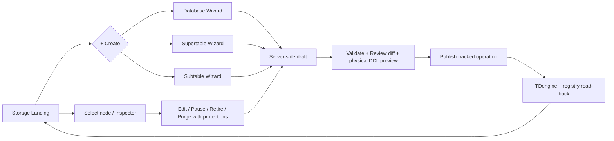

**UX test gate:** mọi input có label, default giải thích được, keyboard support, screen readers, responsive khi viewport nhỏ, zero state lần đầu, back/forward reload/draft recovery, bước nào lỗi thì focus tới field đó, nút Publish disabled khi validate chưa PASS. Chỉ UI chính thống nhất hai nav; các route cũ phải redirect có chủ đích và preserve query parameters nếu có deep links thực tế.

---
# PHẦN IV — LỆNH THỰC THI END-TO-END: SỬA GÌ, Ở ĐÂU, THEO THỨ TỰ NÀO

## 17. Trình tự bắt buộc: không được bỏ qua gate

Không thực hiện toàn bộ trong một mega-commit. Không thay UI trước khi chốt backend contracts; không sửa database khi chưa có backup/restore proof; không xóa legacy trước khi dependency audit. Mỗi phase phải có `phase-xx.md` dưới evidence và status `NOT_STARTED/IN_PROGRESS/BLOCKED/VERIFIED`, kèm link commits/tests. `BLOCKED` là kết quả hợp lệ khi phát hiện thiếu chứng cứ; không được tự hạ tiêu chuẩn để có màu xanh.

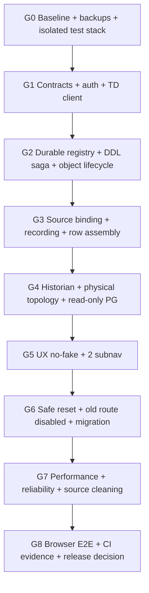

### PHASE 00 — Freeze baseline và bảo vệ local data trước mọi thay đổi (P0)

**Lý do:** lỗi tệ nhất không phải code mới không chạy; lỗi tệ nhất là Codex xóa hoặc migrate hỏng hệ thống local đã có cấu hình thật. Chỉ backup không đủ nếu chưa restore-test. Do đó, agent phải xác minh local là environment nào, volume nào, database host nào và có dữ liệu nào. Không chạy lệnh `docker compose down -v` để “khởi động sạch”.

**Tệp thao tác:** `docker-compose.yml`, `docker-compose.test.yml`, `.env.example`, `run-appliance.ps1`, `infrastructure/docker/backup.sh`, `docs/operations/backup-restore.md`, `docs/baseline/manifest.md`; tạo thêm `docs/operations/preserve-local-data.md` và scripts read-only dưới `tools/release/` nếu cần.

**Việc phải làm:**

1. `git status --porcelain=v1`; ghi `git rev-parse HEAD`; `git branch --show-current`; `git ls-files`; tạo manifest source SHA và baseline contracts. **Không được checkout/reset làm mất uncommitted work**. Nếu dirty, dừng và lưu danh sách; chỉ tiếp tục sau khi backup source được xác nhận.
2. Xác định chính xác Compose project name, container names, volume names, mountpoints, đường dẫn `.env` và các external DB DSNs theo môi trường. Chỉ ghi **redacted** endpoint names vào report, không ghi secret/password/IP OT đầy đủ.
3. Chạy các read-only queries thống kê tenant, resource, connection, signal, model và Storage Objects; ghi IDs sorted+hash (HMAC keyed với secret chỉ giữ local khi cần chống đoán IDs), config revision và schema metadata. Đếm không được dùng hardcoded `36/336/5` làm đầu vào verdict: phải *đọc từ DB thật* rồi đối chiếu baseline mà owner xác nhận.
4. Sao lưu PostgreSQL nhất quán bằng `pg_dump` custom format hoặc cơ chế tương đương đã được xác nhận; sao lưu TDengine bằng `taosdump`/công cụ được version đó hỗ trợ; sao lưu SQLite spool/outbox bằng API backup/consistent checkpoint, export/archive manifests và secret key riêng. Không commit các bản backup lên Git. Backup phải mã hóa, access restricted và có checksum.
5. Dựng một test stack hoàn toàn khác `compose -p`, project volumes, ports, network, credentials; không kết nối thiết bị OT production, không dùng hostnames/IP nguồn thật, không mount volumes production. Restore bản backup vào môi trường riêng **chỉ khi được owner cho phép dùng bản sao có dữ liệu**, đồng thời kiểm soát data privacy. Nếu không, dùng dataset tự sinh trong test để chứng minh cơ chế reset, và so manifest live bằng read-only.
6. Test restore cấu hình + TD schema + secrets availability trong bản sao; chứng minh có thể rollback. Chưa restore-test xong thì gate backup chưa đạt.

**Đầu ra:** `baseline-source.json`, `baseline-redacted-config-manifest.json`, `backup-manifest.sha256`, `restore-verification.json`, `environment-isolation.json`, `phase-00.md`. Các file đưa Git là **metadata đã redacted**, không phải dump/dataset/số đo của nhà máy. **PASS** chỉ khi owner xác nhận backup độc lập và test stack không chạm local volumes.

### PHASE 01 — Inventory routes, dependencies, imports, test claims và owner của dữ liệu

**Lý do:** repository đang đồng thời có code Edge Sync, Acquisition, Storage Designer/Catalog thế hệ cũ và Storage Management thế hệ mới. Xóa bằng mắt thường có thể làm hỏng bất kỳ deep link hoặc API nội bộ nào. Cần lập graph sử dụng trước khi xóa.

**Tệp cần đọc:** `apps/web/src/App.tsx`, `components/shell/Sidebar.tsx`, `lib/storageApi.ts`, `lib/storagePhysicalApi.ts`, `apps/center/src/factorix/transport/app.py`, `transport/storage_api.py`, `modules/edge_sync.py`, `modules/telemetry.py`, `modules/storage_designs.py`, `modules/storage_dsl.py`, `modules/storage_compiler.py`, `modules/models_engine.py`, `modules/ingestion_worker.py`, `apps/edge/`, migrations, `README.md`, all tests/docs.

**Thực hiện:** dựng danh sách các route frontend được truy cập, REST endpoints thực khai báo, class/service đang import, bảng PG được đọc/ghi, TD STABLE/subtables đang ghi, message queues và consumers. Gắn nhãn `ACTIVE_RUNTIME`, `MIGRATION_COMPAT`, `TEST_ONLY`, `DEAD_CODE_CANDIDATE`, `DESTRUCTIVE_LEGACY`, `UNKNOWN`. Chỉ `DEAD_CODE_CANDIDATE` có bằng chứng zero import/zero router/zero deployment mới được xem xét xóa sau regression. Xác định rõ mã do ai sở hữu contract; không có hai writer cùng tự nhận source of truth.

**Đầu ra:** `dependency-map.md`, `api-inventory.json`, `pg-table-ownership.md`, `tdengine-object-ownership.md`, `legacy-candidates.md`. Tất cả `UNKNOWN` phải có action xác minh, không tự chuyển thành unused.

### PHASE 02 — Viết shared contracts và state machines, test trước khi sửa implementation

**Lý do:** UI và API không được tiếp tục định nghĩa `StorageOperation` khác nhau. Không vá từng component theo cảm tính. Đây là nơi đóng băng wire schema của object ID, operation, sources, errors, timestamps và statuses.

**Tệp:** tạo `docs/contracts/storage-v1.md`, `docs/contracts/telemetry-v1.md` hoặc OpenAPI schema được sinh/validated; sửa `transport/storage_api.py`, Pydantic schemas ở module thích hợp, `apps/web/src/lib/storagePhysicalApi.ts` (có thể generate TypeScript từ OpenAPI), `apps/web/src/types/`; kiểm các consumers trong wizard/inspector/historian.

**Contract cần chốt cụ thể:**

| Contract | Đầu vào | Đầu ra / invariant |
|---|---|---|
| `StorageObjectRef` | canonical ID, tenant context | `id, kind, physical_db, parent_id, physical_name, registry_revision, observed_at, drift_status` |
| `StorageOperation` | `intent, idempotency_key, expected_revision` | `operation_id, status, spec_hash, step_errors, verification, links` |
| `SourceReference` | 3 perspectives | canonical leaf ID, kind, type, unit, path, model revision, actual live status |
| `StorageBinding` | `source_ref, destination_column, transform, policy, assembly` | durable binding revision, validation, materialization target |
| `HistorianQuery` | source IDs, time range, aggregation, time mode | values, quality, provenance, actual count, pagination, no simulated fill |
| `ErrorResponse` | typed exception | HTTP status, code, message, retryable, correlation_id, field/path details |
| `EngineHealth` | health probes | version/edition, reachable, observed_at, capabilities, errors (never hardcode green) |

**Contract tests:** OpenAPI snapshot diff reviewed, TS compile, Pydantic validation, negative payloads, pagination, timezone, 409 concurrency, 403 ownership; example requests trong docs phải được ghi rõ là *schema examples*, không là real evidence. Chỉ sau phase này mới được đổi api client.

### PHASE 03 — Sửa TDengine adapter và integration với metadata thật (FX-P0-02)

**Tệp:** `platform/tdengine.py`, `modules/storage_topology.py`, `modules/storage_revisions.py`, `transport/storage_api.py`, `apps/center/tests/unit/test_storage_physical_backend.py`, `apps/center/tests/integration/tdengine/`.

**Triển khai chi tiết:** thay `run_read` bằng `query_rows`, `run_write` bằng `execute_sql`, cập nhật mọi kiểu rows dictionary. Viết `metadata_query` helpers có column alias explicit: query DBs, STABLEs, subtables, DESCRIBE, tags, server version, capabilities. Mỗi helper có timeout, cancellation/retry policy và typed error; không swallow exceptions thành empty. Test actual TDengine 3.4.3.9 như Compose và xác minh binary/SDK phiên bản đang pin; nếu CI vẫn chạy 3.3.6.13, phải có compatibility matrix/thay test image hoặc hai matrix versions có lý do. Validate dialect và query schemas từ database thực trước khi đổi SQL. Không phụ thuộc version giả.

**Gate:** `GET /storage/engines` không trả reachable=true khi TD down; thao tác create/inspect trên DB thật pass; response fields match TypeScript; ngay cả khi network reset không trả `[]` giả.

### PHASE 04 — Tạo Registry/Revision/Operation bền vững, migration zero-loss (FX-P0-03/04)

**Tệp:** migration mới sau `apps/center/migrations/versions/0008_storage_and_historian.py`, `modules/storage_revisions.py`, `modules/storage_topology.py`, `modules/storage_designs.py`, `modules/storage_bindings.py`, `transport/storage_api.py`.

**Cách làm:** trước migration vẽ mapping bảng cũ `storage_designs`, `storage_design_versions`, `storage_datasets`, `storage_field_bindings`, `storage_physical_registry`, `storage_operations` và mọi FK. Chỉ thêm bảng/column/index bằng safe migration, backfill IDs và revisions trong transaction; validate counts/hash + no-drift trên bản sao. Không drop bảng legacy trong cùng release nếu chưa chứng minh mọi reader/writer chuyển xong. Viết service CRUD draft trong PG, uniqueness, optimistic locks, object lifecycle, typed DDL plan và persist status per step. Trigger `publish` giữ idempotency key, object lock, schema fingerprint; verify metadata sau DDL và commit verified state; ambiguity đưa `RECOVERING`, không gọi `APPLIED`. Boot/restart phải có recovery worker đọc pending operations và reconcile actual TD state.

**Gate:** migration up trên empty PG và copy PG, restart giữa DDL, write/read parity, migration rerun idempotent, `alembic upgrade head` không cần reset schema local; rollback procedure có backup chứng minh, không fake downgrade destructive.

### PHASE 05 — Complete Create Database, STABLE, Subtable bằng actual DDL

**Tệp:** `storage_objects.py` (validators/DDL), `storage_revisions.py`, `storage_api.py`, `platform/tdengine.py`, `modules/storage_topology.py`, `CreateStorageObjectWizard.tsx`, `DatabaseWizardSteps.tsx`, `StableWizardSteps.tsx`, `SubtableWizardSteps.tsx`.

**Luồng:**

1. Create DB intent server kiểm physical name, retention, precision, vgroups/replica/capability, tenant ownership; plan `CREATE DATABASE` đúng dialect TD version. Publish -> operation progress -> read-back thuộc tenant.
2. Create STABLE phải lựa chọn existing DB authorized, validate first timestamp column, column type/length/null, tag definitions/type/order, max lengths, name collision, schema compatibility; compile deterministic SQL; create -> inspect `DESCRIBE` -> verify all columns and tags.
3. Create Subtable phải lựa parent STABLE có thật, fetch tag schema từ TD, normalize tag values đúng thứ tự, không dùng `stable_tags=[]`; validate source bindings+policy; perform `CREATE TABLE ... USING ... TAGS` (hoặc cú pháp được version chứng minh), verify materialized subtable/tag values, persist binding revision and enable write atomically theo state machine. Nếu publish physical success nhưng binding fail, object phải ở `RECONCILE_REQUIRED`/paused, không tuyên bố Active.
4. Khi chưa có observation từ nguồn, UI phải hiện `Waiting for real data`; không có bản ghi demo hoặc `quality=GOOD` mặc định. Sau khi nguồn thật gửi sample, đối chiếu count/UID/time/quality trong TD.

**Gate:** 3 happy paths, duplicate name, invalid TD types, tag mismatch, source missing, tenant mismatch, network failure, duplicate submit, operation progress, refresh after reload.

### PHASE 06 — Full lifecycle Edit, Pause, Resume, Retire, Purge

**Tệp:** `EditStorageObjectWizard.tsx`, `StorageObjectDrawer.tsx`, `StorageObjectDetailPage.tsx`, `storage_api.py`, `storage_revisions.py`, `storage_objects.py`, registry migration, `ingestion_worker.py`.

**Thực thi:** thêm API thật cho editing với expected revision và idempotency; chọn patch semantics theo loại change. Metadata-only update không chạy DDL; add compatible column/tag được plan theo version; breaking schema/reparent/tag change yêu cầu safe migration hoặc refuse; binding change có effective revision và switching barrier, không edit live dict. Pause ngừng managed writes có check liveness không đổi, Resume khôi phục, Retire chặn future binding, Purge yêu cầu dependency scan, backup, re-auth và exact confirmation. Sau drop phải thử gửi observation cũ chứng minh writer không tái tạo object; `storage_physical_registry`/revision phải được cập nhật cùng status. Cleanup data phải tenant-scoped.

**Gate:** network request PATCH thực nhận 2xx operation hoặc 409/422; không 405; backend SQL read-back; lifecycle consistency, auth, restart, dependent Historian saved view, recording policy, model reference.

### PHASE 07 — Canonical Source Picker cho 3 tab + server-side validation

**Tệp:** `storage_bindings.py`, `storage_api.py`, `StableWizardSteps.tsx`, `SubtableWizardSteps.tsx`, `lib/storagePhysicalApi.ts`, `models_engine.py`, `data_models.py`, `resources.py`, `collect.py` khi cần contract mapping.

**Cách triển khai:** chọn một response chuẩn `source_groups` + `leaves`; từng leaf có canonical ID, source kind, status, data type, unit, path và field revision. `Hierarchy`, `Collector`, `Models` chỉ thay cách nhóm/filter; chọn signal qua hai tab phải ra một ID. Giữ selection bền ở draft server qua navigation/search, không hardcode `resource_id` thay `signal_id`. Search server theo scoped resource/connection/model, không return quá nhiều do cap; pagination rõ. Type/unit/quality/nullable checks ở backend và preview mapping. Model output field phải tồn tại trong model spec hiện hành và revision được cố định; nested path parser chuẩn. Cập nhật UI hiển thị 3 view theo cây trực quan, selected summary luôn thấy, drag-drop + click đều cùng contract.

**Gate:** tìm cùng signal bằng hai tab; mix signal+model fields; duplicate selection; model paused/archived/changed revision; field missing; nullable/type mismatch; cancel/reload; selection persisted; tenant A không thấy tenant B.

### PHASE 08 — Recording, source liveness, change-only semantics, operational default

**Tệp:** `recording_policy.py`, `ingestion_worker.py`, `live_state.py`, `history_repository.py`, `platform/settings.py`, `docker-compose.yml`, `modules/telemetry.py`, test parity.

**Thực thi:** quyết định operational retention và policy `ON_CHANGE`, `EVERY_ACQUISITION`, `INTERVAL`, deadband/checkpoint/quality transition. `ON_CHANGE` không được làm mất `last_acquired_at` khi value không đổi; startup hydrate from TD + PG policy phải cho biết last-good, last-changed, last-acquired và staleness. Data Model value-at từ history phải hoạt động khi sparse; Chart 15m phải tương thích. Trong PG giữ control-plane và optional materialized latest projections nếu cần để giữ latency/UX, nhưng không coi PG là durable historian thay cho TD. Không tạo no-data => 0.

**Gate:** signal giá trị cố định 1 giờ nhưng được poll mỗi 1s không được STALE; khi ngắt nguồn thì STALE theo expected interval; thay quality GOOD→BAD→GOOD có checkpoint; reboot reload current; 15m sparkline/Model `value_at` match benchmark; retention hiện có được bảo toàn/migrate, không đột ngột xóa.

### PHASE 09 — Managed materializer và row assembly thực, hỗ trợ mixed sources

**Tệp:** `storage_bindings.py`, `recording_policy.py`, `ingestion_worker.py`, `models_engine.py`, `history_repository.py`, `platform/tdengine.py`, migration registry, `SubtableWizardSteps.tsx`.

**Thực hiện:** xây compiler binding→physical write plan có validate; cùng một source→column mapping phải được writer dùng khi message commit. Managed writes đi cùng epoch, revision, policy decision và deterministic UID. Model output chưa có ở time nguồn raw phải được materialize theo scheduler lifecycle thật, không tưởng tượng từ cùng một message RabbitMQ. Áp dụng row assembly modes ở mục 8 với explicit unsupported blocking, `max_age`, watermark, duplicate/reorder handling, sparse fields. Trước read-back, kiểm actual TD tags và schema fingerprint; khi mismatch phải quarantine/paused operation và cảnh báo. Không bỏ qua binding chỉ vì managed write lỗi mà vẫn báo tất cả Active.

**Gate:** 1 source→1 column, many sources→one subtable, raw+model two rates, NULL/missing, late/out-of-order, reset epoch, pause/resume, replay, policy revision and edit change, ID deterministic.

### PHASE 10 — Historian API và UI tin cậy theo data thực

**Tệp:** `historian_service.py`, `history_repository.py`, `transport/storage_api.py`, `apps/web/src/pages/historian/HistorianExplorerPage.tsx`, `lib/storagePhysicalApi.ts`, `lib/storageApi.ts`, chart components, exports workers.

**Thực hiện:** tách query `recorded` vs `reconstructed` rõ semantic; query bound time UTC, async cancellation, pagination, filters, aggregate min/max/avg/last/quality/gap; hỗ trợ nguồn Signal, Model Field và physical table binding đã verify; không hiểu một table không có binding là historian source giả. Value inspector trả source_time/acquired_at/event_time, epoch, quality/reason/origin. Export streaming/paginated có CSV injection escaping và file lifecycle; saved views tenant-scoped; job canceled phải không để file orphan. Chuyển loại đồ thị/event timeline theo type, không ép string/bool thành numeric. Khi query error hiện Error, empty có nguyên nhân; user-selected source vẫn tồn tại sau reload.

**Gate:** so query CSV, chart và SQL cùng thời gian/series; quality BAD/gap; 0 rows; large time range; duplicate source; mixed model fields; timezone; cancel/retry/export expiration; access denied.

---
### PHASE 11 — TDengine graph, real stats và drift

**Tệp:** `storage_topology.py`, `storage_api.py`, `StorageManagementPage.tsx`, `StorageObjectGraph.tsx`, `StorageObjectsTable.tsx`, `StorageHealthStrip.tsx`, `StorageObjectDrawer.tsx`.

**Thực thi:** mô hình cây containment không dùng FK; graph position layout ổn định giữa refresh, pan/zoom/fit/minimap, lazy expand per STABLE. API hỗ trợ `depth`, `cursor`, filter, `observed_at`, actual counts independent of paging. Object detail dùng ID chuẩn, mapping thuộc registry. Có filter `Physical | Source Lineage` với cạnh khác kiểu (`CONTAINS`, `INHERITS_SCHEMA`, `BINDS_SOURCE`), legend và click inspector. Health phải phân biệt broker/TD/PG/ingestion; một nguồn down không xóa graph metadata cached nhưng cache phải hiện STALE. Drift query registry thật, operator có trang `Reconcile` riêng chỉ sau preview.

**Gate:** canvas hiển thị 51+ child không sai tổng; DB user-created thuộc tenant không bị ẩn; selected node detail đúng, graph không sinh fallback; mismatch actual-vs-desired được bắt; schema changed ngoài app được báo drift (không tự sửa phá hủy).

### PHASE 12 — PostgreSQL Explorer chỉ xem, chính xác và tối ưu

**Tệp:** `postgres_explorer.py`, `storage_api.py`, `PostgresExplorerView.tsx`, migrations/grants/deployment docs.

**Thực thi:** role DB riêng, allowlisted schemas/views, tenant-scoped preview, cấm base secret tables; `pg_constraint` lấy FK thật, phân biệt inferred edges bằng style riêng và không gán constraint_name giả. Sử dụng React Flow canvas như Knowledge Graph, nhưng node là relational table và cạnh là FK. Metadata/index introspection không trỏ quyền rộng; preview limit 20–100 và max bytes, stable `ORDER BY` PK, no raw count trên bảng lớn, estimated count có flag. Query timeout, cancel, rate-limit; redaction nested JSON; SQL injection/cursor tests. UI không có Create/Edit/Delete.

**Gate:** kiểm database role thực sự không UPDATE được (test bằng transaction rollback trong stack ephemeral), không preview `admin_accounts`, `secret_store`, `sessions`, `password_reset_codes`; tenant isolation negative tests; bảng lớn dưới resource budget; 503 không hiển thị fake ERD.

### PHASE 13 — Clear Telemetry R0–R5 và loại route phá hủy cũ

**Tệp:** `telemetry_reset.py`, `identity.py`, `transport/app.py`, frontend modal/actions, docs reset, tests reset; kiểm `telemetry_migrator.py` và storage exports.

**Thực thi:** tắt route cũ, báo kiểm tra backup, preflight manifest, exact unlock/tenant lock, epoch barrier ở Acquisition+Ingestion+broker; cleanup dữ liệu runtime TD/PG/file theo allowlist, **preserve physical schema/definitions/tags, account và bindings**. Trong reset, UI hiển thị stage, progress from server, failed-fenced state; không tự xóa draft; operation resume deterministic. Export/orphan cleanup phải dùng path ownership + canonicalization để tránh xóa file ngoài tenant. Secrets phải giữ nguyên và dùng được sau reset. Cache invalidate trên API/worker tránh last values cũ.

**Gate:** test clone có đúng đầy đủ loại object, trước/sau hashes/IDs như nhau, empty-only dữ liệu phát sinh, backend/v1 UI vẫn login được, old messages fenced, new epoch data được ghi. Runbook phải ghi rõ local protected, không có lệnh destructive auto-run.

### PHASE 14 — Broker/Acquisition/Worker resilience và saturation

**Tệp:** `platform/broker.py`, `acquisition/publisher.py`, `acquisition/spool.py`, `acquisition/runtime.py`, `acquisition/config_provider.py`, `ingestion_worker.py`, `.env.example`, tests integration.

**Thực thi:** giữ Quorum Queue với publisher confirms + mandatory delivery guarantee, manual ACK, bounded consumer concurrency, classified NACK and DLQ. Cấu hình health inspector và alerts: publish reject, publisher confirm timeout, spool bytes/pending/drop, DLQ count, queue oldest age, TD write p99, PG commit failure. Chặn double-poll bằng advisory lock và test active/standby; config snapshot LKG không được leak secrets vào file; epoch/secret rotation invalidate appropriate caches. Tránh backpressure làm crash hot loop; rõ chính sách khi source protocol không hỗ trợ dừng gửi. Count của `captured` không thể suy ra từ `published`, phải đo riêng. Bất kỳ dropped sample phải có explicit reason và loss accounting, không hóa thành một ACK.

**Gate:** kill -9 / restart ở mọi bước, broker disk/memory alarm, TD down 20 phút trong test, PG down, network partition, out-of-order, queue overflow, spool overflow, corrupted spool row, redeliver, poison, active/standby race; không âm thầm chấp nhận mất dữ liệu.

### PHASE 15 — Container security, bootstrap zero, backups và shutdown

**Tệp:** `Dockerfile`, `docker-compose.yml`, `docker-compose.test.yml`, `.dockerignore`, `.gitignore`, `.env.example`, `.env.test.example`, `infrastructure/docker/entrypoint.sh`, `bootstrap_db.py`, `backup.sh`, `run-appliance.ps1`, README.

**Thực thi:** clean image chỉ chứa app runtime cần thiết, không copy `tests/`, `.git/`, `.env`, reports, screenshots, fixtures. Có startup preflight cho secret chưa cấu hình, DSN invalid, migration version drift; không khởi động Edge mode ngoài ý muốn. Healthchecks liveness/readiness cho API/Acquisition/Ingestion/RMQ/TD/PG; graceful shutdown drain consumer + spool; không xoá volumes khi restart. Chỉ publish các ports cần thiết (loopback for DB/RMQ/TD nếu không dùng remote); compose zero có named volumes mới, không mount máy tác giả. Product bootstrap nên lần đầu mở `/register` hay setup hợp lệ và **không tự tạo 5 connections/336 signals/36 models**. CLI backup/restore được test và tách nhiệm vụ preservation khỏi reset.

**Gate:** clean git checkout zero+new volumes có đúng 0 user data, auth bootstrap mới, tạo 1 connection mới bằng UI, tiếp nhận sample từ isolated test source, xem history thật; no defaults/secret leaks; image SBOM/trivy hoặc tương đương pass policy; SIGTERM drains no corruption.

### PHASE 16 — Bảo toàn 5 navigation cũ và public API compatibility

**Tệp:** `OverviewPage.tsx`, `FactoryStructurePage.tsx`, `KnowledgeGraphPage.tsx`, `ConnectionsPage.tsx`, `AddDataWizardPage.tsx`, `SignalsCatalogPage.tsx`, `DataModelsPage.tsx`, `AppContext.tsx`, `transport/app.py`, `modules/collect.py`, `modules/resources.py`, `modules/data_models.py`, `modules/models_engine.py`, legacy routes.

**Thực thi:** capture golden workflows/typed contracts trước patch, replay với cấu hình và workload equivalent sau patch. Overview và Signals phải phản ánh freshness đúng; Factory Structure và Knowledge Graph không mất node/relations; Data Collector add/edit/pause/resume/test/bulk signals giữ hành vi; model create/edit/validate/preview/duplicate/pause/resume giữ rule evaluation và snapshots; 15m sparkline/history value_at parity; Coming Soon routes không bất ngờ hiện placeholder khác. Nếu cần đổi implementation backend thì ghi ADR và proving tests, không tự gọi là “same UX” khi outputs khác.

**Gate:** `docs/testing/golden-contracts.md` cập nhật assertions từ source thực; browser tests trước/sau; no unintended route loss; 36 models/336 signals local chỉ để đọc baseline, không bắt owner nhập lại.

### PHASE 17 — Profile/tune CPU và RAM dựa trên benchmark đúng

**Tệp:** `docs/operations/cpu-profiling-runbook.md`, `docs/benchmark/report.md`, `apps/center/modules/ingestion_worker.py`, `modules/models_engine.py`, `modules/storage_topology.py`, frontend AppContext & Historian; config performance.

**Thực thi:** kiểm một workload chuẩn có 5 protocols, mixed source 1s/5s/event, source metadata varying, quality transitions, 3 mức tải 1×/10×/burst, idle, soak; measurement không chứa live factory data. Snapshot docker stats, per-PID CPU (`py-spy`/pyinstrument nếu dùng được), wall-clock spans, PG query stats, TD query time, broker queue, WebSocket connected clients. Có chứng cứ trước và sau trên **cùng SHA image/version hoặc ghi rõ khác biệt**. Thử optimization từng biến, rollback nếu đụng fidelity p95/p99. Cần biết môi trường Windows + Docker Desktop có thể có virtualization resource limit; ghi CPU cores, vCPU, memory limit, disk type. Mọi số `CPU reduction` phải là measurement, không suy ra từ việc ít log.

**Gate:** release performance SLO qua ba lần chạy và 95th/99th percentile; không tăng queue lag vô hạn, không làm mất test observations; benchmark report có raw artifacts an toàn ở CI và hash.

### PHASE 18 — Repository clean-room audit và xóa đúng loại rác

**Tệp:** toàn bộ tree, đặc biệt `apps/edge/`, các pages legacy 07/09/10/11/12/14/15, `modules/edge_sync.py`, `modules/telemetry.py`, `modules/storage_designs.py`, `modules/storage_dsl.py`, `reports/`, `docs/`, `tests/simulators/`, `.env*`, `README.md`, `.gitignore`, `.dockerignore`, Docker build context.

**Thực thi:** dùng inventory Phần V, chạy code/reference/route/schema/test/image search; xóa **chỉ khi** đủ bằng chứng không còn runtime dependency, không phá migration/readability của historical rows. Tách test harness khỏi product runtime; ngừng seed/demo/mocks trong production; xoá checked-in report chứa fake claims hoặc annotate superseded; dọn dead imports/types/components; hợp nhất hai client API nếu được chứng minh tương đương, tránh hai hợp đồng cạnh tranh. `git rm` artefacts đã tracked, thêm ignore đúng cách; quay lại build, typecheck, unit, integration, E2E. Không được xóa test thật chỉ để khiến report đẹp.

**Gate:** clean fresh build không có test/mock/demo data/artifacts, no secrets; dead-code report nêu mọi file xóa và vì sao; full regression pass.

### PHASE 19 — Full E2E QA, bug bash và release evidence

**Tệp:** `.github/workflows/ci.yml`, Playwright tests mới, `docs/testing/e2e-browser-walkthrough.md`, test matrix Phần VI, evidence artifacts.

**Thực thi:** mở browser thật trỏ isolated Docker stack, test theo action/expect trên UI và đối chiếu API/PG/TD/RMQ; screenshot + Playwright trace cho mỗi nhóm, không dùng mock network. Browser tests phải chạy trong pipeline có setup/teardown ephemeral, seed test sources **chỉ lúc chạy** và cleanup. Negative tests, failures/recovery, reset only isolated, security/tenancy, keyboard, mobile, cross-browser. Report failure ngay cả khi API 200 nhưng actual TD object không tồn tại. CI thống nhất version matrix; số cases được đếm từ discovered executable tests chứ không đánh số tự tạo.

**Gate:** các testcase P0 bắt buộc 100% PASS; không có ignored critical failures; evidence hashes/CI run ID đúng HEAD SHA.

### PHASE 20 — Handoff, push Git và chứng chỉ Release Candidate có điều kiện

**Thực thi:** commit source, migrations, docs, tests, scripts/release config và sanitized evidence (định dạng trong Phần VII) lên đúng branch; push với CI success và tag candidate có mã SHA. Tạo PR vào main **nhưng không merge khi chưa được chủ dự án chấp thuận**, không xóa branches khác. Biên soạn `RELEASE_READINESS.md` có matrix bug ID, status, commit fixing, test evidence, known risks, exact unverified items, backup policy, install-from-zero proof, migrations upgrade proof, rolling-back scope. Release verdict chỉ `READY_FOR_OWNER_REVIEW` nếu mọi P0 pass, còn `READY_FOR_PRODUCTION` cần owner approval plus deploy strategy; không có bất kỳ “ACCEPTED 100%” được tự khai.

**Người thực thi không được tự gọi đây là final release** nếu test stack không đáp ứng điều kiện hoặc không có quyền truy cập thiết bị/môi trường cần đo. Thay vào đó ghi rõ limitation, result blocked và công việc còn lại; không sử dụng bằng chứng được bịa để lấp chỗ trống.

---

## 18. Bảng đối chiếu file → trách nhiệm sửa và kiểm chứng

| File/module | Chức năng | Thay đổi tối thiểu | Test chính |
|---|---|---|---|
| `apps/acquisition/src/factorix_acquisition/config_provider.py` | config snapshot / LKG | secret/epoch/version integrity, no leaked cache | restart, secret rotate, PG down |
| `apps/acquisition/src/factorix_acquisition/runtime.py` | scheduler/leader | active/standby, backpressure, clean shutdown | split brain, failover, CPU |
| `apps/acquisition/src/factorix_acquisition/publisher.py` | canonical publishing | confirm + spool + counters + provenance | failure, replay, duplicates |
| `apps/acquisition/src/factorix_acquisition/spool.py` | outage WAL | quota policy, fail closed/visible loss, tests | disk full, cap, reboot |
| `apps/center/src/factorix/platform/broker.py` | Quorum transport | health, DLQ, error handling/timeout | AMQP integration |
| `apps/center/src/factorix/platform/tdengine.py` | TD adapter | actual SDK API + idempotent writes + query | TD integration, collisions |
| `apps/center/src/factorix/modules/ingestion_worker.py` | data commit | epoch, owner, source bindings, ack/dedup | integration fault injection |
| `apps/center/src/factorix/modules/recording_policy.py` | managed writes | modes, liveness, deterministic materialization | 1s/5s mixed, quality |
| `apps/center/src/factorix/modules/live_state.py` | current state | freshness, last-good, reboot hydrate | stale/fresh/quality |
| `apps/center/src/factorix/modules/models_engine.py` | model outputs | actual output materialization + parity | model revision, value-at |
| `apps/center/src/factorix/modules/storage_objects.py` | DDL contracts | tag/schema/dialect validations | STABLE/Subtable DDL |
| `apps/center/src/factorix/modules/storage_revisions.py` | draft/apply | PG persistence, saga/read-back | crash, double publish |
| `apps/center/src/factorix/modules/storage_topology.py` | actual topology | typed dict rows, paging, drift | large topology, TD down |
| `apps/center/src/factorix/modules/storage_bindings.py` | source discovery | canonical leaves, tenants, type checks | 3 tabs, mixed types |
| `apps/center/src/factorix/modules/storage_designs.py` | legacy managed registry | safe migration/compat, no duplicate writer | old history parity |
| `apps/center/src/factorix/modules/historian_service.py` | query/export | no fake, recorded/reconstructed | query/CSV/paging |
| `apps/center/src/factorix/modules/history_repository.py` | data read | source-to-physical mapping and consistency | value-at/history |
| `apps/center/src/factorix/modules/postgres_explorer.py` | PG read-only | allowlist/role/tenant/timeout | secret/leak tests |
| `apps/center/src/factorix/modules/telemetry_reset.py` | selective clear | schema/data separation, manifests, epoch | reset-only isolated |
| `apps/center/src/factorix/modules/identity.py` | destructive legacy | remove truncate route use | no old revert |
| `apps/center/src/factorix/transport/app.py` | HTTP/WS | auth/deps/error/legacy routes | 401/403/405/E2E |
| `apps/center/src/factorix/transport/storage_api.py` | API contracts | one lifecycle, tenant, ID, read-back | API contract suite |
| `apps/web/src/lib/storagePhysicalApi.ts` | physical types | align real wire contracts | typecheck + contract |
| `apps/web/src/lib/storageApi.ts` | legacy types | deprecate/harmonize carefully | build + old routes |
| `apps/web/src/pages/storage-management/*` | topology/PG UI | actual data, state machine, wizard | browser E2E |
| `apps/web/src/pages/historian/*` | historian UI | no synthetic fallback, quality | browser data comparisons |
| `apps/web/src/store/AppContext.tsx` | metadata/live | polling backoff, freshness and parity | reconnect/CPU |
| `infrastructure/docker/*` + Compose | deployment | secrets, startup, shutdown, backups | fresh install + restart |

**Ràng buộc code:** những file mới phải theo cùng layering/domain conventions; không đặt SQL vào React, không đặt HTTP-specific exceptions trong domain, không gọi TDengine từ frontend, không để backend return UI-specific fake values. Không thêm dependency lớn chỉ để né vấn đề contract. Tất cả new public functions phải typed, có docstrings/method contracts, structured log and relevant test.

---
# PHẦN V — DỌN SOURCE ĐỂ GIT LÀ BẢN RELEASE SẠCH, NHƯ NGƯỜI MỚI CÀI TỪ ZERO

## 19. Phân biệt “repository sạch” với “xóa dữ liệu local”

Đây là phần phải hiểu đúng để tránh thảm họa. Source được push lên Git **không** chứa data thật của máy tác giả; Docker image **không** có database, telemetry hay model được seed; test source chỉ được phép tự tạo dữ liệu trong stack test. Ngược lại, **runtime volumes local** có thể đang chứa 36 models/336 signals/5 connections, điều đó hoàn toàn bình thường và phải bảo toàn. Dọn file tracked và image build context **không liên quan** tới chuyện chạy `docker compose down -v` hoặc xóa `/var/lib/postgresql/data`/`/var/lib/taos`.

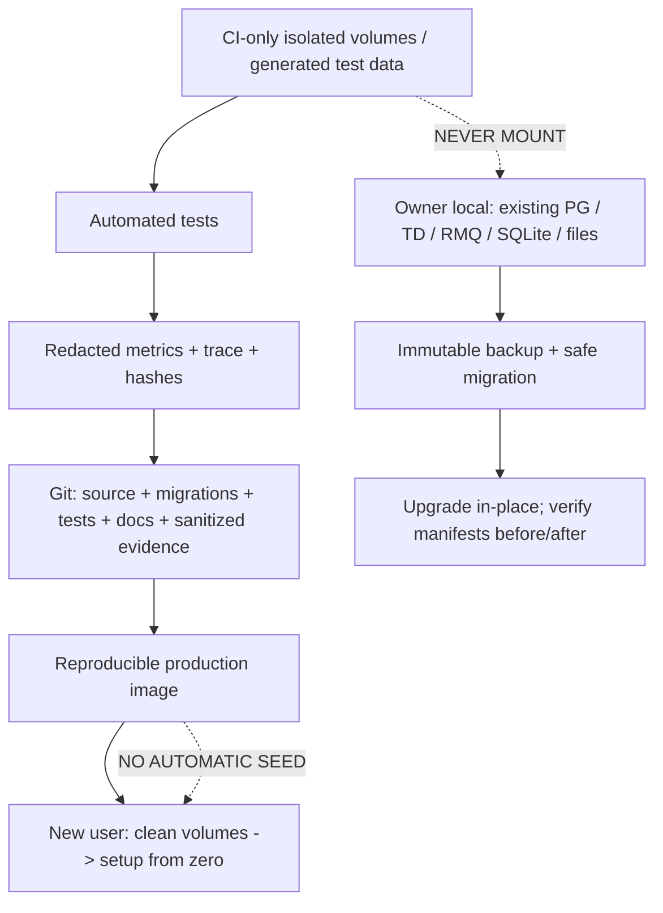

**Không chấp nhận:** đưa `sample-data.json` hay `factory_master` demo vào runtime rồi ẩn bằng flag; nhét screenshot test giả vào release; giấu secret trong `.env.example`; tự tạo admin/tenant/signal/model lần boot; biến output tạm thành “reference dataset”; xóa tests để không phải chạy; xóa đường legacy không báo tác động; hoặc tự động reset volumes khi migrate.

**Được phép và nên giữ:** test code, assertions, CI scripts, contract schemas, migrations, ADRs còn giá trị, docs, test generator **chỉ chạy trong CI/test env**. Test code phải tự dựng dữ liệu tạm lúc test và hủy đi; không commit fixture database chứa record/timestamps nhà máy, test dump hoặc generated CSV. “No test data in Git” ở đây nghĩa là không có **dataset/artifact/seed được sử dụng hoặc đóng gói như state**; những literal nhỏ trong unit test để assert phép biến đổi là code test, không phải dữ liệu người dùng và không được import từ runtime.

## 20. Inventory dọn dẹp cụ thể từ Git tree baseline

Danh sách dưới đây được kiểm tra qua cây repository hiện tại; phần “ứng viên” **không phải** lệnh xóa vô điều kiện. Agent phải ghi `git grep/import graph/docker build usage/test dependency` rồi quyết định. Chỉ xóa khi có bằng chứng và cùng commit cập nhật tất cả references.

| Đường dẫn chính xác | Vấn đề hoặc giả thuyết | Chỉ thị dọn dẹp | Điều kiện trước khi xóa |
|---|---|---|---|
| `reports/test-results.json` | 264 PASS với evidence generic, commit cũ | **Remove from authoritative release**; tạo report thật bởi CI runner | lưu trong `docs/release/superseded/` nếu cần lịch sử, ghi clearly unverified; không giữ PASS giả như thật |
| `reports/cpu-before-after.csv` | số benchmark chưa có raw run attribution ở current HEAD | thay bằng aggregates có run ID, SHA, workload và hash artifacts | chỉ dùng dữ liệu đo mới, không copy số giả làm baseline |
| `docs/release/storage-rework-acceptance.md` | `ACCEPTED FOR RELEASE` mâu thuẫn review | đánh `SUPERSEDED`, không làm release gate | thay bằng decision doc dựa trên gates |
| `docs/release/acceptance-matrix.md` | 3 nav cũ, claims/PASS stale | viết lại theo 2 nav và implementation mới | đối chiếu `App.tsx`/UI/code/tests |
| `docs/implementation-progress.md` | progress lịch sử có thể mâu thuẫn current HEAD | cập nhật hoặc lưu dưới historical/superseded | không xóa ADR để che dấu quyết định |
| `docs/architecture/current-state.md`, `target-state.md` | có thể không phản ánh 2-nav/physical-first | rewrite actual vs target và SHA rõ ràng | review đối chiếu Compose và routes |
| `docs/architecture/ADR-001..ADR-011` | quyết định kiến trúc quan trọng | **giữ; cập nhật supersession links nếu đổi** | chỉ sửa điều khoản thay đổi và lý do, không xóa lịch sử |
| `apps/edge/src/factorix_edge/` | legacy Edge daemon cùng chức năng connectors | ứng viên remove khỏi production image và cuối cùng từ repo | prove 100% parity Acquisition, không route/worker cần Edge, tests chuyển/đảm bảo coverage |
| `apps/edge/tests/` | test legacy | migrate những invariants còn giá trị sang Acquisition tests rồi mới remove | test count/coverage không suy giảm |
| `apps/center/src/factorix/modules/edge_sync.py` | HTTP Edge compatibility | đánh deprecate → remove trong release sau nếu không còn consumer | audit `/api/v1/edge-sync/*`, migration, backwards compat, old deployments |
| `apps/center/src/factorix/modules/telemetry.py` | nhiều đường ingest/history legacy | refactor/tách theo chức năng, không xóa cả file | check Overview/Signals/Data Models/REST dependencies từng hàm |
| `apps/center/src/factorix/modules/storage_designs.py` | Dataset-first/Designer legacy | adapter/migrate hoặc remove public paths; không xóa PG data | verify managed recordings and old history still readable |
| `storage_dsl.py`, `storage_compiler.py` | DSL/managed legacy | giữ nếu writer/migration còn dùng; deprecate UI exposure | prove no active references in ingestion and registry |
| `apps/web/src/pages/10_StorageDesigner/` | UI Designer cũ | candidate remove nếu `App.tsx` đã không route và no deep-link usage | git grep import; migration to new physical UI |
| `apps/web/src/pages/11_StorageCatalog/` | UI Catalog cũ | candidate remove, consolidate necessary code | inspect imports/references and tests |
| `apps/web/src/pages/11_HistorianExplorer/` | Historian cũ | candidate remove, reuse only verified components | preserve exports/queries after migrator |
| `apps/web/src/pages/07_ProtocolStudioOPC/` | standalone legacy page | candidate remove | check Add Data Wizard redirects, import and documentation |
| `apps/web/src/pages/14_ProtocolStudioMQTT/` | standalone legacy page | candidate remove | verify MQTT commissioning in active Connection Wizard |
| `apps/web/src/pages/15_ProtocolStudioHTTP/` | standalone legacy page | candidate remove | verify HTTP capture still works through active wizard |
| `apps/web/src/pages/09_CalculatedSignals/` | old calculated page | candidate remove | new model workflow still supports calculated values |
| `apps/web/src/pages/10_LiveOperations/` | old live page | candidate remove | live data routes/Signals inspector preserved |
| `apps/web/src/pages/12_ActivityLog/` | old page | candidate remove | actual audit/health routes still accessible or intentionally coming soon |
| `apps/web/src/lib/storageApi.ts` | huge legacy client with potentially duplicate contracts | split/harmonize/deprecate; avoid competing APIs | search all imports, migrate consumers with contract tests |
| `apps/web/src/lib/storagePhysicalApi.ts` | current client but mismatched statuses | keep and correct/generate from OpenAPI | all routes/typecheck E2E |
| `apps/web/src/pages/storage-management/*` | production mocks/fake fallback | **remove synthetic data branches** | retain actual loading/empty/error UI |
| `apps/web/src/pages/historian/*` | synthetic chart rows | **delete fallback generator from product code** | real data handling/empty states tests |
| `apps/web/src/pages/storage-management/PostgresExplorerView.tsx` | fake schemas/FK/rows | **delete all fake fallback records** | backend role/allowlist and API errors work |
| `tests/simulators/*` | generators for CI/benchmark, not production | isolate under test harness, never ship/image/run on start | maintain functional 5-protocol integration coverage |
| `apps/center/tests/*`, `apps/acquisition/tests/*` | valuable automated tests | **keep**, improve, generate ephemeral fixtures at runtime | no checked-in factory datasets or credentials |
| `apps/web/src/assets/factorix_brand_logo.png` | intentional branded asset | **giữ nếu frontend dùng**; optimize weight nếu chứng minh | don't call logo “test data” |
| `infrastructure/postgres/001_schema.sql` | bootstrap schema | giữ, bảo đảm không chèn data user/demo | clean bootstrap+alembic parity |
| `infrastructure/docker/bootstrap_db.py` | bootstrap | kiểm và bỏ mọi sample tenant/connection/model seed nếu có | first install 0 business entities |
| `.env.example`, `.env.test.example` | samples cấu hình | giữ templates nhưng vô hiệu với production nếu thiếu secret; không chứa giá trị thật | secret scan + startup validation |
| `.gitignore`, `.dockerignore` | chưa bao phủ toàn bộ artifacts | mở rộng và kiểm tracked existing | `git ls-files`/git check-ignore evidence |
| `README.md`, `docs/testing/*`, `docs/storage/*` | nguồn hướng dẫn/hợp đồng | giữ nhưng cập nhật để không quảng cáo tính năng chưa verify | link source HEAD and tests |

**Đặc biệt:** không xóa migration cũ chỉ vì nó tạo `storage_datasets`, `observations` hay các bảng legacy. Một DB đã có data sử dụng Alembic migration chain để upgrade; xóa migration lịch sử có thể chặn toàn bộ production upgrade. Khi cắt bỏ legacy feature, cần transition migration rõ, có backfill và tested clean install from zero.

## 21. Quy trình tự động quét “rác” để Codex thực hiện, không được bỏ sót

**Bước 1 — Tập hợp tracked inventory.** Tạo `docs/release/source-clean-inventory.tsv` xuất từ `git ls-files` và path, type, size, git blob SHA, classification. Các đuôi cần rà: `.csv`, `.json`, `.jsonl`, `.sqlite`, `.db`, `.dump`, `.sql.gz`, `.log`, `.trace`, `.zip`, `.tar`, `.parquet`, `.png`, `.webm`, `.mp4`, `.html`, `.md`. Có `.json`/`.png` không mặc định là rác: package-lock và brand logo là tài nguyên hợp pháp. Tìm các tập tin lớn và commits có thêm data/artifact sau branch split.

**Bước 2 — Scan production code.** Quét `fallback`, `mock`, `synthetic`, `sample`, `fixture`, `demo`, `seed`, `Math.sin`, `random`, `faker`, `Factory / Line 1`, `factory_master`, `CNC-01`, `336`, `36`, `5`, `known-default-database-credential`, `localhost`, `test-results`, `ACCEPTED FOR RELEASE`, `COMPLETED`, `APPLIED`, `run_read`, `run_write`, `SENSITIVE_TABLES`. Cần review từng match, đặc biệt `336/36/5` có thể nằm trong **test verification names** và không phải fake data. Trong production không cho default number/source state hay synthetic signal; trong tests có thể có constants tạo fixture runtime.

**Bước 3 — Scan imports/runtime.** Tạo reachable graph từ `Dockerfile`, `entrypoint.sh`, `__main__.py`, `app.py`, `App.tsx`/routes, scripts chính, deployed commands. Phân biệt đường dynamic import/router mounting. Các candidate legacy chỉ xóa sau khi CI chứng minh import graph ổn và parity tests cover tính năng được thay.

**Bước 4 — Quét secret và PII.** Trước mỗi commit/push chạy `gitleaks`/`trufflehog` hoặc approved scanner, kiểm image layer; redact credentials/OT network addresses, usernames, tokens, API keys, client certs, queue DSN, TD URL. Mask/deny secret phải áp dụng cả screenshot, traces, Playwright HAR, logs và DB evidence. Không push SHA256 của mật khẩu raw dễ đoán; secret fingerprint nội bộ nên dùng HMAC key giữ local.

**Bước 5 — Kiểm Git tracked state sau cleanup.** Một file từng được tracked **không biến mất khỏi Git history** chỉ vì thêm `.gitignore`. Dùng `git rm --cached <path>` cho data đã lỡ track (chỉ sau khi backup an toàn), commit bỏ khỏi HEAD; với secrets đã leak phải rotate và xem xét remediation/history rewriting **theo phê duyệt riêng**, không rewrite history/force-push vô điều kiện. Git `.gitignore` chỉ ngăn commit tương lai.

**Bước 6 — Kiểm Docker image.** Build `--no-cache` từ fresh clone/clean context; inspect image filesystem/package paths cho `tests`, `fixtures`, `reports`, `.env`, `.git`, sqlite, CSV, mocks, backups; source runtime chỉ chứa assets/code/migrations cần thiết. Không mount test runner vào runtime entrypoint. Test `new user from zero` phải dùng volume mới, không dùng docker project name đã gắn persistent data.

### 21.1. Safe commands để thu thập inventory (read-only)

```bash
# Chạy trong root repository; các lệnh này KHÔNG xóa dữ liệu.
git rev-parse HEAD
git status --porcelain=v1
git ls-files > tracked-files.txt

git grep -n -i -E 'mock|synthetic|fallback|demo|sample|fixture|seed|Math\.sin|factory_master|ACCEPTED FOR RELEASE' -- apps infrastructure tests docs || true
git grep -n -E 'run_read\(|run_write\(|COMPLETED|APPLIED|FACTORIX_RECORD_OPERATIONAL|revert-to-zero' || true

# Lệnh liệt kê chỉ tạo file tạm nằm ngoài phần Git chuẩn.
# Sau scan, chuyển kết quả đã phân loại và redact sang evidence; KHÔNG commit raw grep logs.
```

Lưu ý các nhóm path trong lệnh trên tồn tại ở baseline; Codex vẫn phải kiểm tra lại chúng khi branch thay đổi. Không coi exit code của `git grep` là kết quả chức năng pass/fail. Các file tạm `tracked-files.txt` tạo ra bằng lệnh trên phải được di chuyển ra ngoài working tree hoặc xóa **sau khi xác minh đó chỉ là output mới tạo**, không được commit.

### 21.2. `.gitignore` / `.dockerignore` bắt buộc (bổ sung theo repo thực tế)

Các nhóm patterns phải được audit: `.env`, `.env.*` trừ các file `*.example` an toàn; `__pycache__`, `.pytest_cache`, `.mypy_cache`, `.ruff_cache`, `.coverage`, `.venv`, `node_modules`, `dist`, `build`, Playwright `test-results`, `playwright-report`, `artifacts`, `.log`, `*.sqlite*`, `*.db`, `*.dump`, `*.bak`, `*.csv` runtime, `*.parquet`, `*.zip` backup, flamegraphs, profiles, screenshots/traces/HAR có dữ liệu, TD/Postgres/Rabbit volumes, credentials/certs/private keys. **Không đặt pattern `*.json` hoặc `*.png` global** khiến package-lock, manifest, icon/logo bị mất; dùng path-specific excludes. Whitelist sanitized small evidence riêng nếu CI produce và scanner pass; không allow raw traces vào Git.

### 21.3. Không tự động xóa `apps/edge/` khi chưa chứng minh parity

`apps/edge/` còn chứa code connector và test khác biệt với Acquisition. **Nghiệm thu sạch** không có nghĩa “xóa 29 file cho nhanh”. Phải xác nhận production `FACTORIX_COLLECTOR_MODE=acquisition` không còn import Edge; migrate những integration/negative tests đáng giá; remove legacy API only khi không còn caller; giữ migration compatibility với installations đã phát hành. Nếu trong release candidate vẫn cần backward compatibility, đưa mã legacy vào package riêng bị disabled by default, có removal date; build production không chạy Edge. Nếu thực sự zero dependency và tests pass, `git rm -r apps/edge` là hợp lệ ở phase cleanup, nhưng phải kèm dependency report và smoke test; không tự làm trước Gate G6.

---
# PHẦN VI — MA TRẬN KIỂM THỬ BẮT BUỘC: PHẢI THỰC THI, KHÔNG DỰNG PASS

## 22. Quy ước test runner, môi trường và bằng chứng

**Một test case PASS** phải có: ID; điều kiện đầu vào; actual action/API/command; expected predicate có thể assert; measured result; commit/image version; timestamp; evidence path/sha256; test-run ID. Chỉ `PASS`, `FAIL`, `BLOCKED`, `NOT_RUN`, `SKIPPED_WITH_APPROVED_REASON`; không có `PASS` từ lời giải thích lý thuyết. Test nào cần thiết bị OT thật nhưng không có thiết bị thì ghi `BLOCKED_HARDWARE`; mô phỏng 5 giao thức chỉ chứng minh phần mềm trong môi trường test, không chứng minh interoperability với mọi thiết bị nhà máy. Browser tests phải dùng Playwright/Computer Use hoặc automation GUI có request logs; unit test chỉ bổ sung, không thay thế.

**Các môi trường test tối thiểu:**

- **ZERO:** fresh clone, empty named volumes, generated production-like non-default credentials, không có data seed; test onboarding và fresh install.
- **INT:** Docker ephemeral PG17 + RMQ4.4 + TD3.4.3.9 hoặc actual version matrix được khóa, Acquisition/Ingestion/API/Web; 5 protocol test endpoints chỉ lắng nghe trong mạng riêng; input generated *khi chạy*, không track dataset; isolated from local owner.
- **UPGRADE:** clone/staging với đầy đủ schema/constraints/objects + representative state (phải an toàn với dữ liệu được sao chép); validate Alembic upgrade, registry backfill, no config loss. Nếu không có dữ liệu clone được phép sử dụng thì test schema fidelity trên synthetic config, đồng thời `BLOCKED` đối với xác minh dữ liệu chủ dự án.
- **SEC:** ít nhất hai tenants độc lập và hai roles, với quyền khác nhau; credentials/test secrets mới tạo trong ephemeral stack.
- **PERF:** hardware info, Docker Desktop resource budgets, workload rate, duration, full trace và unaltered actual results; không chạy cùng lúc với local production stack nếu CPU interference ảnh hưởng dữ liệu live.

### 22.1. Các mục tiêu định lượng phải khóa trước test

| Chỉ tiêu | Định nghĩa đo | Yêu cầu/gate |
|---|---|---|
| Captured → Confirmed → Committed | đếm theo unique canonical event UID / epoch | **0 loss không giải thích được** trong các fault cases nằm trong capacity đã cam kết; mọi allowed drop có event/counter/reason |
| Duplicate durable rows | cùng UID replay/retry/restart | **0 duplicates logically visible** sau reconciliation; nếu engine có giới hạn, ghi rõ và gate reject nếu chưa giải quyết |
| Ordering/current state | epoch, acquisition time, sequence, UID tie-breaker | latest không bị observation cũ ghi đè; 100% asserted cases |
| Quality correctness | GOOD/BAD/UNCERTAIN/STALE + reasons | **0** trạng thái mặc định giả/zero-fill; equal against test oracle |
| Source freshness | `last_acquired_at`, expected interval, heartbeat | không STALE khi vẫn poll hợp lệ; STALE đúng khi mất nguồn; đo distribution |
| Latency (capture→UI, capture→TD) | p50, p95, p99 sau 5 phút warm-up | đề xuất **nominal p95 ≤ 2s, p99 ≤ 5s** với workload 1×; owner chốt trước test theo hardware; nếu không đạt, ghi FAIL, không đổi ngưỡng sau đo |
| Polling jitter 1s | actual interval vs scheduled interval | đề xuất p99 drift ≤ 250 ms tại 1×, nếu device latency cho phép; ghi đầy đủ source timeout, Docker scheduling và ngoại lệ |
| 10× throughput | tối thiểu test 3,000 observations/s nếu architecture target giữ từ benchmark trước | sustained 15–30 phút; queue lag không tăng không giới hạn; zero unexplained loss; p99 và CPU ghi thực |
| Soak | chạy 8–24 giờ trên môi trường dành cho release | no monotonic memory/queue growth, zero unexplained loss; điều kiện thời gian phải test đủ, không extrapolate |
| CPU/RAM | per container + per PID tại idle/1×/10× | không vượt agreed resource budget; performance improvement chỉ công nhận so cùng workload/hardware |
| Start/Stop recovery | restart & failover time | thời gian đo thực + exact RTO/RPO; không tự claim một con số nếu chưa xác nhận budget |
| API/browser correctness | error/loading/empty/permission/data | 100% P0 assertions, 0 critical console/network errors không xử lý |
| Configuration preservation | IDs + canonical config hashes + TD schema fingerprint | **100% equality** before/after permitted reset/upgrade, không chỉ cùng số dòng |

**Lưu ý:** các giá trị p95/p99/throughput ở đây là **đề xuất acceptance SLO để Codex triển khai thử**, không phải số đo đã đạt. Nếu phần cứng owner không thể đo đủ, phải report `BLOCKED/NOT_MEASURED` và đề nghị owner chốt ngưỡng bằng văn bản **trước** khi chạy chính thức; không lấy số benchmark cũ chưa xác minh làm kết quả mới.

## 23. Test cases — Fresh install, packaging, backup và control plane

| ID | Thao tác/điều kiện cụ thể | Điều phải assert |
|---|---|---|
| ZERO-001 | Clone branch ở thư mục mới, không `.env`, run safe startup | fail với thông báo thiếu config; không tạo admin/secret mặc định |
| ZERO-002 | Cấp secrets hợp lệ, `docker compose up` với volumes mới | health healthy sau migrations, không có 5 connections/336 signals/36 models seed |
| ZERO-003 | Query count các bảng business sau boot | 0 tenants/user resources/connections/signals/models, trừ system metadata cần cho schema |
| ZERO-004 | Mở `/` từ browser incognito khi chưa bootstrap | setup/register đúng, không rơi vào shell authenticated giả |
| ZERO-005 | Tạo admin lần đầu | user mới được tạo chính xác 1 lần; re-submit không duplicate |
| ZERO-006 | Đăng nhập/sai mật khẩu/đổi mật khẩu/logout | cookie/CSRF/session/lockout đúng, no secret in logs |
| ZERO-007 | Tạo site/resource/connection/signal/model bằng UI | chỉ các object vừa tạo xuất hiện, no defaults tự gắn thêm |
| ZERO-008 | Restart API/worker/compose **không `-v`** | user/config/state không mất, không duplicate jobs |
| ZERO-009 | Fresh clone build image với clean context | image không có `.env`, tests, reports, fixture DB, traces, local backups |
| ZERO-010 | Docker image inspection and SBOM scan | không chứa private key, raw DSN, known critical package issue unwaived |
| ZERO-011 | Production mode với placeholder env `change-me` | startup fail closed, không tiến tới processing credentials yếu |
| ZERO-012 | Check Compose/service internal ports | PostgreSQL/RMQ/TD không mở LAN ngoài thiết kế; API được cấu hình network phù hợp |
| ZERO-013 | Graceful SIGTERM khi không có pending messages | exit sạch, no runaway subprocess, no orphan connection |
| ZERO-014 | Graceful SIGTERM khi ingestion đang xử lý batch | drain or durable requeue, recover no duplicate logical rows |
| ZERO-015 | Simulate corrupt migration before startup | fail + actionable log; không tự drop schema |
| ZERO-016 | Database 17 version check | UI displays detected PG version; không hardcode PG16 |
| ZERO-017 | TDengine unreachable at startup | degraded/unavailable, no fake data/healthy green |
| ZERO-018 | Restore backup on **separate volumes** | manifests/DDL/config hashes restored, no local production touched |
| ZERO-019 | Upgrade from previous branch schema in isolated clone | all IDs/relationships/models preserved, migration deterministic |
| ZERO-020 | Re-run migrations after successful upgrade | idempotent/no unintended schema or row change |
| ZERO-021 | Simulate insufficient disk on upgrade test | rollback/recovery path, no claims of committed success |
| ZERO-022 | Test backup tool with files/DB/TD | backup complete, checksum good, secrets separately protected |
| ZERO-023 | Test restore with omitted archive backup | detect incomplete restore; fail gate, no green status |
| ZERO-024 | Compare zero boot before and after cleanup | no test/demo data, no schema drift, same expected bootstrap UX |

## 24. Test cases — RabbitMQ, Acquisition và canonical observations

| ID | Thao tác/điều kiện cụ thể | Điều phải assert |
|---|---|---|
| ACQ-001 | Create one Modbus polling connection in INT | correct registers/endianness/decode, canonical type/quality/time |
| ACQ-002 | Create OPC UA read connection | NodeId, status code, source timestamp preserved |
| ACQ-003 | OPC UA subscription value changes and reconnect | no silent gap hidden as GOOD; reconnect/backoff and revision valid |
| ACQ-004 | MQTT subscribe wildcard/QoS with 10 topics | per-topic source mapping, no cross-topic contamination |
| ACQ-005 | MQTT duplicate delivery / retained event / out of order | deterministic UID policy, no unintended logical duplicate |
| ACQ-006 | HTTP pull 429 + Retry-After + timeout | rate limiting/backoff, quality/health reason visible |
| ACQ-007 | WebSocket high-frequency frames + reconnect | frame order, bounded buffer and drop accounting |
| ACQ-008 | 5 protocols simultaneously 10+ sources | all canonical fields and relation mapping correct |
| ACQ-009 | Source data values bool/int64/float/string/json/timestamp | type and precision exact; no lossy coercion |
| ACQ-010 | Negative NaN/Inf/int overflow/invalid JSON | reject/quarantine with code; never crash worker |
| ACQ-011 | Source clock ahead/behind, missing time, timezone offset | event/received/source times normalized with reason codes |
| ACQ-012 | Same source value repeated 1h | freshness correct, recorded mode as configured |
| ACQ-013 | Change config while poll in progress | old/new revision fencing, deterministic job transition |
| ACQ-014 | Rotate OT credentials during active collection | no stale secret use, no secret in logs |
| ACQ-015 | Stop PG while Acquisition is running | LKG policy as designed, no config corruption or double polling |
| ACQ-016 | Two Acquisition instances active/standby | one holds leader lock, exactly one polls source |
| ACQ-017 | Leader crash and follower takeover | no split-brain, no missing/duplicate beyond explicitly tested replay |
| ACQ-018 | Disable a connection from UI | polling stops, health/quality transitions correct |
| ACQ-019 | Resume connection | rehydrate without duplicate source jobs |
| ACQ-020 | Broker unreachable 30s / 5min / longer than spool capacity | persists where promised, explicit loss alert at cap |
| ACQ-021 | Broker `reject-publish` | failed observations go to spool, never counted as confirmed |
| ACQ-022 | Publisher confirm timeout after broker received | retry idempotent at Center; no silent double count |
| ACQ-023 | Crash after spooling before broker publish | recover pending rows on restart |
| ACQ-024 | Crash after publish confirm before spool mark ACKED | replay safe, at-most-one logical result |
| ACQ-025 | Corrupt one SQLite PENDING payload | quarantine with event_uid/reason, other rows continue |
| ACQ-026 | Fill spool byte cap with push traffic | fail-closed/explicit allowed data-loss policy, no fake ACK |
| ACQ-027 | Fill broker quorum max length / DLQ max length | backpressure/alerts and retry, no infinite hot-loop |
| ACQ-028 | Stop Ingestion only, keep Acquisition running | queue backlog, bounded memory, resume reconciliation |
| ACQ-029 | Stop TDengine, keep RabbitMQ/Ingestion | no ACK for required unwritten TD data; retry controlled |
| ACQ-030 | Stop PostgreSQL after TD write, before metadata commit | redelivery/repair, no newer state rollback |
| ACQ-031 | Ingestion invalid source ownership/tenant binding | quarantine or reject, no TD writes cross-tenant |
| ACQ-032 | 100 duplicate `event_uid` across micro-batches/reboots | exactly one logical event in historized read-back |
| ACQ-033 | Same observed timestamp for different UIDs in multiple batches | deterministic preservation/no overwrite, review timestamp semantics |
| ACQ-034 | Epoch increases while queue has backlog | old messages fenced, new messages accepted |
| ACQ-035 | Graceful shutdown with unacked consumer tasks | NACK/requeue safely, no phantom ACK |
| ACQ-036 | Poison message over size/type limit | quarantine/DLQ with reason and metrics, not block queue forever |
| ACQ-037 | Mixed source types on same target table | policy executes source mapping, quality retained |
| ACQ-038 | Reprocess history order after outage | latest-per-signal optimization does not starve old events |
| ACQ-039 | Compare canonical source IDs from Connector/PG/TD | exact mapping, no replace by display names |
| ACQ-040 | Full 1× and 10× run captured→confirmed→committed reconciliation | conservation equation and per-stage latency asserted |

## 25. Test cases — Storage physical objects, wizard, operation lifecycle

| ID | Thao tác/điều kiện cụ thể | Điều phải assert |
|---|---|---|
| TD-001 | Open Storage Management with TDengine available, no custom objects | real empty/operational topology; no factory_master demo nodes |
| TD-002 | Create Database valid name/precision/keep | actual TD `SHOW DATABASES`, tenant registry, operation APPLIED after verify |
| TD-003 | Create database same name twice | idempotent same key or conflict, no duplicate registry |
| TD-004 | Create Database invalid name/reserved/system db | UI field error; no DDL submitted |
| TD-005 | Create DB with invalid vgroups/replica/retention | capability validation, no arbitrary fallback |
| TD-006 | Create DB while TDengine down | explicit failed/paused operation; no false APPLIED |
| TD-007 | Create STABLE with timestamp + numeric/boolean/string columns | TD DESCRIBE matches intended types and order |
| TD-008 | Create STABLE with tags and optional descriptions | actual tag definitions match; no fake FK |
| TD-009 | STABLE missing timestamp or duplicate columns/tags | reject at validate; no DDL |
| TD-010 | STABLE tag length/type boundary | precise TD version behavior + safe error |
| TD-011 | Create Subtable under selected STABLE with all tag values | correct parent/tag values in actual TD metadata |
| TD-012 | Create Subtable missing required tag | reject before DDL; no zero-value fill |
| TD-013 | Create Subtable with tag values out of UI order | server normalizes to parent STABLE definition order |
| TD-014 | Create Subtable with mixed binding | persisted mapping and first sample physically arrives |
| TD-015 | Choose unsupported row assembly policy | UI disables/backend rejects; not silently ignored |
| TD-016 | Double-click Publish + replay request with same Idempotency-Key | only one physical operation and one object |
| TD-017 | Restart API after draft Save | draft still exists and preserved revision |
| TD-018 | Restart during PREPARING/APPLYING/VERIFYING | reconcile to APPLIED or RECOVERING with real verification |
| TD-019 | TD DDL succeeds, PG final transaction fails | no false success; recovery reconciles actual object |
| TD-020 | PG records operation, TD DDL never ran | retry/recover, never APPLIED without physical read-back |
| TD-021 | Concurrent edits from two browsers with same revision | one wins; other receives 409 diff without overwrite |
| TD-022 | Edit metadata-only properties | no destructive DDL; registry rev increments |
| TD-023 | Add compatible column to STABLE | physical ALTER + child schema read-back |
| TD-024 | Try change incompatible timestamp/type/tag | safe rejection or approved migration plan; no data corruption |
| TD-025 | Change binding from signal A to signal B | controlled switch; no write into old mapping after effective rev |
| TD-026 | Pause/resume recording on physical target | writer honors policy, UI status actual |
| TD-027 | Retire object with active dependent views/models | impact report and safe block or relocation |
| TD-028 | Purge object with confirmation absent/wrong | denied; physical tables unchanged |
| TD-029 | Purge authorized isolated object | registry terminal state + TD object absent; writer not recreate |
| TD-030 | Refresh deep-link after create or edit | canonical IDs route to correct object, no fallback |
| TD-031 | 0, 50, 51, 501 subtables; page/scroll graph | total counts correct independent of loaded nodes |
| TD-032 | Rename display alias but not physical object | label updates, physical identity remains same |
| TD-033 | Change physical schema outside app (isolated test) | drift `SCHEMA_MISMATCH`, no `OK` hardcode |
| TD-034 | TDengine unplug after graph loaded | stale snapshot explicitly labeled, no current-green claim |
| TD-035 | 2 tenants with similarly named STABLE/subtable | every physical API scoped; no cross-tenant metadata leak |
| TD-036 | Process special chars in cursor/object names | validation prevents SQL injection and accidental other-object access |
| TD-037 | List all operations, filter by status/object | actual statuses, stable pagination/correlation IDs |
| TD-038 | Create supported normal TD table if UI design allows it | capability explicitly proven; otherwise hidden/unsupported |
| TD-039 | Negative null/invalid quality in mapped observations | TD history preserves missing/BAD rules |
| TD-040 | Build fresh from zero and repeat all create steps | no reliance on author local schema/default fake objects |

---
## 26. Test cases — Source Picker, Recording Policies, raw+model assembly

| ID | Thao tác/điều kiện cụ thể | Điều phải assert |
|---|---|---|
| SRC-001 | Mở tab Hierarchy chọn signal của Resource A | selectable leaf là signal ID, không là resource ID |
| SRC-002 | Mở Collector tìm chính signal đó | canonical ID trùng SRC-001, chỉ path/group khác |
| SRC-003 | Tìm cùng signal bằng search text, đổi tab, quay lại | selection không mất, không duplicate |
| SRC-004 | Mở Model tab và chọn một field lồng trong model | canonical `(model_id,field_path,version)` chuẩn |
| SRC-005 | Model pause/archived sau lúc chọn | source status UNRESOLVED/PAUSED, Publish có validation |
| SRC-006 | Model revision thay field type | 409 hoặc migration plan có impact; không auto coercion mù |
| SRC-007 | Raw signal boolean tới TD BOOL column | exact boolean, quality/time đúng |
| SRC-008 | Raw float tới numeric TD column | precision và overflow behavior rõ, no fake zero |
| SRC-009 | Source string/json ngoài allowed TD length | reject/quarantine with reason, no silent truncation |
| SRC-010 | Đổi đơn vị nguồn nhưng binding vẫn old unit | validation warning/error theo policy, no hidden conversion |
| SRC-011 | Bind cùng column từ 2 nguồn khác kiểu | conflict detected hoặc explicit aggregation rule |
| SRC-012 | Bind 2 columns trong same target từ 2 raw signals | each value maps to correct field, no swapped fields |
| SRC-013 | Bind raw signal + model output same target | both actual values appear according to assembly policy |
| SRC-014 | Missing source after draft saved | reload shows unresolved binding; no placeholder identity |
| SRC-015 | Select source from tenant B using forged ID | 403/422, no metadata leakage |
| SRC-016 | `INDEPENDENT_EVENTS` with raw1s + model5s | events preserved as distinct updates, no fake synchronous row |
| SRC-017 | `LATEST_AS_OF_TRIGGER` with model delayed 4s | respects max_age, marks quality/provenance, not unlimited forward-fill |
| SRC-018 | `LATEST_AS_OF_TRIGGER` with model older than max_age | field missing/stale per policy, not GOOD |
| SRC-019 | `TIME_BUCKET` with bucket boundary timestamps | deterministic bucket index, timezone and late policy |
| SRC-020 | `EXACT_TIMESTAMP` with time precision us | only exact-match events merged as permitted |
| SRC-021 | Two updates same source timestamp but different UID | distinguish legitimate events or explicit policy, no accidental overwrite |
| SRC-022 | Re-play same bucket after worker restart | one logical assembled row, same provenance |
| SRC-023 | Enable `ON_CHANGE`, emit 1,000 unchanged values | correct sparse records and 1,000 acquisition freshness events/counters |
| SRC-024 | Change quality GOOD→UNCERTAIN→BAD without value change | quality transitions recorded and UI visible |
| SRC-025 | Enable `EVERY_ACQUISITION`, repeated values | actual rows per acquisition, no unintended dedup by value |
| SRC-026 | Enable `INTERVAL`, source burst > interval | correct interval snapshot/checkpoint; no silent value loss beyond declared semantics |
| SRC-027 | Configure absolute/percent deadband boundary | exact threshold behavior, negative/zero values handled |
| SRC-028 | Long unchanged state + checkpoint configured | checkpoints according to policy, live state stays fresh |
| SRC-029 | Pause recording but continue acquisition | source/connection health up; no managed writes; clear UI status |
| SRC-030 | Epoch reset with buffered row assembly state | old aggregates fenced, no cross-epoch row assembled |
| SRC-031 | Edit binding policy while buffered event exists | revision boundary deterministic, no mixed old/new fields |
| SRC-032 | Reload TD/Postgres during mixed-data writes | resume with duplicate protection and policy state restored |

## 27. Test cases — Historian, charts, quality, exports

| ID | Thao tác/điều kiện cụ thể | Điều phải assert |
|---|---|---|
| HIST-001 | Historian mở chưa chọn source | intentional empty guidance, không tự hiện CNC-01 sample |
| HIST-002 | Chọn signal có 100 TD rows trong time range | chart và records cùng 100 actual raw points ở Recorded mode |
| HIST-003 | TDengine down khi query | error state, zero synthesized sin waves |
| HIST-004 | API 200 với 0 points | empty state, không báo TDengine down |
| HIST-005 | API trả 401/403/404 | appropriate error, không fallback sang source khác |
| HIST-006 | Recorded mode với ON_CHANGE sparse state | chỉ rows vật lý thật, không thêm điểm giữ nguyên |
| HIST-007 | Reconstructed mode với state kéo dài | step interpolation có provenance, không giả event đã đo |
| HIST-008 | Chọn khoảng bắt đầu giữa hai change points | pre-window seed đúng nếu đủ history, không tạo fake value khi không có |
| HIST-009 | Source BAD sau 5 phút tốt | gap/quality overlay biểu diễn đúng, không GOOD toàn kỳ |
| HIST-010 | Không có last-good/first point | không fill 0, không `goodPct=100` |
| HIST-011 | Chọn 1/5/50 numeric signals | batching/cancellation, correct color/legend, no duplicates |
| HIST-012 | Chọn 1 bool, 1 enum, 1 JSON field | chart/table tùy type, không `Number()` vô điều kiện |
| HIST-013 | Timezone UTC+7 vs UTC vs DST region | event instants same, labels accurately converted |
| HIST-014 | Timestamp precision us and multiple same second | stable ordering, no lost points due rounding |
| HIST-015 | Aggregation 1m/1h + null/BAD | min/max/avg/last/count with documented exclusion rules |
| HIST-016 | Data epoch reset and old history cursor | no leak old-epoch records; cursor invalidated or scoped |
| HIST-017 | Scroll/pagination across 10,001 rows | no skipped/duplicate records, correct total/has_more |
| HIST-018 | Filter quality and origin | SQL response matches chart/table and UI counts |
| HIST-019 | Select model field from picker | actual materialized model time-series, no inferred fake samples |
| HIST-020 | Select physical subtable column | authorized binding and actual row/column mapping |
| HIST-021 | Save view, reload/login from another browser same tenant | view spec persists and restores filters |
| HIST-022 | Tenant B attempts access tenant A view/export | denied, no metadata/history leak |
| HIST-023 | Export 10k rows CSV | matches query/quality/time, download file exists with checksum |
| HIST-024 | String begins =,+,-,@, tab or CR | CSV formula injection mitigated as designed |
| HIST-025 | Cancel export halfway and retry | job states correct, temp file cleanup, no duplicate exposure |
| HIST-026 | Download expired export | 404/410 with explanation, no stale file served |
| HIST-027 | Unplug TD while export running | retryable failure, not `COMPLETED` with empty file |
| HIST-028 | Query after retire/purge of data source | lifecycle-aware 404/archived explanation, no fake trend |
| HIST-029 | Chart out-of-order raw samples | sorts on authoritative timestamps, retains late provenance |
| HIST-030 | Browser switch tabs/window hidden, return after 1h | no massive duplicate polling, refresh with correct stale state |

## 28. Test cases — PostgreSQL Explorer, security, multi-tenant isolation

| ID | Thao tác/điều kiện cụ thể | Điều phải assert |
|---|---|---|
| SEC-001 | PG Explorer list schemas as tenant A | only authorized schema metadata, no sensitive leakage |
| SEC-002 | Preview public configuration table safe view | scoped rows, masked fields, stable pagination |
| SEC-003 | Try preview `admin_accounts` | blocked at server, even if direct API called |
| SEC-004 | Try preview `secret_store` | blocked at server, ciphertext/secret_ref not returned |
| SEC-005 | Try preview `sessions`/password reset table | blocked; no auth tokens, hashes, reset codes |
| SEC-006 | Sensitive key nested in JSON column | redacted by schema policy; not just by outer column name |
| SEC-007 | Read-only DB role attempts DDL or DML | DB denies permission, not merely UI hiding button |
| SEC-008 | SQL injection in schema/table/cursor | request rejected, DB untouched |
| SEC-009 | Table with no primary key | stable paging strategy or explicit no stable paging warning |
| SEC-010 | Huge PG table preview | bounded count/time/memory, no unbounded full COUNT(*) |
| SEC-011 | PostgreSQL ERD FK from `pg_constraint` | actual constraint endpoints, no fabricated FK |
| SEC-012 | ERD missing FK but naming suggests it | inferred edge labeled inferred or omitted; not called real FK |
| SEC-013 | Query physical TDengine object by tenant B name | 403/404; no observable data leak |
| SEC-014 | Use path traversal/quoted identifiers on Storage API | strict identifier normalization and authorization |
| SEC-015 | Submit tenant_id different from session in body | ignored/rejected, no cross-tenant write |
| SEC-016 | Forge Object revision/status on Publish payload | server recomputes/validates, no client authority |
| SEC-017 | Replay CSRF-less write request | 403, no DDL/state change |
| SEC-018 | Test unauthenticated websocket/REST direct | protected and closed, no history/signal stream |
| SEC-019 | Test forbidden source/model field in picker | not returned, cannot bind by forged ID |
| SEC-020 | Two tenants share same display aliases | mapping by canonical IDs, never alias collision |
| SEC-021 | Measure rate-limit/query timeouts for metadata search | no unbounded requests/DoS-like performance collapse |
| SEC-022 | Review logs after failed login/connection/TD DSN | no username/password/secret token exposure |
| SEC-023 | Scan final Git diff and image for secrets | 0 undisclosed findings (exceptions signed with rationale) |
| SEC-024 | Verify error message for unauthorized DDL | not disclose other tenant's physical object names/schema |

## 29. Test cases — Selective reset, preservation and safety

| ID | Thao tác/điều kiện cụ thể | Điều phải assert |
|---|---|---|
| RST-001 | Legacy `/api/v1/admin/revert-to-zero` called in INT | 410/404, **no change** to any account/config/telemetry |
| RST-002 | Open Clear Telemetry preview as admin | real tenant-scoped counts/object list, no hardcoded 5/336/36 |
| RST-003 | Wrong confirm phrase | rejection, zero changes |
| RST-004 | Wrong admin password or missing CSRF | rejection, zero changes |
| RST-005 | Non-admin attempts reset | 403, zero changes |
| RST-006 | Two admins concurrently click reset | only one operation, second conflict/queued; no double epoch |
| RST-007 | Snapshot pre-reset model/connection/signal/resource IDs | full canonical manifest, immutable before snapshot |
| RST-008 | Snapshot physical TD schema with custom tags/subtables | DDL/tag fingerprint captured |
| RST-009 | Execute reset with old queue messages in flight | old epoch blocked, reset clean |
| RST-010 | Old SQLite spool queued in Acquisition | old epoch purged/fenced without republishing |
| RST-011 | Kill worker during R1/R2 | recovery holds fenced; no stale writes |
| RST-012 | Kill API during R3 TD cleanup | durable operation resumes/reconciles; no false ACTIVE |
| RST-013 | Kill TDengine during cleanup | fail fenced and preserve config; operator sees error |
| RST-014 | Kill PG during post-TD cleanup | fail fenced, recovery based on persisted phase |
| RST-015 | Check Factory Model after reset | same IDs and relationships/hash as before |
| RST-016 | Check 5 Connections after reset (if baseline is 5) | same IDs/config/secret validity, not hardcoded creation |
| RST-017 | Check 336 Signals after reset (if baseline is 336) | same IDs/type/binding/address/revision |
| RST-018 | Check 36 Data Models (if baseline is 36) | same IDs/spec/rules/version/scheduling, outputs clear as designed |
| RST-019 | Check admin account/role/login/password | account works, sessions per policy, no reroute to first-run setup |
| RST-020 | Check STABLE/Subtable/tag definitions | exact schema fingerprint equality before/after |
| RST-021 | Check Storage bindings and recording policies | same source IDs, column mappings and effective revisions |
| RST-022 | Check allowed tenant exports/archives cleanup | only intended data files gone; no unrelated local file erased |
| RST-023 | Confirm TD/PG telemetry counts zero at reset completion | 0 scoped old runtime rows, no orphan history |
| RST-024 | Publish fresh new-epoch value via isolated source | new history/live state works, old epoch remains fenced |
| RST-025 | Verify audit trail for each R0–R5 stage | timestamps, operator, hash/trace and errors present |
| RST-026 | Manually interrupt at each stage and restart app | deterministic resume or explicit FAILED_FENCED; no loss of config |
| RST-027 | Attempt reset while backup missing or unverified | operation not permitted under release policy |
| RST-028 | Confirm no reset touches owner local volumes | environment guard checks project ID/volume identity, no destructive commands |

## 30. Test cases — Legacy navigation, performance, UX/clean source

| ID | Thao tác/điều kiện cụ thể | Điều phải assert |
|---|---|---|
| REG-001 | Overview totals/health/live statuses before vs after | equivalent rules + correct current data |
| REG-002 | Factory Structure create/move/rename/archive/restore | same hierarchy constraints and relationships |
| REG-003 | Knowledge Graph pan/zoom/search/edge semantics | no regression and no confusion with TD graph |
| REG-004 | Data Collector create/modbus/opcua/mqtt/http/ws wizard | same form fields, commissioning and active state |
| REG-005 | Connection Test after introducing RabbitMQ | test path still works, does not require fake observation |
| REG-006 | Signal catalog bulk address/properties actions | correct revision, no lost source mapping |
| REG-007 | Signal live value, freshness and 15min sparkline | same contract with TDengine-backed history |
| REG-008 | Data Models create/edit/validate/preview | source references/resolvers correctly honor model rules |
| REG-009 | Data Models duplicate/retarget/pause/resume | model outputs/history/status correct |
| REG-010 | 36 models/336 signal mapping parity in allowed isolated clone | values, quality, references and relation cardinality equal |
| REG-011 | Auth login/reset/logout and CSRF | no regression from storage changes |
| REG-012 | Coming Soon routes and legacy redirects | intentional navigation, preserve query/deep-links |
| REG-013 | Cross-tab opening Storage/Signals/Historian | canonical source deep links and IDs preserved |
| REG-014 | Browser back/forward wizard, unsaved changes | no silent discard or physical mutation |
| REG-015 | Keyboard-only wizard and graph | accessible controls, focus, no keyboard trap |
| REG-016 | 360px/768px/1440px viewport snapshots | no unusable overflow; all actions reachable |
| REG-017 | Screen reader labels/errors for Create/Edit | field-level semantics and live errors available |
| REG-018 | Browser offline/online while wizard open | draft/server retry, no duplicate Publish |
| REG-019 | Open Storage with no tables/with 500 tables | empty guidance/lazy graph performance |
| REG-020 | Switch TDengine/PostgreSQL engine tabs | state preserved, no cross-engine data confusion |
| PERF-001 | Idle CPU 15m after warmup | measured per PID/stack, no busy loop |
| PERF-002 | 1× sustained 300 obs/s candidate | measure throughput, p95/p99, CPU, data fidelity |
| PERF-003 | 10× 3,000 obs/s candidate | throughput stable 15–30m, queue lag bounded |
| PERF-004 | Burst 20× for bounded duration | backlog and spool react per policy, no silent loss |
| PERF-005 | 8–24h soak in isolated environment | memory/CPU/queue trends and errors captured |
| PERF-006 | 1/10/50 concurrent Historian users | p95/p99 API, cache, TD query load within budget |
| PERF-007 | Open TD topology 0/50/500/5k objects | bounded fetch, no N+1 CPU spike, correct totals |
| PERF-008 | PostgreSQL preview 10M-row table | bounded latency, no unbounded COUNT(*) |
| PERF-009 | Run profile with Ingestion concurrency 16/32/64/128 | compare throughput vs p99, select measured optimum |
| PERF-010 | Web hidden tab 30m then reconnect | no storm of duplicate API calls |
| PERF-011 | Compare before/after CPU with matched hardware and workload | actual evidence, no unsupported improvement claim |
| PERF-012 | Test contention when PG/RMQ/TD same Docker Desktop SSD | resource metrics and durability impact assessed |
| CLEAN-001 | `git ls-files` scan for dumps, sqlite, raw CSV, logs | no tracked runtime/test datasets/artifacts |
| CLEAN-002 | Source scan for synthetic production fallback | 0 active UI fake data branches |
| CLEAN-003 | Image filesystem scan for fixtures/reports/secrets | no packaged test data or secret |
| CLEAN-004 | Start from empty volumes and click every nav | no prepopulated factory, connections, models, signal data |
| CLEAN-005 | Scan GitHub diff, env templates, screenshots and traces | no credentials/PII/OT endpoint leaks |
| CLEAN-006 | Confirm tests still exist after cleanup | coverage maintained, real failures still fail CI |
| CLEAN-007 | CI artifacts are generated by actual tests with commit SHA | report no generic repeated false evidence |
| CLEAN-008 | `git status` after clean build/tests | no unintended tracked build outputs/modifications |
| CLEAN-009 | Inspect production startup import graph | no automatic runtime Edge plus Acquisition double poll |
| CLEAN-010 | Inspect docs routes/release statuses | no stale 3-nav or unverified accepted claims |
| CLEAN-011 | Run all migrations and health on fresh install | clean zero state with required system schema |
| CLEAN-012 | Compare release build SHA and tested SHA | exact same code, no unreviewed last-minute change |

**Tổng số ID mô tả trong tài liệu:** tổng thực tế phải được tính bằng parser kiểm uniqueness từ Markdown; con số testcase trong file **không chứng minh** chúng đã chạy. Khi chuyển sang executable tests, một ID có thể gồm nhiều assertions hoặc parametrized runs nhưng report phải chỉ rõ từng run. Test source phát triển phải map đầy đủ IDs; không được xóa ca khó để đạt tỷ lệ PASS ảo.

---
# PHẦN VII — BẰNG CHỨNG BẮT BUỘC PHẢI PUSH GIT ĐỂ LẦN REVIEW SAU CÓ THỂ KIỂM TRA SÁT NHẤT

## 31. Nguyên tắc evidence: không bịa, không rò rỉ data, phải liên kết tới code chạy

Tài liệu hiện tại gặp lỗi “264 PASS nhưng cùng một câu actual”. Không được lặp lại. Evidence phải là **kết quả machine-generated** từ CI/runner và người review có khả năng kiểm chứng nguồn phát sinh, chứ không phải lời tóm tắt do agent tự viết. Mặt khác, repository phải sạch; không thể push database dump, OT IP, raw telemetry, screenshot chứa credentials hoặc test output dataset lên Git. Hai yêu cầu không mâu thuẫn nếu tách **sanitized evidence index được Git track** với **protected raw execution artifacts có hash và link đến GitHub Actions run / lưu trữ được kiểm soát**. Nếu reviewer không có quyền mở protected artifacts, phải ghi đó là `REVIEW_LIMITATION`, không claim đã chứng minh hoàn toàn.

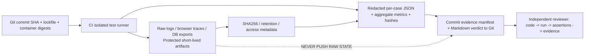

## 32. Cây thư mục bàn giao bắt buộc trên branch sửa

```text
review.md                                  # Tài liệu đang đọc; không xóa
RELEASE_READINESS.md                       # Verdict cuối, KHÔNG tự ACCEPT
README.md                                  # Fresh install and upgrade procedure
CHANGELOG.md                               # Behavioral/API/schema changes
.github/workflows/ci.yml                   # Unit, integration, E2E, security, package gates
.github/workflows/release-evidence.yml     # Có thể dùng, sinh artifacts từ job thật

docs/
  architecture/
    current-state.md
    target-state.md
    ADR-001..ADR-011 (giữ và cập nhật/supersede đúng)
    ADR-012-physical-storage-object-registry.md
    ADR-013-storage-transaction-and-reconciliation.md
    ADR-014-canonical-source-binding-and-row-assembly.md
    ADR-015-clean-install-and-local-data-preservation.md
  contracts/
    storage-v1.md
    telemetry-v1.md
    error-contract-v1.md
  operations/
    backup-restore.md
    preserve-local-data.md
    selective-clear-telemetry.md
    storage-incident-and-recovery.md
    performance-profiling.md
  testing/
    release-test-matrix.md
    browser-e2e-runbook.md
    fault-injection-runbook.md
    test-data-isolation.md
  release/
    source-clean-inventory.tsv
    dead-code-dependency-audit.md
    migration-upgrade-compatibility.md
    evidence/
      <tested-commit-sha>/
        MANIFEST.json
        summary.md
        issues-status.md
        test-cases.jsonl
        source-clean-report.json
        security-scan-summary.json
        build-provenance.json
        migration-verification.json
        td-schema-parity.json
        pg-config-preservation.json
        reset-verification.json
        operation-contract-verification.json
        rabbitmq-reliability-summary.json
        ingestion-fidelity-summary.json
        historian-query-parity.json
        ui-e2e-summary.json
        performance-summary.json
        file-hashes.sha256
        failures-and-limitations.md

# tests/ and CI scripts must be code-only and use ephemeral test data.
# NO raw DB dump, spool.sqlite, telemetry.csv, HAR containing values, ZIP of images,
# credentials, production logs, generated test-data files or installation snapshots in Git.
```

**Chú ý:** các tên ADR/JSON ở đây là **deliverables phải tạo khi thực hiện**; không có nghĩa chúng đã tồn tại. Không tạo file bằng template toàn chữ PASS khi chưa chạy, và không đẩy 20 JSON rỗng chỉ để khớp tree. Với phase không chạy, manifest phải ghi `NOT_RUN`/`BLOCKED` và reason. Các file có thể tách nhỏ hợp lý khi chương trình tạo ra; reviewer phải đọc được đường dẫn và liên kết.

## 33. Nội dung tối thiểu của từng evidence artifact

| Tệp | Dữ liệu phải có (không có thì gate chưa đạt) | Tuyệt đối không ghi |
|---|---|---|
| `MANIFEST.json` | SHA code, date UTC, CI URL/run ID, environment ID, runner versions, OS, Docker resources, image digests, object counts metadata, all evidence sha256 | DSN/password/tokens/OT IP/raw IDs nhạy cảm |
| `test-cases.jsonl` | mỗi case 1 record: ID, status, started_at, duration_ms, test function, expected/actual predicates, artifact link/hash | câu actual generic dùng chung, fabricated time |
| `issues-status.md` | FX-P0/P1 issue, root cause, exact files changed, commit, tests, proof, reviewer notes | “Fixed” không có link test |
| `source-clean-report.json` | tracked inventory summary, removed files & rationale, remaining accepted runtime assets, no seeded data attestation | list raw filenames có secret/full local paths |
| `security-scan-summary.json` | scanner version, run ID, findings count/classification, waived finding approvals | secret literals, full vulnerable payloads |
| `migration-verification.json` | alembic from→to, before/after schema IDs/counts/hash, safe upgrade and fresh install | raw config rows, passwords |
| `td-schema-parity.json` | logical names redacted if needed, STABLE/subtable/tag/precision hash and count before/after | physical OT tag values chứa PII/sensitive IDs |
| `pg-config-preservation.json` | table groups, cardinalities, canonical field-hashes, equivalence verdict, excluded runtime tables | database dump/row values |
| `reset-verification.json` | stage sequence R0–R5 on test stack, epoch before/after, old-epoch rejects, schema hash parity, file cleanup statuses | raw local telemetry, owner login credential |
| `operation-contract-verification.json` | create/edit/publish/retry state traces keyed op ID (redacted), read-back verdict, race tests | fake op IDs as actual evidence |
| `rabbitmq-reliability-summary.json` | confirms/ACK/NACK/redelivery/queue depths/DLQ/spool counts and loss accounting | raw message payload |
| `ingestion-fidelity-summary.json` | captured/confirmed/persisted, unique UID counts, duplicates, quality mismatches, p50/p95/p99 | source samples or plant signals |
| `historian-query-parity.json` | SQL/API/chart/export equivalence counts+hashes, mode, time window test ID | CSV values or credentials |
| `ui-e2e-summary.json` | browser/viewport, passed actions, network/console error counts, trace artifact links | screenshot/trace containing raw secrets |
| `performance-summary.json` | workload generator version/seed hash (not dataset), rates, CPU/RAM by PID/container, latency distribution, run length and hardware | invented before/after CSV |
| `failures-and-limitations.md` | all BLOCKED/NOT_RUN/risks, environment limits, missing hardware tests, signed waivers | optimistic cover-up |
| `file-hashes.sha256` | checksums for every committed evidence file + protected artifact reference | credentials/PATHs exposing private information |

**Example *schema* for test result, not an executed test:**

```json
{
  "test_id": "TD-018",
  "status": "NOT_RUN",
  "commit_sha": "<actual-git-sha-at-runtime>",
  "started_at_utc": null,
  "duration_ms": null,
  "runner": null,
  "expected": "Restart during DDL does not produce false APPLIED",
  "actual_predicates": {},
  "evidence_uri": null,
  "evidence_sha256": null,
  "blocker": "Test must be executed on isolated Docker stack"
}
```

**Không được** commit ví dụ trên như “kết quả” sau sửa. Test runner phải xuất records thật, trong đó `status=PASS` chỉ nếu action/assertion đã chạy.

## 34. Những artifacts cần thiết nhưng KHÔNG đưa raw bytes lên Git

Để review gần với thực tế nhất, nên giữ các artifacts này trong GitHub Actions artifacts hoặc kho kiểm thử riêng có quyền đọc và thời hạn lưu, đồng thời commit vào Git **URI, SHA256, run ID, redaction policy và access notes**:

- `playwright trace.zip`, video/screenshots thật của thao tác UI E2E, có step IDs và network/console; trước upload phải che passwords/tokens/IP/site names và nội dung data values không cần thiết.
- `pytest -vv --junitxml`, coverage XML, test discovery index, service logs có correlation IDs, query-probe logs đã sanitize, stack startup logs và compose config đã redact.
- TDengine schema/query execution logs thực, PG migration/EXPLAIN/query stats (không có rows), RMQ queue metrics, producer/spool/consumer counters; raw MQ messages không upload.
- CPU profiling flamegraphs/speedscope, process/container stats, memory profiles, p95/p99 latency samples hoặc histogram aggregates, máy test và các mức tài nguyên; không có OT device credentials.
- Backup/restore test invocation logs **không** chứa dump bytes hoặc key; backup thực nằm ở nơi owner quản lý, ngoài Git/GitHub nếu dữ liệu chủ dự án nhạy cảm.

Nếu CI artifact URL bị hết hạn, report phải ghi `EVIDENCE_EXPIRED`; không được vẫn claim fully independently verified mà không có durable sanitized evidence. Có thể lưu long-term **aggregates đã xóa thông tin nhạy cảm**, run metadata và signed attestations trong Git.

## 35. Bắt buộc giữ traceability từ requirement → code → test → evidence

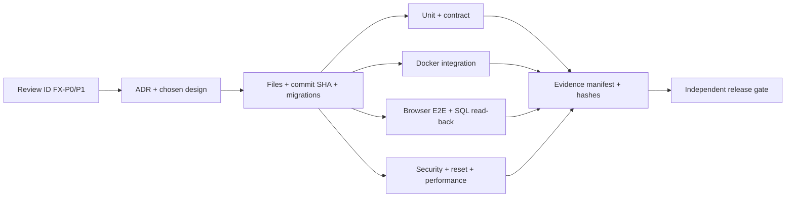

Ví dụ `FX-P0-03`: PR phải chỉ rõ `CreateStorageObjectWizard.tsx` và `storage_revisions.py` đổi như nào; có unit kiểm enum, integration DDL returns APPLIED, browser test Create không timeout 60s, operation read-back trong TDengine; evidence có CI SHA và trace. Không chấp nhận “đã đồng bộ status” nếu không có ca retry/error/restart. Mỗi issue phải có ít nhất một *failure-mode test*; chỉ happy path chưa đủ.

---
# PHẦN VIII — QUY TẮC KỸ THUẬT NGHIÊM NGẶT CHO CODING AGENT VÀ RELEASE GATE

## 36. Tiêu chuẩn code thương mại — cấm “code bừa”

Một hệ thống IIoT phải chịu downtime thiết bị, message redelivery, database overload, clock skew, nâng cấp schema và thao tác sai của user. Vì vậy tiêu chuẩn chất lượng không phải số LOC hay lượng feature AI viết được, mà là **mọi luồng có invariant, ownership, boundary, khả năng recover và bằng chứng**. Đối với mỗi thay đổi, agent phải trình bày trước khi commit: sự cố gốc gây ra gì, contract nào bị vi phạm, thay đổi này tạo invariant mới nào, có thể gây hồi quy nơi nào, và test nào chứng minh. Nếu không giải thích được đường dữ liệu end-to-end, không được merge patch.

### 36.1. Non-negotiable coding constraints

1. **Single source of truth:** một registry cho physical objects, một mã nguồn chuẩn cho SourceReferences, một operation state machine, một writer ownership cho managed rows. Không làm hai module tự lưu trạng thái trái nhau.
2. **Typed boundaries:** Pydantic/OpenAPI/TypeScript interfaces thống nhất; enum casing, datetime timezone, nullable, pagination, ID format, HTTP statuses và retryability đều phải có contract test.
3. **Explicit failures:** `except Exception: return []`, `catch: seed demo`, `pass` ở processing critical path, `healthy=true` khi không kiểm tra là blockers. Chỉ được catch khi có structured log, error classification và deterministic recovery.
4. **Durability:** draft/operation/revision phải persist, no RAM-only authority; commit order và RabbitMQ ACK được định nghĩa; không gọi at-least-once là exactly-once khi chưa chứng minh.
5. **Idempotency:** một event/operation retry không được tạo kết quả logic mới; keys bền vững across process/epoch; batch size/thread order không thay semantics.
6. **Isolation:** mọi SQL/TD operations tenant-scoped bằng server principal, không lấy tenant từ client body; sensitive data default deny, allowlist explicit.
7. **Safety by design:** destructive actions cần inventory, dependency scan, preview, re-auth, audit, backup/restore; không xóa tables/volumes tự động.
8. **Source correctness:** không hardcode signal names, register addresses, 36/336/5, models, machine type, fake `GOOD`/`ACTIVE`, time now để thay source timestamp.
9. **Performance bounded:** batch sizes, worker pool, queue, spool, query limit, paging, graph lazy loading, retry backoff, SQL/HTTP timeouts phải có cấu hình và metrics.
10. **Maintainability:** tách domain/storage/API/UI theo module boundary, dependency injection, schema migrations, meaningful naming, no circular imports, no business logic duplicated across UI & backend. Lớp/file quá lớn được tách theo trách nhiệm sau khi có parity tests, không tách chỉ để đẹp.
11. **Security:** secret read via secure provider, no plaintext logs/evidence; SQL parameterize values, quote identifiers, allowlist endpoints, auth+CSRF/RBAC, network egress controls cho OT connectors.
12. **Compatibility:** mọi đổi hiện có của Overview, Factory Model, Data Collector, Data Models, Signals phải có golden tests. Nếu behavior intentional changed, cần RFC/owner approval trước.
13. **Observability:** trace/correlation, reason codes, lifecycle event, rate counters, loss accounting, timestamps nguồn; alerts phải liên kết đến actual issue.
14. **Documentation as executable specification:** examples phải đồng bộ với source HEAD; docs sai phải sửa; không viết số PASS không có runner evidence.
15. **No test hiding:** không `pytest.mark.skip` với P0 để xanh, không remove a failing test thay vì fix, không đổi SLO sau khi đo, không đổi fixture để tránh đường lỗi.

### 36.2. Mẫu chuẩn cho mỗi PR/commit

```text
Issue IDs: FX-P0-xx, TD-xxx, RST-xxx
Root cause: [specific function, call chain, broken contract]
User consequence: [observable risk/failure]
Invariant before / after: [what must remain true]
Changed files: [exact list + why]
Migration/data impact: [none/compatible/backfill/recovery]
Security/tenant impact: [analysis]
Rollback approach: [tested, not destructive]
Tests executed: [command, passed/failed counts, run URL]
Browser evidence: [trace URL/hash, if UI]
Data evidence: [TD/PG query hash/count from isolated stack]
Known unknowns: [explicit]
Release gate status: NOT_RUN / BLOCKED / VERIFIED
```

### 36.3. Checklist chống code sai quanh TDengine và RabbitMQ

- Không viết SQL theo cảm tính từ PostgreSQL sang TDengine: xem engine dialect/edition và verify trên container version thực.
- Không nhét arbitrary user-controlled `table_name`, `cursor` hoặc `tag` raw vào SQL; identifier validation + deterministic quoting.
- Không dùng `LAST_ROW` làm bằng chứng nguồn vừa cập nhật; `last_acquired_at` và liveness phải được giữ độc lập.
- Không coi Quorum Queue có thể giữ vô hạn backlog; phải có bounded queue + publisher reject/backpressure/spool capacity policy.
- Không ACK RabbitMQ trước durable writes **theo contract**; nếu poison permanent thì quarantine/DLQ có audit, không âm thầm ACK thành công.
- Không dùng uniqueness “event_uid trong cache RAM” làm bằng chứng durable idempotency.
- Không ghi một row sparse với missing fields thành zero/GOOD, và không mix model-output time với raw timestamp mà không row assembly policy.
- Không tạo một STABLE theo mỗi signal tùy tiện để né source binding; physical layout phải cân đối cardinality/retention và support user-defined schema.
- Không đưa default `FACTORIX_RECORD_OPERATIONAL=false` để pass CPU target nếu Historian/15m/model parity không được chứng minh.
- Không dùng `DROP TABLE` để reset rồi chỉ so số config PG; TD object schema/tags/binding phải được giữ hoặc reconstruct exact.
- Không cho PostgreSQL Explorer raw privileges chỉ vì frontend có nhãn `READ ONLY`.

## 37. Gate definitions và quyền quyết định

| Gate | Điều kiện bắt buộc | Chứng cứ | Quyền xác nhận |
|---|---|---|---|
| G0 — Preservation | baseline local read-only, backup có restore proof, isolated stack | manifest + backup/restore logs redacted | owner + implementer |
| G1 — Contract/Security | unified API and tenant auth, no fake UI path | contract + negative tests | reviewer/QA |
| G2 — Storage CRUD | Create/Edit/Pause/Retire/Purge DDL + registry read-back và recovery | TD SQL/operation traces | backend reviewer/QA |
| G3 — Ingestion Fidelity | 5 connectors→RMQ→TD/PG, mixed bindings, dedup, freshness | traces, counters, query parity | backend reviewer/QA |
| G4 — Historian & Explorer | actual TD data, no synthetic/fake, PG least privilege | query/CSV/ERD + browser traces | QA + security |
| G5 — Reset safety | route cũ disabled, selective R0–R5 clone tests, config/schema preservation | before/after manifests and stage logs | owner + reviewer |
| G6 — Clean source | no seeded data/secret in Git/image; tests remain | scan inventories, clean zero install | reviewer + security |
| G7 — Reliability/Performance | outages, capacity, CPU/latency, soak per pre-agreed SLO | perf report and fault runner artifacts | reviewer + performance owner |
| G8 — Final release decision | all P0 VERIFIED, all mandatory scenarios executed, no unresolved critical security/data risks, change SHA frozen | `RELEASE_READINESS.md` + links | owner alone authorizes production |

**Quy tắc quyết định:** Gate nhận `PASS` khi assertion và evidence khớp cùng HEAD SHA. Nếu evidence không thể tiếp cận, run trên hardware khác, đã hết hạn, hoặc test bị skipped mà không có acceptance, gate `BLOCKED`. Critical issues đang mở => **NOT READY**. Không có trường hợp tự “waive” bảo toàn dữ liệu, tenant isolation, fake telemetry hoặc destructive legacy API. G6 có thể hoàn thành sau khi tất cả test code còn nguyên nhưng production image chỉ ship runtime.

## 38. Các lệnh vận hành đề xuất cho coding agent — có guard rõ ràng

Tất cả những câu lệnh sau mô tả **thao tác trong working clone và test environment**; không được copy sang local production nếu chứa thao tác ghi. Agent phải điền project path thật và kiểm env trước.

### 38.1. Bước đọc-only đầu tiên

```bash
pwd
git status --porcelain=v1
git rev-parse HEAD
git branch --show-current
git ls-files | wc -l
# Check expected branch SHA and compare to review baseline.
# If SHA has moved, record delta and re-review affected files before applying patches.
```

### 38.2. Build/typecheck/unit — non-destructive to data when configured correctly

```bash
# Must execute with isolated TEST env for anything that can connect to DB.
cd apps/web
npm ci
npm run check
npm run build
cd ../..

# Test runners must point to ephemeral stack, not owner local DB.
# python -m pytest apps/center/tests/unit apps/acquisition/tests/unit -q
# python -m pytest apps/center/tests/integration apps/acquisition/tests/integration -vv
```

### 38.3. Docker chạy test với namespace riêng — chỉ khi verify env isolation

```bash
# Example project namespace only. Use unique env vars and fresh test volumes.
# DO NOT use regular owner project name / existing volumes.
# docker compose -p factorix-ci-<runid> -f docker-compose.test.yml up -d --build
# python -m pytest ...
# docker compose -p factorix-ci-<runid> -f docker-compose.test.yml down --remove-orphans
# The command above intentionally omits -v. Any cleanup of CI volumes needs
# verified project identity and explicit test-only guard in a separate script.
```

### 38.4. Push branch sau khi các gate code/test/evidence tương ứng đã hoàn thành

```bash
# Never push unreviewed credentials, exports, local data, mock datasets.
git status --short
git diff --check
git diff --stat
# Run secret/source hygiene scanners and all required test suites first.
git add -A
# Inspect staged names and contents; remove forbidden artifacts from staging.
git diff --cached --name-status
git diff --cached --check
# Commit only after phase evidence and safety checks.
# git commit -m "fix(storage): durable verified physical operations and clean release"
# git push origin TDengine-RabbitMQ-Stoorage-Historian
```

**Không** dùng `git push --force`, `git clean -fdx`, `git reset --hard`, `git branch -D`, `git push origin --delete`, `docker system prune --volumes`, `docker compose down -v`, `docker volume rm`, `TRUNCATE`, `DROP` trên môi trường owner trong workflow sửa. Những lệnh phá hủy chỉ được cân nhắc thủ công, có backup, scope test được chứng minh và xác nhận owner. Thêm **test guard** từ `FACTORIX_ENVIRONMENT=test`, Compose project label, volume ID, DB hostname/DB name allowlist; biến `FACTORIX_ENABLE_DESTRUCTIVE_TESTS=YES_I_USE_EPHEMERAL_DB` không đủ nếu DB có thể thực là production — phải kiểm identity thực tế.

## 39. Cách reviewer độc lập tiếp tục lần kiểm tra tiếp theo

Reviewer không cần tin vào lời agent. Họ phải tải đúng branch và commit được ghi ở `RELEASE_READINESS.md`, xem `git diff` với `ed2970c...` hoặc baseline mới được công nhận, dựng fresh test stack, chạy test discovery và các pipeline critical, mở test run/artifacts được hash, rồi đối chiếu các issue IDs trong file này. Nếu test case ghi PASS nhưng code path không thể chạy, SHA khác, artifact không tồn tại hoặc expected predicate không có, trả gate về BLOCKED. Nếu chỉ có screenshots mà không có network/SQL/read-back, Storage CRUD không được coi là pass.

Một reviewer phải trả lời được **từ Git + CI evidence** những câu hỏi sau: Dữ liệu đi từ connector nào đến đâu và mất ở stage nào khi lỗi? Khi publish thành công thì actual physical object và binding nào đang ghi? Khi nguồn dừng mà value không đổi thì ai đánh dấu STALE? Khi raw/model cập nhật lệch nhịp thì có tự ghi null/GOOD giả không? Khi hai tenant có database trùng tên logic thì quyền được kiểm thế nào? Khi reset, các 36 models/336 signals/5 connections còn nguyên **ID và hash config** hay chỉ cùng số lượng? Hệ thống zero install có dữ liệu demo không? Nếu không trả lời được với evidence, verdict phải để **NOT READY**.

### 39.1. Definition of Done cuối cùng

Một task chỉ **DONE** nếu: root cause được sửa; không còn code path cũ trái invariant; typed contract nhất quán; migration có upgrade path an toàn; unit + real integration + browser E2E tương ứng pass; negative failure path pass; không sinh dữ liệu giả; no local data loss; no leaked secrets; code/documentation/tests/evidence cùng SHA; chủ dự án có thể fresh-install từ zero mà không có dataset, model, signals hay connection giả; reviewer có thể phục hiện quy trình từ docs và test runner. Nếu thiếu bất kỳ mục nào, task phải ghi `INCOMPLETE` và nêu cụ thể.

---

# PHẦN IX — SOURCE REFERENCES VÀ RANH GIỚI KẾT LUẬN

## 40. Các tệp gốc bắt buộc đọc lại tại HEAD trước khi bắt đầu

- `docker-compose.yml`, `Dockerfile`, `infrastructure/docker/entrypoint.sh`, `.github/workflows/ci.yml`, `.env.example`.
- `apps/acquisition/src/factorix_acquisition/{__main__,runtime,publisher,spool,config_provider,pg_control,jobs,mapping}.py` và `connectors/`.
- `apps/center/src/factorix/platform/{broker,tdengine,settings}.py`, `domain/canonical.py`.
- `apps/center/src/factorix/modules/{ingestion_worker,recording_policy,live_state,storage_objects,storage_revisions,storage_topology,storage_bindings,storage_designs,storage_compiler,history_repository,historian_service,postgres_explorer,telemetry_reset,telemetry_migrator,models_engine,data_models,telemetry,identity}.py`.
- `apps/center/src/factorix/transport/{app,storage_api}.py`, `apps/center/migrations/versions/0008_storage_and_historian.py` cùng chain migrations.
- `apps/web/src/{App,store/AppContext,lib/storagePhysicalApi,lib/storageApi}.ts[x]`, `pages/storage-management/`, `pages/historian/`, `components/shell/Sidebar.tsx`, toàn bộ các pages navigation cũ.
- `docs/architecture/ADR-001..011`, `docs/release/*`, `docs/storage/*`, `docs/testing/*`, `reports/*`, các test files từ unit/integration đến UI.

Đây là file map tại **baseline**, không phải lời khẳng định sau khi Codex chạy chúng vẫn còn nguyên; mỗi implementation phase phải `git show HEAD:<path>`/open actual code tại commit đang sửa, không dùng line number stale làm sự thật nếu đã đổi. Hạn chế chứng cứ: bản review đã đọc Git tree, source critical paths và tài liệu trao đổi, **chưa khởi chạy runtime Docker**. Bất kỳ lỗi nào chỉ xuất hiện hoặc được bác bỏ khi chạy phải cập nhật evidence/finding status thay vì lờ đi.

## 41. Link mã nguồn và tài liệu làm cơ sở review

- Branch: <https://github.com/dangtai111325/factoriX/tree/TDengine-RabbitMQ-Stoorage-Historian>
- Baseline commit: <https://github.com/dangtai111325/factoriX/commit/ed2970c72c4773ff8108e4f8dffc7dc0afa881e0>
- TD client: <https://github.com/dangtai111325/factoriX/blob/ed2970c72c4773ff8108e4f8dffc7dc0afa881e0/apps/center/src/factorix/platform/tdengine.py>
- Storage topology: <https://github.com/dangtai111325/factoriX/blob/ed2970c72c4773ff8108e4f8dffc7dc0afa881e0/apps/center/src/factorix/modules/storage_topology.py>
- Storage revisions: <https://github.com/dangtai111325/factoriX/blob/ed2970c72c4773ff8108e4f8dffc7dc0afa881e0/apps/center/src/factorix/modules/storage_revisions.py>
- Storage API: <https://github.com/dangtai111325/factoriX/blob/ed2970c72c4773ff8108e4f8dffc7dc0afa881e0/apps/center/src/factorix/transport/storage_api.py>
- Ingestion worker: <https://github.com/dangtai111325/factoriX/blob/ed2970c72c4773ff8108e4f8dffc7dc0afa881e0/apps/center/src/factorix/modules/ingestion_worker.py>
- Acquisition spool: <https://github.com/dangtai111325/factoriX/blob/ed2970c72c4773ff8108e4f8dffc7dc0afa881e0/apps/acquisition/src/factorix_acquisition/spool.py>
- Telemetry reset: <https://github.com/dangtai111325/factoriX/blob/ed2970c72c4773ff8108e4f8dffc7dc0afa881e0/apps/center/src/factorix/modules/telemetry_reset.py>
- Web Storage: <https://github.com/dangtai111325/factoriX/blob/ed2970c72c4773ff8108e4f8dffc7dc0afa881e0/apps/web/src/pages/storage-management/StorageManagementPage.tsx>
- Web Historian: <https://github.com/dangtai111325/factoriX/blob/ed2970c72c4773ff8108e4f8dffc7dc0afa881e0/apps/web/src/pages/historian/HistorianExplorerPage.tsx>
- Web PG Explorer: <https://github.com/dangtai111325/factoriX/blob/ed2970c72c4773ff8108e4f8dffc7dc0afa881e0/apps/web/src/pages/storage-management/PostgresExplorerView.tsx>
- Frontend routes: <https://github.com/dangtai111325/factoriX/blob/ed2970c72c4773ff8108e4f8dffc7dc0afa881e0/apps/web/src/App.tsx>
- CI: <https://github.com/dangtai111325/factoriX/blob/ed2970c72c4773ff8108e4f8dffc7dc0afa881e0/.github/workflows/ci.yml>

## 42. Kết luận và mệnh lệnh cuối cùng

**FactoriX chưa được chứng minh sẵn sàng phát hành.** Kiến trúc RabbitMQ Quorum Queue + Acquisition + TDengine/PostgreSQL là cơ sở phù hợp để tiếp tục, nhưng hiện có lỗi tích hợp hợp đồng ở Storage service, khả năng hiển thị dữ liệu giả, vòng đời operation chưa bền vững, Source Binding chưa được chứng minh xuyên writer, quyền đọc database chưa chặt và reset cũ có thể xóa cấu hình. Các P0 này phải được sửa trước khi tối ưu UI hay tuyên bố release.

**Lệnh cho bên triển khai:** thực hiện các PHASE 00→20, không bỏ gate; viết code + tests + migrations + docs; giữ runtime local owner nguyên vẹn; làm sạch Git/image từ đầu đến cuối; chạy test trên stack cô lập với dữ liệu được tạo và hủy tại runtime; tạo evidence thật theo từng test và push source/metadata evidence đã sanitize lên branch. Không merge main, không xóa branch và không thực hiện Clear Telemetry trên dữ liệu local thật nếu owner chưa yêu cầu, backup chưa verified và test clone chưa đạt.

**Lệnh cho reviewer lần sau:** chỉ đánh dấu READY khi chính họ có thể đối chiếu code SHA với test run, mở logs/trace thật, đọc actual TD/PG schema, kiểm no-fake production build và xác minh manifests before/after. Không xem “264 PASS” cũ là bằng chứng đạt. Hãy báo cả những mục FAIL/BLOCKED và tác động của chúng; báo cáo trung thực là tiêu chuẩn sản phẩm thương mại.

**Trạng thái tài liệu tại thời điểm tạo:** `REVIEW COMPLETE AS SPECIFICATION — IMPLEMENTATION NOT EXECUTED; RELEASE NOT READY`.
